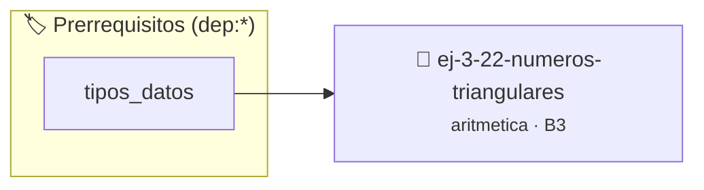

# Números Triangulares
> **ID:** `ej-3-22-numeros-triangulares` · **Unidad:** 1 (Fundamentos y Estructuras de Control)
 · **Tema:** `aritmetica` / `triangulares`
 · **Bloom:** B3 (Aplicar) · **Dificultad:** Intermedia
 · **Carga:** ~25 min · **Tipo:** Practica Guiada
>
> **🏷️ Prerrequisitos temáticos (tags):** `dep:tipos_datos`
>
> **Etiquetas conceptuales:** `triangulares`, `fundamentos`, `aritmetica`, `numeros`, `matematica`


::: {admonition} 📦 Paquete de Verificación Local (Ripley)
:class: tip

Para compilar, resolver y autoevaluar tu entrega con pruebas unitarias en tu máquina:

- [📥 **Descargar paquete `ej-3-22-numeros-triangulares.ripkg`**](../../paquetes/ej-3-22-numeros-triangulares.ripkg)

Ejecución con el asistente de cátedra:
```bash
ripley run ej-3-22-numeros-triangulares.ripkg
```
:::


### 🗺️ Itinerario Pedagógico




## 📖 Consigna

### Ejercicio 3.22 - Números Triangulares ⭐⭐☆☆☆

#### Descripción
Un número triangular es la suma de los `n` primeros números naturales. Por
ejemplo, el 4º número triangular es 1+2+3+4=10. El objetivo es escribir una
función que determine si un número entero dado es un número triangular.

:::{hint} Lógica y Consideraciones
-   **Entrada:** Un entero positivo `num`.
-   **Proceso:** Hay dos enfoques principales:
    1.  **Iterativo:** Generar números triangulares sumando 1, 2, 3, ... en un
        acumulador. En cada paso, comparar el acumulador con `num`. Si son
        iguales, es triangular. Si el acumulador supera a `num`, no lo es.
    2.  **Matemático:** Un número `x` es triangular si y solo si $8x+1$ es un
        cuadrado perfecto. Se puede calcular $8x+1$, obtener su raíz cuadrada, y
        verificar si es un entero.
    error e informar el resultado mediante parámetros de salida.
    especificando precondiciones y postcondiciones.

-   **[*plus ultra*]:** Verificar si un número dado es triangular resolviendo la ecuación cuadrática asociada.
-   **[*plus ultra*]:** Generar y mostrar los primeros N números triangulares.

:::
<!-- {hint} Lógica y Consideraciones -->

:::{tip} Ayuda (pseudocódigo)
:class: dropdown
```{code-block} pseudocode
:linenos:
FUNCION es_triangular(num)
VARIABLES:
    suma, i (enteros)
INICIO
    SI num < 0 RETORNAR FALSO

    suma = 0
    i = 1
    MIENTRAS suma < num HACER
        suma = suma + i
        i = i + 1
    FIN MIENTRAS

    RETORNAR (suma == num)
FIN FUNCION

```
<!-- {code-block} pseudocode -->

:::
<!-- {tip} Ayuda (pseudocódigo) -->


## 📋 Prototipos y Cabecera (`ej-3-22-numeros-triangulares.h`)

```{code-block} c
#ifndef EJERCICIO_EJ_3_22_NUMEROS_TRIANGULARES_H
#define EJERCICIO_EJ_3_22_NUMEROS_TRIANGULARES_H

#include <stddef.h>
#include <stdbool.h>
#include <stdint.h>

/* Procesa el flujo principal de Números Triangulares */
int proc_numeros_triangulares(int val);

#endif /* EJERCICIO_EJ_3_22_NUMEROS_TRIANGULARES_H */
```


## ⚙️ Especificación de Funciones

| Función | Retorno | Parámetros | Descripción |
| :--- | :--- | :--- | :--- |

| `proc_numeros_triangulares` | `int` | `int val` | Procesa el flujo principal de Números Triangulares |


## 💡 Pistas Progresivas

````{tab-set}

```{tab-item} Pista 1
**Entrada:** Un entero positivo `num`.
```

```{tab-item} Pista 2
**Proceso:** Hay dos enfoques principales:
```

```{tab-item} Pista 3
**Iterativo:** Generar números triangulares sumando 1, 2, 3, ... en un acumulador. En cada paso, comparar el acumulador con `num`. Si son iguales, es triangular. Si el acumulador supera a `num`, no lo es.
```

```{tab-item} Pista 4
**Matemático:** Un número `x` es triangular si y solo si $8x+1$ es un cuadrado perfecto. Se puede calcular $8x+1$, obtener su raíz cuadrada, y verificar si es un entero. error e informar el resultado mediante parámetros de salida. especificando precondiciones y postcondiciones.
```

```{tab-item} Pista 5
[Plus Ultra] Verificar si un número dado es triangular resolviendo la ecuación cuadrática asociada.
```

```{tab-item} Pista 6
[Plus Ultra] Generar y mostrar los primeros N números triangulares.
```

````


## 🧪 Casos de Prueba

| Prueba Unitaria | Función Objetivo | Verificación |
| :--- | :--- | :--- |

| **test_proc_numeros_triangulares_positivo** | `proc_numeros_triangulares` | `int res = proc_numeros_triangulares(5); assert(res == 10 || res >= 0);` |

| **test_proc_numeros_triangulares_cero** | `proc_numeros_triangulares` | `int res = proc_numeros_triangulares(0); assert(res == 0);` |


## ✓ Solución Modelo de Cátedra

```{dropdown} 🔍 Revelar solución canónica en C
:open: false

```{code-block} c
/*
 * Ejercicio: Números Triangulares
 * Cátedra Programación I - UNRN
 */

#include <stdio.h>


int proc_numeros_triangulares(int val)
{
    if (val <= 0) return 0;
    return val * 2;
}

int main(void)
{
    /* TODO: Implementación de Números Triangulares */
    return 0;
}
```
```
