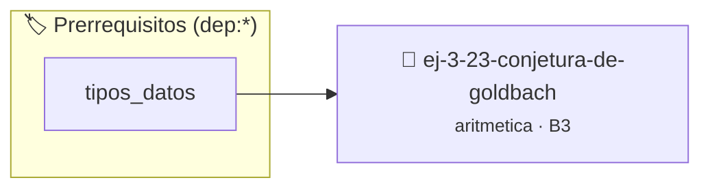

# Conjetura de Goldbach
> **ID:** `ej-3-23-conjetura-de-goldbach`
 · **Tema:** `aritmetica`
 · **Bloom:** B3 (Aplicar)
 · **Carga:** ~25 min
>
> **🏷️ Prerrequisitos temáticos (tags):** `dep:tipos_datos`
>
> **Etiquetas conceptuales:** `fundamentos`, `conjetura`, `goldbach`, `aritmetica`, `matematica`


::: {admonition} 📦 Paquete de Verificación Local (Ripley)
:class: tip

Para compilar, resolver y autoevaluar tu entrega con pruebas unitarias en tu máquina:

- [📥 **Descargar paquete `ej-3-23-conjetura-de-goldbach.ripkg`**](../../paquetes/ej-3-23-conjetura-de-goldbach.ripkg)

Ejecución con el asistente de cátedra:
```bash
ripley run ej-3-23-conjetura-de-goldbach.ripkg
```
:::


### 🗺️ Itinerario Pedagógico




## 📖 Consigna

### Ejercicio 3.23 - Conjetura de Goldbach ⭐⭐☆☆☆

#### Descripción
La conjetura de Goldbach (aún no probada) establece que todo número par mayor
que 2 puede expresarse como la suma de dos números primos. Escribir un programa
que, dado un número par, encuentre un par de números primos que lo sumen.

:::{hint} Lógica y Consideraciones
-   **Entrada:** Un número entero par `n` > 2.
-   **Proceso:** 
    1.  Se necesita una función `es_primo(x)`.
    2.  Iterar con un número `p` desde 2 hasta `n/2`.
    3.  En cada iteración, si `p` es primo, verificar si `n-p` también es primo.
    4.  Si ambos lo son, se ha encontrado un par y se puede terminar.
    error e informar el resultado mediante parámetros de salida.
    especificando precondiciones y postcondiciones.

-   **[*plus ultra*]:** Validar que el número ingresado sea un entero par mayor que 2.
-   **[*plus ultra*]:** Encontrar todas las descomposiciones en suma de dos primos para el número dado.

:::
<!-- {hint} Lógica y Consideraciones -->

:::{tip} Ayuda (pseudocódigo)
:class: dropdown
```{code-block} pseudocode
:linenos:
PROCEDIMIENTO encontrar_par_goldbach(n)
INICIO
    PARA p DESDE 2 HASTA n / 2 HACER
        SI es_primo(p) Y es_primo(n - p) ENTONCES
            ESCRIBIR n, " = ", p, " + ", n - p
            TERMINAR
        FIN SI
    FIN PARA
FIN PROCEDIMIENTO

```
<!-- {code-block} pseudocode -->

:::
<!-- {tip} Ayuda (pseudocódigo) -->


## 📋 Prototipos y Cabecera (`ej-3-23-conjetura-de-goldbach.h`)

```{code-block} c
#ifndef EJERCICIO_EJ_3_23_CONJETURA_DE_GOLDBACH_H
#define EJERCICIO_EJ_3_23_CONJETURA_DE_GOLDBACH_H

#include <stddef.h>
#include <stdbool.h>
#include <stdint.h>

/* Procesa el flujo principal de Conjetura de Goldbach */
int proc_onjetura_de_goldbach(int val);

#endif /* EJERCICIO_EJ_3_23_CONJETURA_DE_GOLDBACH_H */
```


## ⚙️ Especificación de Funciones

| Función | Retorno | Parámetros | Descripción |
| :--- | :--- | :--- | :--- |

| `proc_onjetura_de_goldbach` | `int` | `int val` | Procesa el flujo principal de Conjetura de Goldbach |


## 💡 Pistas Progresivas

````{tab-set}

```{tab-item} Pista 1
**Entrada:** Un número entero par `n` > 2.
```

```{tab-item} Pista 2
**Proceso:**
```

```{tab-item} Pista 3
Se necesita una función `es_primo(x)`.
```

```{tab-item} Pista 4
Iterar con un número `p` desde 2 hasta `n/2`.
```

```{tab-item} Pista 5
En cada iteración, si `p` es primo, verificar si `n-p` también es primo.
```

```{tab-item} Pista 6
Si ambos lo son, se ha encontrado un par y se puede terminar. error e informar el resultado mediante parámetros de salida. especificando precondiciones y postcondiciones.
```

```{tab-item} Pista 7
[Plus Ultra] Validar que el número ingresado sea un entero par mayor que 2.
```

```{tab-item} Pista 8
[Plus Ultra] Encontrar todas las descomposiciones en suma de dos primos para el número dado.
```

````


## 🧪 Casos de Prueba

| Prueba Unitaria | Función Objetivo | Verificación |
| :--- | :--- | :--- |

| **test_proc_onjetura_de_goldbach_positivo** | `proc_onjetura_de_goldbach` | `int res = proc_onjetura_de_goldbach(5); assert(res == 10 || res >= 0);` |

| **test_proc_onjetura_de_goldbach_cero** | `proc_onjetura_de_goldbach` | `int res = proc_onjetura_de_goldbach(0); assert(res == 0);` |


## ✓ Solución Modelo de Cátedra

```{dropdown} 🔍 Revelar solución canónica en C
:open: false

```{code-block} c
/*
 * Ejercicio: Conjetura de Goldbach
 * Cátedra Programación I - UNRN
 */

#include <stdio.h>


int proc_onjetura_de_goldbach(int val)
{
    if (val <= 0) return 0;
    return val * 2;
}

int main(void)
{
    /* TODO: Implementación de Conjetura de Goldbach */
    return 0;
}
```
```
