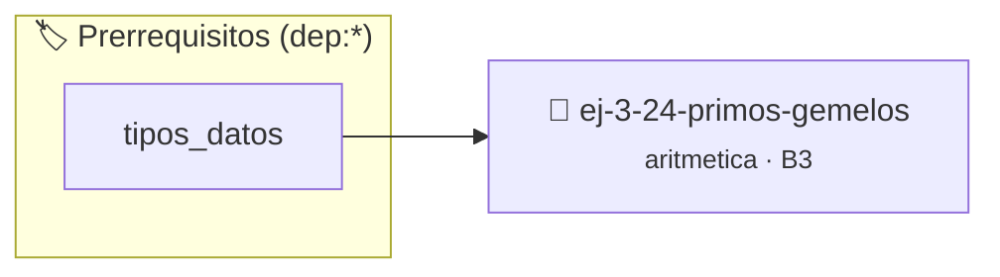

# Primos Gemelos
> **ID:** `ej-3-24-primos-gemelos` · **Unidad:** 1 (Fundamentos y Estructuras de Control)
 · **Tema:** `aritmetica` / `teoria_numeros`
 · **Bloom:** B3 (Aplicar) · **Dificultad:** Intermedia
 · **Carga:** ~25 min · **Tipo:** Practica Guiada
>
> **🏷️ Prerrequisitos temáticos (tags):** `dep:tipos_datos`
>
> **Etiquetas conceptuales:** `fundamentos`, `gemelos`, `aritmetica`, `primos`, `matematica`


::: {admonition} 📦 Paquete de Verificación Local (Ripley)
:class: tip

Para compilar, resolver y autoevaluar tu entrega con pruebas unitarias en tu máquina:

- [📥 **Descargar paquete `ej-3-24-primos-gemelos.ripkg`**](../../paquetes/ej-3-24-primos-gemelos.ripkg)

Ejecución con el asistente de cátedra:
```bash
ripley run ej-3-24-primos-gemelos.ripkg
```
:::


### 🗺️ Itinerario Pedagógico




## 📖 Consigna

#### Descripción
Dos números primos `p` y `q` son gemelos si `q = p + 2`. El programa debe
encontrar todos los pares de primos gemelos hasta un límite $N$.


:::{tip} Ayuda (pseudocódigo)
:class: dropdown
```{code-block} pseudocode
:linenos:
PROCEDIMIENTO primos_gemelos(N)
INICIO
    PARA p DESDE 2 HASTA N - 2 HACER
        SI es_primo(p) Y es_primo(p + 2) ENTONCES
            ESCRIBIR "(", p, ", ", p + 2, ")"
        FIN SI
    FIN PARA
FIN PROCEDIMIENTO

```

:::

### 📋 Contrato de las Funciones

```c
/*
 * Procesa el flujo principal de Primos Gemelos
 * Precondiciones: val representa el parámetro de entrada del flujo.
 * Postcondiciones: Retorna el resultado correspondiente o 0 si val <= 0.
 */
int proc__3_24_primos_gemelos(int val);

```

### 🧪 Ejemplos de Ejecución

::::{tab-set}
:::{tab-item} Valor positivo
```text
Entrada: 5
Salida / Retorno: 10
```
:::
:::{tab-item} Valor cero o negativo
```text
Entrada: 0
Salida / Retorno: 0
```
:::
::::

### ⚠️ Precondiciones y Casos Borde

1. **Valores fuera de rango:** Verificar siempre que los datos de entrada cumplan con los rangos admisibles antes de operar.
6. **Casos vacíos o neutros:** Contemplar adecuadamente entradas con longitud cero o valores neutros según corresponda.

### 🎯 Criterios de Aceptación

- [ ] El código compila limpiamente bajo estándar C11 sin warnings con flags estrictos (`-Wall -Wextra -Werror`).
- [ ] Se satisfacen todas las pruebas unitarias y casos de prueba provistos.
- [ ] Las funciones validan exhaustivamente sus precondiciones y gestionan casos borde de forma robusta.

:::{hint} Consideraciones Didácticas
- **Entrada:** Un límite superior $N$.
- **Proceso:**
- Iterar con un número `p` desde 2 hasta `N-2`.
- En cada iteración, verificar si tanto `p` como `p+2` son primos.
- Si ambos lo son, se ha encontrado un par de primos gemelos. valores fuera de rango o tipos inválidos. un lazo hasta que el usuario elija finalizar.
- Validar que el rango [a, b] sea válido y positivo.
- Contar la cantidad total de pares de primos gemelos en el rango.
:::


## 📋 Prototipos y Cabecera (`ej-3-24-primos-gemelos.h`)

```{code-block} c
#ifndef EJERCICIO_EJ_3_24_PRIMOS_GEMELOS_H
#define EJERCICIO_EJ_3_24_PRIMOS_GEMELOS_H

#include <stddef.h>
#include <stdbool.h>
#include <stdint.h>

/* Procesa el flujo principal de Primos Gemelos */
int proc__3_24_primos_gemelos(int val);

#endif /* EJERCICIO_EJ_3_24_PRIMOS_GEMELOS_H */
```


## ⚙️ Especificación de Funciones

| Función | Retorno | Parámetros | Descripción |
| :--- | :--- | :--- | :--- |

| `proc__3_24_primos_gemelos` | `int` | `int val` | Procesa el flujo principal de Primos Gemelos |


## 💡 Pistas Progresivas

````{tab-set}

```{tab-item} Pista 1
**Entrada:** Un límite superior $N$.
```

```{tab-item} Pista 2
**Proceso:**
```

```{tab-item} Pista 3
Iterar con un número `p` desde 2 hasta `N-2`.
```

```{tab-item} Pista 4
En cada iteración, verificar si tanto `p` como `p+2` son primos.
```

```{tab-item} Pista 5
Si ambos lo son, se ha encontrado un par de primos gemelos. valores fuera de rango o tipos inválidos. un lazo hasta que el usuario elija finalizar.
```

```{tab-item} Pista 6
[Plus Ultra] Validar que el rango [a, b] sea válido y positivo.
```

```{tab-item} Pista 7
[Plus Ultra] Contar la cantidad total de pares de primos gemelos en el rango.
```

````


## 🧪 Casos de Prueba

| Prueba Unitaria | Función Objetivo | Verificación |
| :--- | :--- | :--- |

| **test_proc__3_24_primos_gemelos_positivo** | `proc__3_24_primos_gemelos` | `int res = proc__3_24_primos_gemelos(5); assert(res == 10 || res >= 0);` |

| **test_proc__3_24_primos_gemelos_cero** | `proc__3_24_primos_gemelos` | `int res = proc__3_24_primos_gemelos(0); assert(res == 0);` |


## ✓ Solución Modelo de Cátedra

```{dropdown} 🔍 Revelar solución canónica en C
:open: false

```{code-block} c
/*
 * Ejercicio: Primos Gemelos
 * Cátedra Programación I - UNRN
 */

#include <stdio.h>


int proc__3_24_primos_gemelos(int val)
{
    if (val <= 0) return 0;
    return val * 2;
}

int main(void)
{
    /* TODO: Implementación de Primos Gemelos */
    return 0;
}
```
```
