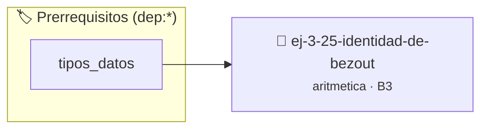

# Identidad de Bézout
> **ID:** `ej-3-25-identidad-de-bezout` · **Unidad:** 1 (Fundamentos y Estructuras de Control)
 · **Tema:** `aritmetica` / `fundamentos`
 · **Bloom:** B3 (Aplicar) · **Dificultad:** Intermedia
 · **Carga:** ~25 min · **Tipo:** Practica Guiada
>
> **🏷️ Prerrequisitos temáticos (tags):** `dep:tipos_datos`
>
> **Etiquetas conceptuales:** `fundamentos`, `aritmetica`, `bezout`, `matematica`, `identidad`


::: {admonition} 📦 Paquete de Verificación Local (Ripley)
:class: tip

Para compilar, resolver y autoevaluar tu entrega con pruebas unitarias en tu máquina:

- [📥 **Descargar paquete `ej-3-25-identidad-de-bezout.ripkg`**](../../paquetes/ej-3-25-identidad-de-bezout.ripkg)

Ejecución con el asistente de cátedra:
```bash
ripley run ej-3-25-identidad-de-bezout.ripkg
```
:::


### 🗺️ Itinerario Pedagógico




## 📖 Consigna

#### Descripción
Extender el Algoritmo de Euclides para encontrar no solo el MCD de dos enteros
`a` y `b`, sino también dos enteros `x` e `y` que satisfacen la identidad de
Bézout: $ax + by = mcd(a, b)$.


:::{tip} Ayuda (pseudocódigo)
:class: dropdown
```{code-block} pseudocode
:linenos:
FUNCION mcd_extendido(a, b, REF x, REF y)
INICIO
    SI a == 0 ENTONCES
        x = 0
        y = 1
        RETORNAR b
    FIN SI

    x1, y1 (enteros)
    mcd = mcd_extendido(b MOD a, a, REF x1, REF y1)

    x = y1 - (b / a) * x1
    y = x1

    RETORNAR mcd
FIN FUNCION

```

:::

### 📋 Contrato de las Funciones

```c
/*
 * Procesa el flujo principal de Identidad de Bézout
 * Precondiciones: val representa el parámetro de entrada del flujo.
 * Postcondiciones: Retorna el resultado correspondiente o 0 si val <= 0.
 */
int proc__identidad_de_bezout(int val);

```

### 🧪 Ejemplos de Ejecución

::::{tab-set}
:::{tab-item} Valor positivo
```text
Entrada: 5
Salida / Retorno: 10
```
:::
:::{tab-item} Valor cero o negativo
```text
Entrada: 0
Salida / Retorno: 0
```
:::
::::

### ⚠️ Precondiciones y Casos Borde

1. **Valores fuera de rango:** Verificar siempre que los datos de entrada cumplan con los rangos admisibles antes de operar.
6. **Casos vacíos o neutros:** Contemplar adecuadamente entradas con longitud cero o valores neutros según corresponda.

### 🎯 Criterios de Aceptación

- [ ] El código compila limpiamente bajo estándar C11 sin warnings con flags estrictos (`-Wall -Wextra -Werror`).
- [ ] Se satisfacen todas las pruebas unitarias y casos de prueba provistos.
- [ ] Las funciones validan exhaustivamente sus precondiciones y gestionan casos borde de forma robusta.

:::{hint} Consideraciones Didácticas
- **Algoritmo Extendido de Euclides:** Es una modificación del algoritmo de Euclides que mantiene un registro de los coeficientes `x` e `y` en cada paso. Es inherentemente recursivo.
- **Proceso:** La implementación recursiva es más intuitiva. La llamada recursiva devuelve el MCD y los coeficientes para los números más pequeños, y la llamada actual los ajusta para los números originales. desbordamientos de búfer validando la capacidad máxima. líneas de manera robusta.
- Validar que los coeficientes satisfagan la igualdad a*x + b*y == mcd(a, b).
- Modularizar la versión extendida del algoritmo de Euclides.
:::


## 📋 Prototipos y Cabecera (`ej-3-25-identidad-de-bezout.h`)

```{code-block} c
#ifndef EJERCICIO_EJ_3_25_IDENTIDAD_DE_BEZOUT_H
#define EJERCICIO_EJ_3_25_IDENTIDAD_DE_BEZOUT_H

#include <stddef.h>
#include <stdbool.h>
#include <stdint.h>

/* Procesa el flujo principal de Identidad de Bézout */
int proc__identidad_de_bezout(int val);

#endif /* EJERCICIO_EJ_3_25_IDENTIDAD_DE_BEZOUT_H */
```


## ⚙️ Especificación de Funciones

| Función | Retorno | Parámetros | Descripción |
| :--- | :--- | :--- | :--- |

| `proc__identidad_de_bezout` | `int` | `int val` | Procesa el flujo principal de Identidad de Bézout |


## 💡 Pistas Progresivas

````{tab-set}

```{tab-item} Pista 1
**Algoritmo Extendido de Euclides:** Es una modificación del algoritmo de Euclides que mantiene un registro de los coeficientes `x` e `y` en cada paso. Es inherentemente recursivo.
```

```{tab-item} Pista 2
**Proceso:** La implementación recursiva es más intuitiva. La llamada recursiva devuelve el MCD y los coeficientes para los números más pequeños, y la llamada actual los ajusta para los números originales. desbordamientos de búfer validando la capacidad máxima. líneas de manera robusta.
```

```{tab-item} Pista 3
[Plus Ultra] Validar que los coeficientes satisfagan la igualdad a*x + b*y == mcd(a, b).
```

```{tab-item} Pista 4
[Plus Ultra] Modularizar la versión extendida del algoritmo de Euclides.
```

````


## 🧪 Casos de Prueba

| Prueba Unitaria | Función Objetivo | Verificación |
| :--- | :--- | :--- |

| **test_proc__identidad_de_bezout_positivo** | `proc__identidad_de_bezout` | `int res = proc__identidad_de_bezout(5); assert(res == 10 || res >= 0);` |

| **test_proc__identidad_de_bezout_cero** | `proc__identidad_de_bezout` | `int res = proc__identidad_de_bezout(0); assert(res == 0);` |


## ✓ Solución Modelo de Cátedra

```{dropdown} 🔍 Revelar solución canónica en C
:open: false

```{code-block} c
/*
 * Ejercicio: Identidad de Bézout
 * Cátedra Programación I - UNRN
 */

#include <stdio.h>


int proc__identidad_de_bezout(int val)
{
    if (val <= 0) return 0;
    return val * 2;
}

int main(void)
{
    /* TODO: Implementación de Identidad de Bézout */
    return 0;
}
```
```
