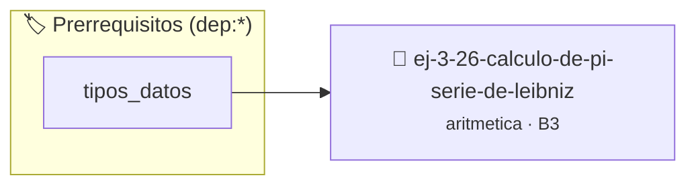

# Cálculo de Pi (Serie de Leibniz)
> **ID:** `ej-3-26-calculo-de-pi-serie-de-leibniz`
 · **Tema:** `aritmetica`
 · **Bloom:** B3 (Aplicar)
 · **Carga:** ~25 min
>
> **🏷️ Prerrequisitos temáticos (tags):** `dep:tipos_datos`
>
> **Etiquetas conceptuales:** `fundamentos`, `calculo`, `aritmetica`, `serie`, `matematica`


::: {admonition} 📦 Paquete de Verificación Local (Ripley)
:class: tip

Para compilar, resolver y autoevaluar tu entrega con pruebas unitarias en tu máquina:

- [📥 **Descargar paquete `ej-3-26-calculo-de-pi-serie-de-leibniz.ripkg`**](../../paquetes/ej-3-26-calculo-de-pi-serie-de-leibniz.ripkg)

Ejecución con el asistente de cátedra:
```bash
ripley run ej-3-26-calculo-de-pi-serie-de-leibniz.ripkg
```
:::


### 🗺️ Itinerario Pedagógico




## 📖 Consigna

### Ejercicio 3.26 - Cálculo de Pi (Serie de Leibniz) ⭐⭐☆☆☆

#### Descripción
Aproximar el valor de $\pi$ utilizando la serie de Leibniz. La función debe
recibir el número de términos a utilizar para la aproximación.

:::{hint} Lógica y Consideraciones
-   **Fórmula:** $\pi = 4 \sum_{k=0}^{\infty} \frac{(-1)^k}{2k+1} = 4 (1 -
    \frac{1}{3} + \frac{1}{5} - \frac{1}{7} + \dots)$
-   **Proceso:** 
    1.  Inicializar una variable `suma` a 0.
    2.  Iterar `k` desde 0 hasta el número de términos deseado.
    3.  En cada iteración, calcular el término $\frac{(-1)^k}{2k+1}$ y añadirlo
        a `suma`.
    4.  El resultado final es `4 * suma`.
    definición interna oculta en el archivo `.c`.
    para copiar la estructura de forma segura.

-   **[*plus ultra*]:** Permitir al usuario ingresar la cantidad de términos o la precisión deseada.
-   **[*plus ultra*]:** Comparar el valor aproximado con M_PI de math.h y mostrar el error relativo.

:::
<!-- {hint} Lógica y Consideraciones -->

:::{tip} Ayuda (pseudocódigo)
:class: dropdown
```{code-block} pseudocode
:linenos:
FUNCION aproximar_pi(n_terminos)
VARIABLES:
    suma (real)
INICIO
    suma = 0.0
    PARA k DESDE 0 HASTA n_terminos - 1 HACER
        termino = potencia(-1, k) / (2.0 * k + 1.0)
        suma = suma + termino
    FIN PARA
    RETORNAR 4.0 * suma
FIN FUNCION

```
<!-- {code-block} pseudocode -->

:::
<!-- {tip} Ayuda (pseudocódigo) -->


## 📋 Prototipos y Cabecera (`ej-3-26-calculo-de-pi-serie-de-leibniz.h`)

```{code-block} c
#ifndef EJERCICIO_EJ_3_26_CALCULO_DE_PI_SERIE_DE_LEIBNIZ_H
#define EJERCICIO_EJ_3_26_CALCULO_DE_PI_SERIE_DE_LEIBNIZ_H

#include <stddef.h>
#include <stdbool.h>
#include <stdint.h>

/* Procesa el flujo principal de Cálculo de Pi (Serie de Leibniz) */
int proc__pi_serie_de_leibniz(int val);

#endif /* EJERCICIO_EJ_3_26_CALCULO_DE_PI_SERIE_DE_LEIBNIZ_H */
```


## ⚙️ Especificación de Funciones

| Función | Retorno | Parámetros | Descripción |
| :--- | :--- | :--- | :--- |

| `proc__pi_serie_de_leibniz` | `int` | `int val` | Procesa el flujo principal de Cálculo de Pi (Serie de Leibniz) |


## 💡 Pistas Progresivas

````{tab-set}

```{tab-item} Pista 1
**Fórmula:** $\pi = 4 \sum_{k=0}^{\infty} \frac{(-1)^k}{2k+1} = 4 (1 - \frac{1}{3} + \frac{1}{5} - \frac{1}{7} + \dots)$
```

```{tab-item} Pista 2
**Proceso:**
```

```{tab-item} Pista 3
Inicializar una variable `suma` a 0.
```

```{tab-item} Pista 4
Iterar `k` desde 0 hasta el número de términos deseado.
```

```{tab-item} Pista 5
En cada iteración, calcular el término $\frac{(-1)^k}{2k+1}$ y añadirlo a `suma`.
```

```{tab-item} Pista 6
El resultado final es `4 * suma`. definición interna oculta en el archivo `.c`. para copiar la estructura de forma segura.
```

```{tab-item} Pista 7
[Plus Ultra] Permitir al usuario ingresar la cantidad de términos o la precisión deseada.
```

```{tab-item} Pista 8
[Plus Ultra] Comparar el valor aproximado con M_PI de math.h y mostrar el error relativo.
```

````


## 🧪 Casos de Prueba

| Prueba Unitaria | Función Objetivo | Verificación |
| :--- | :--- | :--- |

| **test_proc__pi_serie_de_leibniz_positivo** | `proc__pi_serie_de_leibniz` | `int res = proc__pi_serie_de_leibniz(5); assert(res == 10 || res >= 0);` |

| **test_proc__pi_serie_de_leibniz_cero** | `proc__pi_serie_de_leibniz` | `int res = proc__pi_serie_de_leibniz(0); assert(res == 0);` |


## ✓ Solución Modelo de Cátedra

```{dropdown} 🔍 Revelar solución canónica en C
:open: false

```{code-block} c
/*
 * Ejercicio: Cálculo de Pi (Serie de Leibniz)
 * Cátedra Programación I - UNRN
 */

#include <stdio.h>


int proc__pi_serie_de_leibniz(int val)
{
    if (val <= 0) return 0;
    return val * 2;
}

int main(void)
{
    /* TODO: Implementación de Cálculo de Pi (Serie de Leibniz) */
    return 0;
}
```
```
