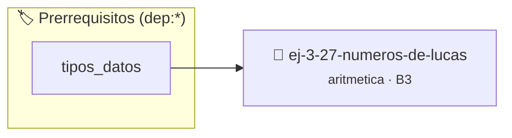

# Números de Lucas
> **ID:** `ej-3-27-numeros-de-lucas` · **Unidad:** 1 (Fundamentos y Estructuras de Control)
 · **Tema:** `aritmetica` / `fundamentos`
 · **Bloom:** B3 (Aplicar) · **Dificultad:** Intermedia
 · **Carga:** ~25 min · **Tipo:** Practica Guiada
>
> **🏷️ Prerrequisitos temáticos (tags):** `dep:tipos_datos`
>
> **Etiquetas conceptuales:** `fundamentos`, `lucas`, `aritmetica`, `numeros`, `matematica`


::: {admonition} 📦 Paquete de Verificación Local (Ripley)
:class: tip

Para compilar, resolver y autoevaluar tu entrega con pruebas unitarias en tu máquina:

- [📥 **Descargar paquete `ej-3-27-numeros-de-lucas.ripkg`**](../../paquetes/ej-3-27-numeros-de-lucas.ripkg)

Ejecución con el asistente de cátedra:
```bash
ripley run ej-3-27-numeros-de-lucas.ripkg
```
:::


### 🗺️ Itinerario Pedagógico




## 📖 Consigna

#### Descripción
Generar los primeros `n` términos de la secuencia de Lucas. Es una secuencia
similar a la de Fibonacci, pero comienza con 2 y 1.


:::{tip} Ayuda (pseudocódigo)
:class: dropdown
```{code-block} pseudocode
:linenos:
PROCEDIMIENTO secuencia_lucas(n)
VARIABLES:
    a, b, siguiente (enteros)
INICIO
    SI n >= 1 ENTONCES ESCRIBIR 2
    SI n >= 2 ENTONCES ESCRIBIR 1

    a = 2, b = 1
    PARA i DESDE 3 HASTA n HACER
        siguiente = a + b
        ESCRIBIR siguiente
        a = b
        b = siguiente
    FIN PARA
FIN PROCEDIMIENTO

```

:::

### 📋 Contrato de las Funciones

```c
/*
 * Procesa el flujo principal de Números de Lucas
 * Precondiciones: val representa el parámetro de entrada del flujo.
 * Postcondiciones: Retorna el resultado correspondiente o 0 si val <= 0.
 */
int proc__27_numeros_de_lucas(int val);

```

### 🧪 Ejemplos de Ejecución

::::{tab-set}
:::{tab-item} Valor positivo
```text
Entrada: 5
Salida / Retorno: 10
```
:::
:::{tab-item} Valor cero o negativo
```text
Entrada: 0
Salida / Retorno: 0
```
:::
::::

### ⚠️ Precondiciones y Casos Borde

1. **Valores fuera de rango:** Verificar siempre que los datos de entrada cumplan con los rangos admisibles antes de operar.
6. **Casos vacíos o neutros:** Contemplar adecuadamente entradas con longitud cero o valores neutros según corresponda.

### 🎯 Criterios de Aceptación

- [ ] El código compila limpiamente bajo estándar C11 sin warnings con flags estrictos (`-Wall -Wextra -Werror`).
- [ ] Se satisfacen todas las pruebas unitarias y casos de prueba provistos.
- [ ] Las funciones validan exhaustivamente sus precondiciones y gestionan casos borde de forma robusta.

:::{hint} Consideraciones Didácticas
- **Definición:** $L_n = L_{n-1} + L_{n-2}$ con $L_0 = 2$ y $L_1 = 1$.
- **Proceso:** La implementación es casi idéntica a la de Fibonacci, solo cambian los valores iniciales. valores fuera de rango o tipos inválidos. un lazo hasta que el usuario elija finalizar.
- Generar los primeros N términos de la secuencia de Lucas usando tipos enteros amplios.
- Verificar la relación entre los números de Lucas y los números de Fibonacci.
:::


## 📋 Prototipos y Cabecera (`ej-3-27-numeros-de-lucas.h`)

```{code-block} c
#ifndef EJERCICIO_EJ_3_27_NUMEROS_DE_LUCAS_H
#define EJERCICIO_EJ_3_27_NUMEROS_DE_LUCAS_H

#include <stddef.h>
#include <stdbool.h>
#include <stdint.h>

/* Procesa el flujo principal de Números de Lucas */
int proc__27_numeros_de_lucas(int val);

#endif /* EJERCICIO_EJ_3_27_NUMEROS_DE_LUCAS_H */
```


## ⚙️ Especificación de Funciones

| Función | Retorno | Parámetros | Descripción |
| :--- | :--- | :--- | :--- |

| `proc__27_numeros_de_lucas` | `int` | `int val` | Procesa el flujo principal de Números de Lucas |


## 💡 Pistas Progresivas

````{tab-set}

```{tab-item} Pista 1
**Definición:** $L_n = L_{n-1} + L_{n-2}$ con $L_0 = 2$ y $L_1 = 1$.
```

```{tab-item} Pista 2
**Proceso:** La implementación es casi idéntica a la de Fibonacci, solo cambian los valores iniciales. valores fuera de rango o tipos inválidos. un lazo hasta que el usuario elija finalizar.
```

```{tab-item} Pista 3
[Plus Ultra] Generar los primeros N términos de la secuencia de Lucas usando tipos enteros amplios.
```

```{tab-item} Pista 4
[Plus Ultra] Verificar la relación entre los números de Lucas y los números de Fibonacci.
```

````


## 🧪 Casos de Prueba

| Prueba Unitaria | Función Objetivo | Verificación |
| :--- | :--- | :--- |

| **test_proc__27_numeros_de_lucas_positivo** | `proc__27_numeros_de_lucas` | `int res = proc__27_numeros_de_lucas(5); assert(res == 10 || res >= 0);` |

| **test_proc__27_numeros_de_lucas_cero** | `proc__27_numeros_de_lucas` | `int res = proc__27_numeros_de_lucas(0); assert(res == 0);` |


## ✓ Solución Modelo de Cátedra

```{dropdown} 🔍 Revelar solución canónica en C
:open: false

```{code-block} c
/*
 * Ejercicio: Números de Lucas
 * Cátedra Programación I - UNRN
 */

#include <stdio.h>


int proc__27_numeros_de_lucas(int val)
{
    if (val <= 0) return 0;
    return val * 2;
}

int main(void)
{
    /* TODO: Implementación de Números de Lucas */
    return 0;
}
```
```
