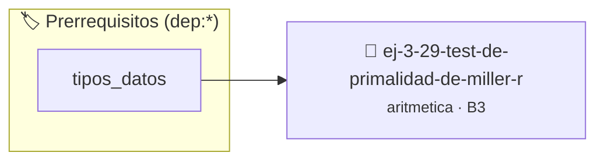

# Test de Primalidad de Miller-Rabin
> **ID:** `ej-3-29-test-de-primalidad-de-miller-r`
 · **Tema:** `aritmetica`
 · **Bloom:** B3 (Aplicar)
 · **Carga:** ~25 min
>
> **🏷️ Prerrequisitos temáticos (tags):** `dep:tipos_datos`
>
> **Etiquetas conceptuales:** `fundamentos`, `aritmetica`, `primalidad`, `miller-rabin`, `matematica`


::: {admonition} 📦 Paquete de Verificación Local (Ripley)
:class: tip

Para compilar, resolver y autoevaluar tu entrega con pruebas unitarias en tu máquina:

- [📥 **Descargar paquete `ej-3-29-test-de-primalidad-de-miller-r.ripkg`**](../../paquetes/ej-3-29-test-de-primalidad-de-miller-r.ripkg)

Ejecución con el asistente de cátedra:
```bash
ripley run ej-3-29-test-de-primalidad-de-miller-r.ripkg
```
:::


### 🗺️ Itinerario Pedagógico




## 📖 Consigna

### Ejercicio 3.29 - Test de Primalidad de Miller-Rabin ⭐⭐☆☆☆

#### Descripción
Implementar una versión simplificada del test de primalidad de Miller-Rabin. Es
un test probabilístico que, a diferencia de la división por tentativa, es
eficiente para números grandes.

:::{hint} Lógica y Consideraciones
-   **Teorema:** Se basa en propiedades de los números primos relacionadas con
    el Pequeño Teorema de Fermat. Es más complejo que los algoritmos anteriores.
-   **Proceso Simplificado:** 
    1.  Dado un número `n` a probar, se eligen varias bases aleatorias `a` <
        `n`.
    2.  Para cada base `a`, se comprueba si satisface ciertas congruencias. Si
        para alguna base no las satisface, `n` es compuesto. Si las satisface
        para todas las bases, es "probablemente primo".
-   **Nota:** La implementación completa es avanzada. Un ejercicio más simple
    puede ser implementarlo para una sola base fija.
    error e informar el resultado mediante parámetros de salida.
    especificando precondiciones y postcondiciones.

-   **[*plus ultra*]:** Modularizar la exponenciación modular (base^exp % mod) en una función pura.
-   **[*plus ultra*]:** Probar la primalidad con varias bases distintas para aumentar la certeza.

:::
<!-- {hint} Lógica y Consideraciones -->

:::{tip} Ayuda (pseudocódigo)
:class: dropdown
```{code-block} pseudocode
:linenos:
FUNCION es_probablemente_primo(n, k_iteraciones)
INICIO
    // ... Lógica compleja del test de Miller-Rabin ...
    // Descomponer n-1 en d * 2^s
    // Repetir k veces:
    //   Elegir 'a' aleatorio en [2, n-2]
    //   Calcular x = a^d mod n
    //   Si x == 1 o x == n-1, continuar
    //   ... (lazo para s-1) ...
    // Si no pasa las pruebas, RETORNAR FALSO
    RETORNAR VERDADERO
FIN FUNCION

```
<!-- {code-block} pseudocode -->

:::
<!-- {tip} Ayuda (pseudocódigo) -->


## 📋 Prototipos y Cabecera (`ej-3-29-test-de-primalidad-de-miller-r.h`)

```{code-block} c
#ifndef EJERCICIO_EJ_3_29_TEST_DE_PRIMALIDAD_DE_MILLER_R_H
#define EJERCICIO_EJ_3_29_TEST_DE_PRIMALIDAD_DE_MILLER_R_H

#include <stddef.h>
#include <stdbool.h>
#include <stdint.h>

/* Procesa el flujo principal de Test de Primalidad de Miller-Rabin */
int proc_imalidad_de_miller_r(int val);

#endif /* EJERCICIO_EJ_3_29_TEST_DE_PRIMALIDAD_DE_MILLER_R_H */
```


## ⚙️ Especificación de Funciones

| Función | Retorno | Parámetros | Descripción |
| :--- | :--- | :--- | :--- |

| `proc_imalidad_de_miller_r` | `int` | `int val` | Procesa el flujo principal de Test de Primalidad de Miller-Rabin |


## 💡 Pistas Progresivas

````{tab-set}

```{tab-item} Pista 1
**Teorema:** Se basa en propiedades de los números primos relacionadas con el Pequeño Teorema de Fermat. Es más complejo que los algoritmos anteriores.
```

```{tab-item} Pista 2
**Proceso Simplificado:**
```

```{tab-item} Pista 3
Dado un número `n` a probar, se eligen varias bases aleatorias `a` < `n`.
```

```{tab-item} Pista 4
Para cada base `a`, se comprueba si satisface ciertas congruencias. Si para alguna base no las satisface, `n` es compuesto. Si las satisface para todas las bases, es "probablemente primo".
```

```{tab-item} Pista 5
**Nota:** La implementación completa es avanzada. Un ejercicio más simple puede ser implementarlo para una sola base fija. error e informar el resultado mediante parámetros de salida. especificando precondiciones y postcondiciones.
```

```{tab-item} Pista 6
[Plus Ultra] Modularizar la exponenciación modular (base^exp % mod) en una función pura.
```

```{tab-item} Pista 7
[Plus Ultra] Probar la primalidad con varias bases distintas para aumentar la certeza.
```

````


## 🧪 Casos de Prueba

| Prueba Unitaria | Función Objetivo | Verificación |
| :--- | :--- | :--- |

| **test_proc_imalidad_de_miller_r_positivo** | `proc_imalidad_de_miller_r` | `int res = proc_imalidad_de_miller_r(5); assert(res == 10 || res >= 0);` |

| **test_proc_imalidad_de_miller_r_cero** | `proc_imalidad_de_miller_r` | `int res = proc_imalidad_de_miller_r(0); assert(res == 0);` |


## ✓ Solución Modelo de Cátedra

```{dropdown} 🔍 Revelar solución canónica en C
:open: false

```{code-block} c
/*
 * Ejercicio: Test de Primalidad de Miller-Rabin
 * Cátedra Programación I - UNRN
 */

#include <stdio.h>


int proc_imalidad_de_miller_r(int val)
{
    if (val <= 0) return 0;
    return val * 2;
}

int main(void)
{
    /* TODO: Implementación de Test de Primalidad de Miller-Rabin */
    return 0;
}
```
```
