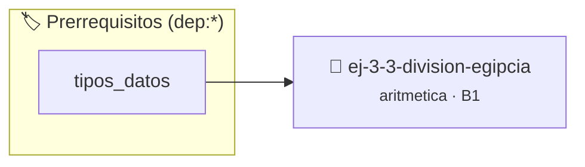

# División egipcia
> **ID:** `ej-3-3-division-egipcia` · **Unidad:** 1 (Fundamentos y Estructuras de Control)
 · **Tema:** `aritmetica` / `egipcia`
 · **Bloom:** B1 (Recordar) · **Dificultad:** Inicial
 · **Carga:** ~10 min · **Tipo:** Concepto
>
> **🏷️ Prerrequisitos temáticos (tags):** `dep:tipos_datos`
>
> **Etiquetas conceptuales:** `egipcia`, `fundamentos`, `aritmetica`, `matematica`, `division`


::: {admonition} 📦 Paquete de Verificación Local (Ripley)
:class: tip

Para compilar, resolver y autoevaluar tu entrega con pruebas unitarias en tu máquina:

- [📥 **Descargar paquete `ej-3-3-division-egipcia.ripkg`**](../../paquetes/ej-3-3-division-egipcia.ripkg)

Ejecución con el asistente de cátedra:
```bash
ripley run ej-3-3-division-egipcia.ripkg
```
:::


### 🗺️ Itinerario Pedagógico




## 📖 Consigna

#### Descripción
Implementar el antiguo método de división egipcio, que no requiere tablas de
multiplicar ni operaciones de división directa. Se basa en duplicar el divisor,
encontrar qué duplicaciones suman el dividendo y sumar los factores de
duplicación correspondientes.


:::{tip} Ayuda (pseudocódigo)
:class: dropdown
```{code-block} pseudocode
:linenos:
PROCEDIMIENTO division_egipcia(dividendo, divisor, REF cociente, REF resto)
VARIABLES:
    col1, col2 (arreglos)
    i (entero)
INICIO
    // 1. Crear tabla
    col1[0] = 1, col2[0] = divisor
    i = 0
    MIENTRAS col2[i] <= dividendo HACER
        i = i + 1
        col1[i] = col1[i-1] * 2
        col2[i] = col2[i-1] * 2
    FIN MIENTRAS

    // 2. Buscar y sumar
    cociente = 0
    PARA j DESDE i-1 HASTA 0 CON PASO -1 HACER
        SI col2[j] <= dividendo ENTONCES
            dividendo = dividendo - col2[j]
            cociente = cociente + col1[j]
        FIN SI
    FIN PARA
    resto = dividendo
FIN PROCEDIMIENTO

```

:::

---

## Divisibilidad y Factores

### 📋 Contrato de las Funciones

```c
/*
 * Procesa el flujo principal de División egipcia
 * Precondiciones: val representa el parámetro de entrada del flujo.
 * Postcondiciones: Retorna el resultado correspondiente o 0 si val <= 0.
 */
int proc_3_3_division_egipcia(int val);

```

### 🧪 Ejemplos de Ejecución

::::{tab-set}
:::{tab-item} Valor positivo
```text
Entrada: 5
Salida / Retorno: 10
```
:::
:::{tab-item} Valor cero o negativo
```text
Entrada: 0
Salida / Retorno: 0
```
:::
::::

### ⚠️ Precondiciones y Casos Borde

1. **Valores fuera de rango:** Verificar siempre que los datos de entrada cumplan con los rangos admisibles antes de operar.
6. **Casos vacíos o neutros:** Contemplar adecuadamente entradas con longitud cero o valores neutros según corresponda.

### 🎯 Criterios de Aceptación

- [ ] El código compila limpiamente bajo estándar C11 sin warnings con flags estrictos (`-Wall -Wextra -Werror`).
- [ ] Se satisfacen todas las pruebas unitarias y casos de prueba provistos.
- [ ] Las funciones validan exhaustivamente sus precondiciones y gestionan casos borde de forma robusta.

:::{hint} Consideraciones Didácticas
- **Entrada:** Un dividendo y un divisor.
- **Proceso:**
- **Tabla de Duplicación:** Crear dos columnas. La primera empieza en 1 y la segunda en el `divisor`. En cada paso, duplicar el valor de la fila anterior en ambas columnas. Detenerse cuando el siguiente valor en la columna del divisor supere al `dividendo`.
- **Búsqueda y Suma:** Recorrer la tabla de abajo hacia arriba. Para cada fila, si el valor en la columna del divisor es menor o igual al `dividendo` restante, se resta ese valor del `dividendo` y se suma el valor correspondiente de la primera columna al `cociente`.
- **Salida:** El `cociente` acumulado y el `dividendo` final (que es el resto). filas (*row-major order*) para mejorar el uso de caché. estrictamente dentro de los límites del contenedor.
- Validar que el divisor sea distinto de cero e imprimir el paso a paso de las duplicaciones sucesivas.
- Comparar la cantidad de operaciones requeridas por la división egipcia frente a la división por restas.
:::


## 📋 Prototipos y Cabecera (`ej-3-3-division-egipcia.h`)

```{code-block} c
#ifndef EJERCICIO_EJ_3_3_DIVISION_EGIPCIA_H
#define EJERCICIO_EJ_3_3_DIVISION_EGIPCIA_H

#include <stddef.h>
#include <stdbool.h>
#include <stdint.h>

/* Procesa el flujo principal de División egipcia */
int proc_3_3_division_egipcia(int val);

#endif /* EJERCICIO_EJ_3_3_DIVISION_EGIPCIA_H */
```


## ⚙️ Especificación de Funciones

| Función | Retorno | Parámetros | Descripción |
| :--- | :--- | :--- | :--- |

| `proc_3_3_division_egipcia` | `int` | `int val` | Procesa el flujo principal de División egipcia |


## 💡 Pistas Progresivas

````{tab-set}

```{tab-item} Pista 1
**Entrada:** Un dividendo y un divisor.
```

```{tab-item} Pista 2
**Proceso:**
```

```{tab-item} Pista 3
**Tabla de Duplicación:** Crear dos columnas. La primera empieza en 1 y la segunda en el `divisor`. En cada paso, duplicar el valor de la fila anterior en ambas columnas. Detenerse cuando el siguiente valor en la columna del divisor supere al `dividendo`.
```

```{tab-item} Pista 4
**Búsqueda y Suma:** Recorrer la tabla de abajo hacia arriba. Para cada fila, si el valor en la columna del divisor es menor o igual al `dividendo` restante, se resta ese valor del `dividendo` y se suma el valor correspondiente de la primera columna al `cociente`.
```

```{tab-item} Pista 5
**Salida:** El `cociente` acumulado y el `dividendo` final (que es el resto). filas (*row-major order*) para mejorar el uso de caché. estrictamente dentro de los límites del contenedor.
```

```{tab-item} Pista 6
[Plus Ultra] Validar que el divisor sea distinto de cero e imprimir el paso a paso de las duplicaciones sucesivas.
```

```{tab-item} Pista 7
[Plus Ultra] Comparar la cantidad de operaciones requeridas por la división egipcia frente a la división por restas.
```

````


## 🧪 Casos de Prueba

| Prueba Unitaria | Función Objetivo | Verificación |
| :--- | :--- | :--- |

| **test_proc_3_3_division_egipcia_positivo** | `proc_3_3_division_egipcia` | `int res = proc_3_3_division_egipcia(5); assert(res == 10 || res >= 0);` |

| **test_proc_3_3_division_egipcia_cero** | `proc_3_3_division_egipcia` | `int res = proc_3_3_division_egipcia(0); assert(res == 0);` |


## ✓ Solución Modelo de Cátedra

```{dropdown} 🔍 Revelar solución canónica en C
:open: false

```{code-block} c
/*
 * Ejercicio: División egipcia
 * Cátedra Programación I - UNRN
 */

#include <stdio.h>


int proc_3_3_division_egipcia(int val)
{
    if (val <= 0) return 0;
    return val * 2;
}

int main(void)
{
    /* TODO: Implementación de División egipcia */
    return 0;
}
```
```
