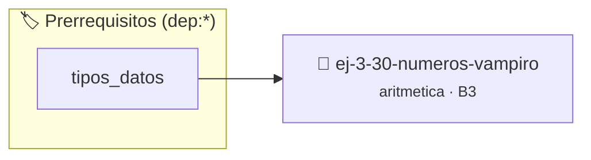

# Números Vampiro
> **ID:** `ej-3-30-numeros-vampiro`
 · **Tema:** `aritmetica`
 · **Bloom:** B3 (Aplicar)
 · **Carga:** ~25 min
>
> **🏷️ Prerrequisitos temáticos (tags):** `dep:tipos_datos`
>
> **Etiquetas conceptuales:** `fundamentos`, `vampiro`, `aritmetica`, `numeros`, `matematica`


::: {admonition} 📦 Paquete de Verificación Local (Ripley)
:class: tip

Para compilar, resolver y autoevaluar tu entrega con pruebas unitarias en tu máquina:

- [📥 **Descargar paquete `ej-3-30-numeros-vampiro.ripkg`**](../../paquetes/ej-3-30-numeros-vampiro.ripkg)

Ejecución con el asistente de cátedra:
```bash
ripley run ej-3-30-numeros-vampiro.ripkg
```
:::


### 🗺️ Itinerario Pedagógico




## 📖 Consigna

### Ejercicio 3.30 - Números Vampiro ⭐⭐☆☆☆

#### Descripción
Un número vampiro es un número de `2k` dígitos que puede ser factorizado en dos
números de `k` dígitos (los "colmillos"), donde los dígitos de los colmillos,
concatenados, son una permutación de los dígitos del número original.

:::{hint} Lógica y Consideraciones
-   **Entrada:** Un número `n` de 4 dígitos.
-   **Proceso:** 
    1.  Iterar a través de todos los posibles pares de "colmillos" de 2 dígitos
        (`i` y `j`).
    2.  Verificar si `i * j == n`.
    3.  Si es así, obtener los 4 dígitos de `n` y los 4 dígitos de `i` y `j`.
    4.  Verificar si los dos conjuntos de dígitos son permutaciones el uno del
        otro (ej. ordenándolos y comparando).
    error e informar el resultado mediante parámetros de salida.
    especificando precondiciones y postcondiciones.

-   **[*plus ultra*]:** Validar que el número tenga una cantidad par de dígitos.
-   **[*plus ultra*]:** Verificar que los colmillos no terminen ambos en cero simultáneamente.

:::
<!-- {hint} Lógica y Consideraciones -->

:::{tip} Ayuda (pseudocódigo)
:class: dropdown
```{code-block} pseudocode
:linenos:
FUNCION es_vampiro_4_digitos(n)
INICIO
    PARA i DESDE 10 HASTA 99 HACER
        PARA j DESDE i HASTA 99 HACER
            SI i * j == n ENTONCES
                digitos_n = obtener_digitos_ordenados(n)
                digitos_colmillos = obtener_digitos_ordenados(i, j)
                SI digitos_n == digitos_colmillos ENTONCES
                    RETORNAR VERDADERO
                FIN SI
            FIN SI
        FIN PARA
    FIN PARA
    RETORNAR FALSO
FIN FUNCION

```
<!-- {code-block} pseudocode -->

:::
<!-- {tip} Ayuda (pseudocódigo) -->


## 📋 Prototipos y Cabecera (`ej-3-30-numeros-vampiro.h`)

```{code-block} c
#ifndef EJERCICIO_EJ_3_30_NUMEROS_VAMPIRO_H
#define EJERCICIO_EJ_3_30_NUMEROS_VAMPIRO_H

#include <stddef.h>
#include <stdbool.h>
#include <stdint.h>

/* Procesa el flujo principal de Números Vampiro */
int proc_3_30_numeros_vampiro(int val);

#endif /* EJERCICIO_EJ_3_30_NUMEROS_VAMPIRO_H */
```


## ⚙️ Especificación de Funciones

| Función | Retorno | Parámetros | Descripción |
| :--- | :--- | :--- | :--- |

| `proc_3_30_numeros_vampiro` | `int` | `int val` | Procesa el flujo principal de Números Vampiro |


## 💡 Pistas Progresivas

````{tab-set}

```{tab-item} Pista 1
**Entrada:** Un número `n` de 4 dígitos.
```

```{tab-item} Pista 2
**Proceso:**
```

```{tab-item} Pista 3
Iterar a través de todos los posibles pares de "colmillos" de 2 dígitos (`i` y `j`).
```

```{tab-item} Pista 4
Verificar si `i * j == n`.
```

```{tab-item} Pista 5
Si es así, obtener los 4 dígitos de `n` y los 4 dígitos de `i` y `j`.
```

```{tab-item} Pista 6
Verificar si los dos conjuntos de dígitos son permutaciones el uno del otro (ej. ordenándolos y comparando). error e informar el resultado mediante parámetros de salida. especificando precondiciones y postcondiciones.
```

```{tab-item} Pista 7
[Plus Ultra] Validar que el número tenga una cantidad par de dígitos.
```

```{tab-item} Pista 8
[Plus Ultra] Verificar que los colmillos no terminen ambos en cero simultáneamente.
```

````


## 🧪 Casos de Prueba

| Prueba Unitaria | Función Objetivo | Verificación |
| :--- | :--- | :--- |

| **test_proc_3_30_numeros_vampiro_positivo** | `proc_3_30_numeros_vampiro` | `int res = proc_3_30_numeros_vampiro(5); assert(res == 10 || res >= 0);` |

| **test_proc_3_30_numeros_vampiro_cero** | `proc_3_30_numeros_vampiro` | `int res = proc_3_30_numeros_vampiro(0); assert(res == 0);` |


## ✓ Solución Modelo de Cátedra

```{dropdown} 🔍 Revelar solución canónica en C
:open: false

```{code-block} c
/*
 * Ejercicio: Números Vampiro
 * Cátedra Programación I - UNRN
 */

#include <stdio.h>


int proc_3_30_numeros_vampiro(int val)
{
    if (val <= 0) return 0;
    return val * 2;
}

int main(void)
{
    /* TODO: Implementación de Números Vampiro */
    return 0;
}
```
```
