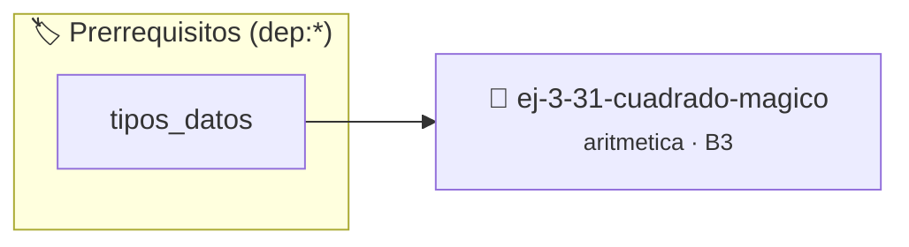

# Cuadrado Mágico
> **ID:** `ej-3-31-cuadrado-magico`
 · **Tema:** `aritmetica`
 · **Bloom:** B3 (Aplicar)
 · **Carga:** ~25 min
>
> **🏷️ Prerrequisitos temáticos (tags):** `dep:tipos_datos`
>
> **Etiquetas conceptuales:** `fundamentos`, `magico`, `cuadrado`, `aritmetica`, `matematica`


::: {admonition} 📦 Paquete de Verificación Local (Ripley)
:class: tip

Para compilar, resolver y autoevaluar tu entrega con pruebas unitarias en tu máquina:

- [📥 **Descargar paquete `ej-3-31-cuadrado-magico.ripkg`**](../../paquetes/ej-3-31-cuadrado-magico.ripkg)

Ejecución con el asistente de cátedra:
```bash
ripley run ej-3-31-cuadrado-magico.ripkg
```
:::


### 🗺️ Itinerario Pedagógico




## 📖 Consigna

### Ejercicio 3.31 - Cuadrado Mágico ⭐⭐☆☆☆

#### Descripción
Verificar si una matriz cuadrada `n x n` de números es un cuadrado mágico. Un
cuadrado mágico es una matriz donde la suma de los números de cada fila, cada
columna y ambas diagonales principales es la misma ("constante mágica").

:::{hint} Lógica y Consideraciones
-   **Entrada:** Una matriz `n x n`.
-   **Proceso:** 
    1.  Calcular la suma de la primera fila y guardarla como la
        `constante_magica` de referencia.
    2.  Iterar por las demás filas, calculando su suma y comparándola con la
        `constante_magica`.
    3.  Iterar por todas las columnas, calculando su suma y comparándola.
    4.  Calcular la suma de la diagonal principal y la diagonal secundaria y
        compararlas.
-   Si todas las sumas son iguales, es un cuadrado mágico.
    filas (*row-major order*) para mejorar el uso de caché.
    estrictamente dentro de los límites del contenedor.

-   **[*plus ultra*]:** Validar que la dimensión sea un entero impar positivo mayor o igual a 3.
-   **[*plus ultra*]:** Verificar que la constante mágica calculada sea igual a n*(n^2 + 1)/2.

:::
<!-- {hint} Lógica y Consideraciones -->

:::{tip} Ayuda (pseudocódigo)
:class: dropdown
```{code-block} pseudocode
:linenos:
FUNCION es_cuadrado_magico(matriz, n)
VARIABLES:
    constante_magica, suma_actual (entero)
INICIO
    // Calcular constante de referencia
    constante_magica = suma_fila(matriz, 0)

    // Verificar filas y columnas
    PARA i DESDE 1 HASTA n-1 HACER
        SI suma_fila(matriz, i) != constante_magica RETORNAR FALSO
        SI suma_columna(matriz, i) != constante_magica RETORNAR FALSO
    FIN PARA

    // Verificar diagonales
    SI suma_diagonal_principal(matriz) != constante_magica RETORNAR FALSO
    SI suma_diagonal_secundaria(matriz) != constante_magica RETORNAR FALSO

    RETORNAR VERDADERO
FIN FUNCION

```
<!-- {code-block} pseudocode -->

:::
<!-- {tip} Ayuda (pseudocódigo) -->

---

## Más Teoría de Números y Algoritmos


## 📋 Prototipos y Cabecera (`ej-3-31-cuadrado-magico.h`)

```{code-block} c
#ifndef EJERCICIO_EJ_3_31_CUADRADO_MAGICO_H
#define EJERCICIO_EJ_3_31_CUADRADO_MAGICO_H

#include <stddef.h>
#include <stdbool.h>
#include <stdint.h>

/* Procesa el flujo principal de Cuadrado Mágico */
int proc_3_31_cuadrado_magico(int val);

#endif /* EJERCICIO_EJ_3_31_CUADRADO_MAGICO_H */
```


## ⚙️ Especificación de Funciones

| Función | Retorno | Parámetros | Descripción |
| :--- | :--- | :--- | :--- |

| `proc_3_31_cuadrado_magico` | `int` | `int val` | Procesa el flujo principal de Cuadrado Mágico |


## 💡 Pistas Progresivas

````{tab-set}

```{tab-item} Pista 1
**Entrada:** Una matriz `n x n`.
```

```{tab-item} Pista 2
**Proceso:**
```

```{tab-item} Pista 3
Calcular la suma de la primera fila y guardarla como la `constante_magica` de referencia.
```

```{tab-item} Pista 4
Iterar por las demás filas, calculando su suma y comparándola con la `constante_magica`.
```

```{tab-item} Pista 5
Iterar por todas las columnas, calculando su suma y comparándola.
```

```{tab-item} Pista 6
Calcular la suma de la diagonal principal y la diagonal secundaria y compararlas.
```

```{tab-item} Pista 7
Si todas las sumas son iguales, es un cuadrado mágico. filas (*row-major order*) para mejorar el uso de caché. estrictamente dentro de los límites del contenedor.
```

```{tab-item} Pista 8
[Plus Ultra] Validar que la dimensión sea un entero impar positivo mayor o igual a 3.
```

```{tab-item} Pista 9
[Plus Ultra] Verificar que la constante mágica calculada sea igual a n*(n^2 + 1)/2.
```

````


## 🧪 Casos de Prueba

| Prueba Unitaria | Función Objetivo | Verificación |
| :--- | :--- | :--- |

| **test_proc_3_31_cuadrado_magico_positivo** | `proc_3_31_cuadrado_magico` | `int res = proc_3_31_cuadrado_magico(5); assert(res == 10 || res >= 0);` |

| **test_proc_3_31_cuadrado_magico_cero** | `proc_3_31_cuadrado_magico` | `int res = proc_3_31_cuadrado_magico(0); assert(res == 0);` |


## ✓ Solución Modelo de Cátedra

```{dropdown} 🔍 Revelar solución canónica en C
:open: false

```{code-block} c
/*
 * Ejercicio: Cuadrado Mágico
 * Cátedra Programación I - UNRN
 */

#include <stdio.h>


int proc_3_31_cuadrado_magico(int val)
{
    if (val <= 0) return 0;
    return val * 2;
}

int main(void)
{
    /* TODO: Implementación de Cuadrado Mágico */
    return 0;
}
```
```
