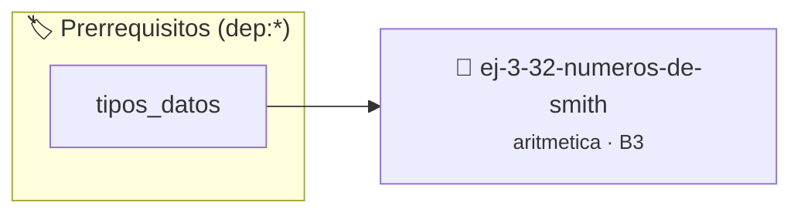

# Números de Smith
> **ID:** `ej-3-32-numeros-de-smith`
 · **Tema:** `aritmetica`
 · **Bloom:** B3 (Aplicar)
 · **Carga:** ~25 min
>
> **🏷️ Prerrequisitos temáticos (tags):** `dep:tipos_datos`
>
> **Etiquetas conceptuales:** `fundamentos`, `aritmetica`, `numeros`, `matematica`, `smith`


::: {admonition} 📦 Paquete de Verificación Local (Ripley)
:class: tip

Para compilar, resolver y autoevaluar tu entrega con pruebas unitarias en tu máquina:

- [📥 **Descargar paquete `ej-3-32-numeros-de-smith.ripkg`**](../../paquetes/ej-3-32-numeros-de-smith.ripkg)

Ejecución con el asistente de cátedra:
```bash
ripley run ej-3-32-numeros-de-smith.ripkg
```
:::


### 🗺️ Itinerario Pedagógico




## 📖 Consigna

### Ejercicio 3.32 - Números de Smith ⭐⭐☆☆☆

#### Descripción
Un número de Smith es un número compuesto cuya suma de dígitos es igual a la
suma de los dígitos de sus factores primos. El programa debe verificar si un
número dado es un número de Smith.

:::{hint} Lógica y Consideraciones
-   **Entrada:** Un entero `n`.
-   **Proceso:** 
    1.  Verificar que `n` no sea primo.
    2.  Calcular la suma de los dígitos de `n`.
    3.  Obtener los factores primos de `n`.
    4.  Calcular la suma de los dígitos de todos los factores primos. Si un
        factor tiene más de un dígito (ej. 13), se deben sumar sus dígitos
        individuales (1+3).
    5.  Comparar las dos sumas.
    error e informar el resultado mediante parámetros de salida.
    especificando precondiciones y postcondiciones.

-   **[*plus ultra*]:** Validar que el número sea compuesto (los primos no se consideran números de Smith).
-   **[*plus ultra*]:** Encontrar todos los números de Smith menores a 500.

:::
<!-- {hint} Lógica y Consideraciones -->

:::{tip} Ayuda (pseudocódigo)
:class: dropdown
```{code-block} pseudocode
:linenos:
FUNCION es_numero_smith(n)
INICIO
    SI es_primo(n) RETORNAR FALSO

    suma_digitos_n = sumar_digitos(n)
    suma_digitos_factores = 0
    temp_n = n

    // Lógica para obtener factores primos y sumar sus dígitos
    // ... (similar a la descomposición en factores primos)

    RETORNAR (suma_digitos_n == suma_digitos_factores)
FIN FUNCION

```
<!-- {code-block} pseudocode -->

:::
<!-- {tip} Ayuda (pseudocódigo) -->


## 📋 Prototipos y Cabecera (`ej-3-32-numeros-de-smith.h`)

```{code-block} c
#ifndef EJERCICIO_EJ_3_32_NUMEROS_DE_SMITH_H
#define EJERCICIO_EJ_3_32_NUMEROS_DE_SMITH_H

#include <stddef.h>
#include <stdbool.h>
#include <stdint.h>

/* Procesa el flujo principal de Números de Smith */
int proc__32_numeros_de_smith(int val);

#endif /* EJERCICIO_EJ_3_32_NUMEROS_DE_SMITH_H */
```


## ⚙️ Especificación de Funciones

| Función | Retorno | Parámetros | Descripción |
| :--- | :--- | :--- | :--- |

| `proc__32_numeros_de_smith` | `int` | `int val` | Procesa el flujo principal de Números de Smith |


## 💡 Pistas Progresivas

````{tab-set}

```{tab-item} Pista 1
**Entrada:** Un entero `n`.
```

```{tab-item} Pista 2
**Proceso:**
```

```{tab-item} Pista 3
Verificar que `n` no sea primo.
```

```{tab-item} Pista 4
Calcular la suma de los dígitos de `n`.
```

```{tab-item} Pista 5
Obtener los factores primos de `n`.
```

```{tab-item} Pista 6
Calcular la suma de los dígitos de todos los factores primos. Si un factor tiene más de un dígito (ej. 13), se deben sumar sus dígitos individuales (1+3).
```

```{tab-item} Pista 7
Comparar las dos sumas. error e informar el resultado mediante parámetros de salida. especificando precondiciones y postcondiciones.
```

```{tab-item} Pista 8
[Plus Ultra] Validar que el número sea compuesto (los primos no se consideran números de Smith).
```

```{tab-item} Pista 9
[Plus Ultra] Encontrar todos los números de Smith menores a 500.
```

````


## 🧪 Casos de Prueba

| Prueba Unitaria | Función Objetivo | Verificación |
| :--- | :--- | :--- |

| **test_proc__32_numeros_de_smith_positivo** | `proc__32_numeros_de_smith` | `int res = proc__32_numeros_de_smith(5); assert(res == 10 || res >= 0);` |

| **test_proc__32_numeros_de_smith_cero** | `proc__32_numeros_de_smith` | `int res = proc__32_numeros_de_smith(0); assert(res == 0);` |


## ✓ Solución Modelo de Cátedra

```{dropdown} 🔍 Revelar solución canónica en C
:open: false

```{code-block} c
/*
 * Ejercicio: Números de Smith
 * Cátedra Programación I - UNRN
 */

#include <stdio.h>


int proc__32_numeros_de_smith(int val)
{
    if (val <= 0) return 0;
    return val * 2;
}

int main(void)
{
    /* TODO: Implementación de Números de Smith */
    return 0;
}
```
```
