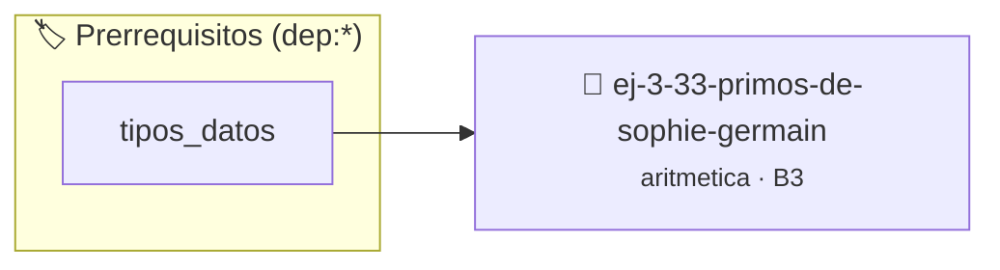

# Primos de Sophie Germain
> **ID:** `ej-3-33-primos-de-sophie-germain` · **Unidad:** 1 (Fundamentos y Estructuras de Control)
 · **Tema:** `aritmetica` / `teoria_numeros`
 · **Bloom:** B3 (Aplicar) · **Dificultad:** Intermedia
 · **Carga:** ~25 min · **Tipo:** Practica Guiada
>
> **🏷️ Prerrequisitos temáticos (tags):** `dep:tipos_datos`
>
> **Etiquetas conceptuales:** `fundamentos`, `sophie`, `germain`, `aritmetica`, `primos`


::: {admonition} 📦 Paquete de Verificación Local (Ripley)
:class: tip

Para compilar, resolver y autoevaluar tu entrega con pruebas unitarias en tu máquina:

- [📥 **Descargar paquete `ej-3-33-primos-de-sophie-germain.ripkg`**](../../paquetes/ej-3-33-primos-de-sophie-germain.ripkg)

Ejecución con el asistente de cátedra:
```bash
ripley run ej-3-33-primos-de-sophie-germain.ripkg
```
:::


### 🗺️ Itinerario Pedagógico




## 📖 Consigna

### Ejercicio 3.33 - Primos de Sophie Germain ⭐⭐☆☆☆

#### Descripción
Un número primo `p` es un primo de Sophie Germain si `2p + 1` también es un
número primo. El programa debe encontrar todos los primos de Sophie Germain
hasta un límite $N$.

:::{hint} Lógica y Consideraciones
-   **Entrada:** Un límite superior $N$.
-   **Proceso:** 
    1.  Iterar con un número `p` desde 2 hasta $N$.
    2.  En cada iteración, verificar si `p` es primo.
    3.  Si `p` es primo, calcular `q = 2*p + 1` y verificar si `q` también es
        primo.
    4.  Si ambos son primos, `p` es un primo de Sophie Germain.
    valores fuera de rango o tipos inválidos.
    un lazo hasta que el usuario elija finalizar.

-   **[*plus ultra*]:** Validar que tanto p como 2p + 1 sean números primos.
-   **[*plus ultra*]:** Listar todos los primos de Sophie Germain menores a un límite dado.

:::
<!-- {hint} Lógica y Consideraciones -->

:::{tip} Ayuda (pseudocódigo)
:class: dropdown
```{code-block} pseudocode
:linenos:
PROCEDIMIENTO primos_sophie_germain(N)
INICIO
    PARA p DESDE 2 HASTA N HACER
        SI es_primo(p) Y es_primo(2*p + 1) ENTONCES
            ESCRIBIR p
        FIN SI
    FIN PARA
FIN PROCEDIMIENTO

```
<!-- {code-block} pseudocode -->

:::
<!-- {tip} Ayuda (pseudocódigo) -->


## 📋 Prototipos y Cabecera (`ej-3-33-primos-de-sophie-germain.h`)

```{code-block} c
#ifndef EJERCICIO_EJ_3_33_PRIMOS_DE_SOPHIE_GERMAIN_H
#define EJERCICIO_EJ_3_33_PRIMOS_DE_SOPHIE_GERMAIN_H

#include <stddef.h>
#include <stdbool.h>
#include <stdint.h>

/* Procesa el flujo principal de Primos de Sophie Germain */
int proc_os_de_sophie_germain(int val);

#endif /* EJERCICIO_EJ_3_33_PRIMOS_DE_SOPHIE_GERMAIN_H */
```


## ⚙️ Especificación de Funciones

| Función | Retorno | Parámetros | Descripción |
| :--- | :--- | :--- | :--- |

| `proc_os_de_sophie_germain` | `int` | `int val` | Procesa el flujo principal de Primos de Sophie Germain |


## 💡 Pistas Progresivas

````{tab-set}

```{tab-item} Pista 1
**Entrada:** Un límite superior $N$.
```

```{tab-item} Pista 2
**Proceso:**
```

```{tab-item} Pista 3
Iterar con un número `p` desde 2 hasta $N$.
```

```{tab-item} Pista 4
En cada iteración, verificar si `p` es primo.
```

```{tab-item} Pista 5
Si `p` es primo, calcular `q = 2*p + 1` y verificar si `q` también es primo.
```

```{tab-item} Pista 6
Si ambos son primos, `p` es un primo de Sophie Germain. valores fuera de rango o tipos inválidos. un lazo hasta que el usuario elija finalizar.
```

```{tab-item} Pista 7
[Plus Ultra] Validar que tanto p como 2p + 1 sean números primos.
```

```{tab-item} Pista 8
[Plus Ultra] Listar todos los primos de Sophie Germain menores a un límite dado.
```

````


## 🧪 Casos de Prueba

| Prueba Unitaria | Función Objetivo | Verificación |
| :--- | :--- | :--- |

| **test_proc_os_de_sophie_germain_positivo** | `proc_os_de_sophie_germain` | `int res = proc_os_de_sophie_germain(5); assert(res == 10 || res >= 0);` |

| **test_proc_os_de_sophie_germain_cero** | `proc_os_de_sophie_germain` | `int res = proc_os_de_sophie_germain(0); assert(res == 0);` |


## ✓ Solución Modelo de Cátedra

```{dropdown} 🔍 Revelar solución canónica en C
:open: false

```{code-block} c
/*
 * Ejercicio: Primos de Sophie Germain
 * Cátedra Programación I - UNRN
 */

#include <stdio.h>


int proc_os_de_sophie_germain(int val)
{
    if (val <= 0) return 0;
    return val * 2;
}

int main(void)
{
    /* TODO: Implementación de Primos de Sophie Germain */
    return 0;
}
```
```
