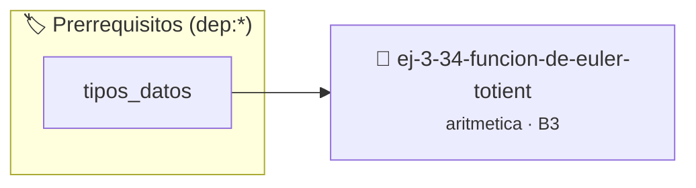

# Función φ de Euler (Totient)
> **ID:** `ej-3-34-funcion-de-euler-totient` · **Unidad:** 1 (Fundamentos y Estructuras de Control)
 · **Tema:** `aritmetica` / `totient`
 · **Bloom:** B3 (Aplicar) · **Dificultad:** Intermedia
 · **Carga:** ~25 min · **Tipo:** Practica Guiada
>
> **🏷️ Prerrequisitos temáticos (tags):** `dep:tipos_datos`
>
> **Etiquetas conceptuales:** `totient`, `fundamentos`, `funcion`, `aritmetica`, `matematica`


::: {admonition} 📦 Paquete de Verificación Local (Ripley)
:class: tip

Para compilar, resolver y autoevaluar tu entrega con pruebas unitarias en tu máquina:

- [📥 **Descargar paquete `ej-3-34-funcion-de-euler-totient.ripkg`**](../../paquetes/ej-3-34-funcion-de-euler-totient.ripkg)

Ejecución con el asistente de cátedra:
```bash
ripley run ej-3-34-funcion-de-euler-totient.ripkg
```
:::


### 🗺️ Itinerario Pedagógico




## 📖 Consigna

### Ejercicio 3.34 - Función φ de Euler (Totient) ⭐⭐☆☆☆

#### Descripción
Implementar una función que calcule el Totient de Euler, `φ(n)`. Esta función
cuenta el número de enteros positivos hasta `n` que son coprimos con `n` (es
decir, `mcd(k, n) = 1` para `1 <= k <= n`).

:::{hint} Lógica y Consideraciones
-   **Entrada:** Un entero `n`.
-   **Proceso (simple):** Iterar `k` desde 1 hasta `n` y contar cuántas veces
    `mcd(k, n) == 1`.
-   **Proceso (eficiente):** Usar la fórmula basada en los factores primos de
    `n`: $\phi(n) = n \prod_{p|n, p \text{ es primo}} (1 - \frac{1}{p})$.
    definición interna oculta en el archivo `.c`.
    para copiar la estructura de forma segura.

-   **[*plus ultra*]:** Modularizar la descomposición en factores primos para calcular phi(n) mediante la fórmula de Euler.
-   **[*plus ultra*]:** Verificar que para un número primo p, phi(p) sea exactamente p - 1.

:::
<!-- {hint} Lógica y Consideraciones -->

:::{tip} Ayuda (pseudocódigo)
:class: dropdown
```{code-block} pseudocode
:linenos:
FUNCION phi_euler(n)
VARIABLES:
    resultado (real)
INICIO
    resultado = n
    p = 2
    temp_n = n
    MIENTRAS p*p <= temp_n HACER
        SI temp_n MOD p == 0 ENTONCES
            MIENTRAS temp_n MOD p == 0 HACER
                temp_n = temp_n / p
            FIN MIENTRAS
            resultado = resultado * (1.0 - (1.0 / p))
        FIN SI
        p = p + 1
    FIN MIENTRAS
    SI temp_n > 1 ENTONCES
        resultado = resultado * (1.0 - (1.0 / temp_n))
    FIN SI
    RETORNAR PARTE_ENTERA(resultado)
FIN FUNCION

```
<!-- {code-block} pseudocode -->

:::
<!-- {tip} Ayuda (pseudocódigo) -->


## 📋 Prototipos y Cabecera (`ej-3-34-funcion-de-euler-totient.h`)

```{code-block} c
#ifndef EJERCICIO_EJ_3_34_FUNCION_DE_EULER_TOTIENT_H
#define EJERCICIO_EJ_3_34_FUNCION_DE_EULER_TOTIENT_H

#include <stddef.h>
#include <stdbool.h>
#include <stdint.h>

/* Procesa el flujo principal de Función φ de Euler (Totient) */
int proc_ion_de_euler_totient(int val);

#endif /* EJERCICIO_EJ_3_34_FUNCION_DE_EULER_TOTIENT_H */
```


## ⚙️ Especificación de Funciones

| Función | Retorno | Parámetros | Descripción |
| :--- | :--- | :--- | :--- |

| `proc_ion_de_euler_totient` | `int` | `int val` | Procesa el flujo principal de Función φ de Euler (Totient) |


## 💡 Pistas Progresivas

````{tab-set}

```{tab-item} Pista 1
**Entrada:** Un entero `n`.
```

```{tab-item} Pista 2
**Proceso (simple):** Iterar `k` desde 1 hasta `n` y contar cuántas veces `mcd(k, n) == 1`.
```

```{tab-item} Pista 3
**Proceso (eficiente):** Usar la fórmula basada en los factores primos de `n`: $\phi(n) = n \prod_{p|n, p \text{ es primo}} (1 - \frac{1}{p})$. definición interna oculta en el archivo `.c`. para copiar la estructura de forma segura.
```

```{tab-item} Pista 4
[Plus Ultra] Modularizar la descomposición en factores primos para calcular phi(n) mediante la fórmula de Euler.
```

```{tab-item} Pista 5
[Plus Ultra] Verificar que para un número primo p, phi(p) sea exactamente p - 1.
```

````


## 🧪 Casos de Prueba

| Prueba Unitaria | Función Objetivo | Verificación |
| :--- | :--- | :--- |

| **test_proc_ion_de_euler_totient_positivo** | `proc_ion_de_euler_totient` | `int res = proc_ion_de_euler_totient(5); assert(res == 10 || res >= 0);` |

| **test_proc_ion_de_euler_totient_cero** | `proc_ion_de_euler_totient` | `int res = proc_ion_de_euler_totient(0); assert(res == 0);` |


## ✓ Solución Modelo de Cátedra

```{dropdown} 🔍 Revelar solución canónica en C
:open: false

```{code-block} c
/*
 * Ejercicio: Función φ de Euler (Totient)
 * Cátedra Programación I - UNRN
 */

#include <stdio.h>


int proc_ion_de_euler_totient(int val)
{
    if (val <= 0) return 0;
    return val * 2;
}

int main(void)
{
    /* TODO: Implementación de Función φ de Euler (Totient) */
    return 0;
}
```
```
