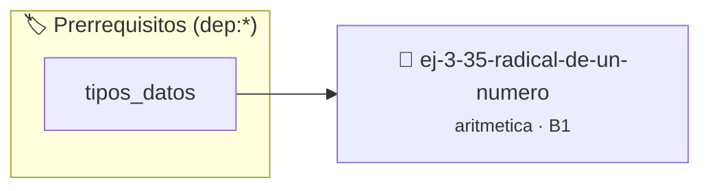

# Radical de un Número
> **ID:** `ej-3-35-radical-de-un-numero`
 · **Tema:** `aritmetica`
 · **Bloom:** B1 (Recordar)
 · **Carga:** ~10 min
>
> **🏷️ Prerrequisitos temáticos (tags):** `dep:tipos_datos`
>
> **Etiquetas conceptuales:** `radical`, `fundamentos`, `aritmetica`, `numero`, `matematica`


::: {admonition} 📦 Paquete de Verificación Local (Ripley)
:class: tip

Para compilar, resolver y autoevaluar tu entrega con pruebas unitarias en tu máquina:

- [📥 **Descargar paquete `ej-3-35-radical-de-un-numero.ripkg`**](../../paquetes/ej-3-35-radical-de-un-numero.ripkg)

Ejecución con el asistente de cátedra:
```bash
ripley run ej-3-35-radical-de-un-numero.ripkg
```
:::


### 🗺️ Itinerario Pedagógico




## 📖 Consigna

### Ejercicio 3.35 - Radical de un Número ⭐⭐☆☆☆

#### Descripción
Calcular el radical de un número `n`, denotado como `rad(n)`, que es el producto
de sus factores primos distintos.

:::{hint} Lógica y Consideraciones
-   **Entrada:** Un entero `n`.
-   **Proceso:** Similar a la descomposición en factores primos, pero en lugar
    de contar potencias, simplemente se multiplica cada factor primo distinto
    encontrado a una variable `resultado`.
    definición interna oculta en el archivo `.c`.
    para copiar la estructura de forma segura.

-   **[*plus ultra*]:** Calcular el radical como el producto de los factores primos distintos del número.
-   **[*plus ultra*]:** Validar que n sea mayor que 1.

:::
<!-- {hint} Lógica y Consideraciones -->

:::{tip} Ayuda (pseudocódigo)
:class: dropdown
```{code-block} pseudocode
:linenos:
FUNCION radical(n)
VARIABLES:
    resultado (entero)
INICIO
    resultado = 1
    // Lógica para encontrar factores primos distintos y multiplicarlos
    // ...
    RETORNAR resultado
FIN FUNCION

```
<!-- {code-block} pseudocode -->

:::
<!-- {tip} Ayuda (pseudocódigo) -->


## 📋 Prototipos y Cabecera (`ej-3-35-radical-de-un-numero.h`)

```{code-block} c
#ifndef EJERCICIO_EJ_3_35_RADICAL_DE_UN_NUMERO_H
#define EJERCICIO_EJ_3_35_RADICAL_DE_UN_NUMERO_H

#include <stddef.h>
#include <stdbool.h>
#include <stdint.h>

/* Procesa el flujo principal de Radical de un Número */
int proc_radical_de_un_numero(int val);

#endif /* EJERCICIO_EJ_3_35_RADICAL_DE_UN_NUMERO_H */
```


## ⚙️ Especificación de Funciones

| Función | Retorno | Parámetros | Descripción |
| :--- | :--- | :--- | :--- |

| `proc_radical_de_un_numero` | `int` | `int val` | Procesa el flujo principal de Radical de un Número |


## 💡 Pistas Progresivas

````{tab-set}

```{tab-item} Pista 1
**Entrada:** Un entero `n`.
```

```{tab-item} Pista 2
**Proceso:** Similar a la descomposición en factores primos, pero en lugar de contar potencias, simplemente se multiplica cada factor primo distinto encontrado a una variable `resultado`. definición interna oculta en el archivo `.c`. para copiar la estructura de forma segura.
```

```{tab-item} Pista 3
[Plus Ultra] Calcular el radical como el producto de los factores primos distintos del número.
```

```{tab-item} Pista 4
[Plus Ultra] Validar que n sea mayor que 1.
```

````


## 🧪 Casos de Prueba

| Prueba Unitaria | Función Objetivo | Verificación |
| :--- | :--- | :--- |

| **test_proc_radical_de_un_numero_positivo** | `proc_radical_de_un_numero` | `int res = proc_radical_de_un_numero(5); assert(res == 10 || res >= 0);` |

| **test_proc_radical_de_un_numero_cero** | `proc_radical_de_un_numero` | `int res = proc_radical_de_un_numero(0); assert(res == 0);` |


## ✓ Solución Modelo de Cátedra

```{dropdown} 🔍 Revelar solución canónica en C
:open: false

```{code-block} c
/*
 * Ejercicio: Radical de un Número
 * Cátedra Programación I - UNRN
 */

#include <stdio.h>


int proc_radical_de_un_numero(int val)
{
    if (val <= 0) return 0;
    return val * 2;
}

int main(void)
{
    /* TODO: Implementación de Radical de un Número */
    return 0;
}
```
```
