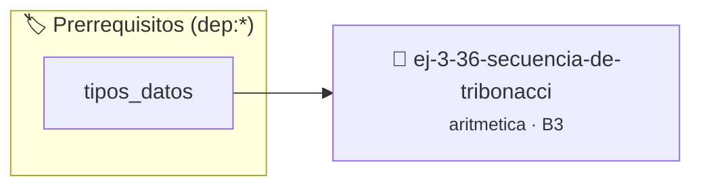

# Secuencia de Tribonacci
> **ID:** `ej-3-36-secuencia-de-tribonacci`
 · **Tema:** `aritmetica`
 · **Bloom:** B3 (Aplicar)
 · **Carga:** ~25 min
>
> **🏷️ Prerrequisitos temáticos (tags):** `dep:tipos_datos`
>
> **Etiquetas conceptuales:** `fundamentos`, `secuencia`, `tribonacci`, `aritmetica`, `matematica`


::: {admonition} 📦 Paquete de Verificación Local (Ripley)
:class: tip

Para compilar, resolver y autoevaluar tu entrega con pruebas unitarias en tu máquina:

- [📥 **Descargar paquete `ej-3-36-secuencia-de-tribonacci.ripkg`**](../../paquetes/ej-3-36-secuencia-de-tribonacci.ripkg)

Ejecución con el asistente de cátedra:
```bash
ripley run ej-3-36-secuencia-de-tribonacci.ripkg
```
:::


### 🗺️ Itinerario Pedagógico




## 📖 Consigna

### Ejercicio 3.36 - Secuencia de Tribonacci ⭐⭐☆☆☆

#### Descripción
Generar los primeros `n` términos de la secuencia de Tribonacci, donde cada
término es la suma de los tres anteriores. La secuencia puede comenzar de
diferentes formas, una común es `0, 1, 1, 2, 4, 7, 13, ...`

:::{hint} Lógica y Consideraciones
-   **Entrada:** Un entero `n`.
-   **Proceso:** Similar a Fibonacci, pero se necesitan tres variables para
    guardar los tres términos anteriores.
    valores fuera de rango o tipos inválidos.
    un lazo hasta que el usuario elija finalizar.

-   **[*plus ultra*]:** Usar un lazo iterativo manteniendo tres variables de estado para los términos previos.
-   **[*plus ultra*]:** Generar los primeros N términos de la secuencia de Tribonacci.

:::
<!-- {hint} Lógica y Consideraciones -->

:::{tip} Ayuda (pseudocódigo)
:class: dropdown
```{code-block} pseudocode
:linenos:
PROCEDIMIENTO tribonacci(n)
VARIABLES:
    a, b, c, siguiente (enteros)
INICIO
    a=0, b=1, c=1
    // Imprimir los primeros términos según n
    PARA i DESDE 4 HASTA n HACER
        siguiente = a + b + c
        ESCRIBIR siguiente
        a = b, b = c, c = siguiente
    FIN PARA
FIN PROCEDIMIENTO

```
<!-- {code-block} pseudocode -->

:::
<!-- {tip} Ayuda (pseudocódigo) -->


## 📋 Prototipos y Cabecera (`ej-3-36-secuencia-de-tribonacci.h`)

```{code-block} c
#ifndef EJERCICIO_EJ_3_36_SECUENCIA_DE_TRIBONACCI_H
#define EJERCICIO_EJ_3_36_SECUENCIA_DE_TRIBONACCI_H

#include <stddef.h>
#include <stdbool.h>
#include <stdint.h>

/* Procesa el flujo principal de Secuencia de Tribonacci */
int proc_uencia_de_tribonacci(int val);

#endif /* EJERCICIO_EJ_3_36_SECUENCIA_DE_TRIBONACCI_H */
```


## ⚙️ Especificación de Funciones

| Función | Retorno | Parámetros | Descripción |
| :--- | :--- | :--- | :--- |

| `proc_uencia_de_tribonacci` | `int` | `int val` | Procesa el flujo principal de Secuencia de Tribonacci |


## 💡 Pistas Progresivas

````{tab-set}

```{tab-item} Pista 1
**Entrada:** Un entero `n`.
```

```{tab-item} Pista 2
**Proceso:** Similar a Fibonacci, pero se necesitan tres variables para guardar los tres términos anteriores. valores fuera de rango o tipos inválidos. un lazo hasta que el usuario elija finalizar.
```

```{tab-item} Pista 3
[Plus Ultra] Usar un lazo iterativo manteniendo tres variables de estado para los términos previos.
```

```{tab-item} Pista 4
[Plus Ultra] Generar los primeros N términos de la secuencia de Tribonacci.
```

````


## 🧪 Casos de Prueba

| Prueba Unitaria | Función Objetivo | Verificación |
| :--- | :--- | :--- |

| **test_proc_uencia_de_tribonacci_positivo** | `proc_uencia_de_tribonacci` | `int res = proc_uencia_de_tribonacci(5); assert(res == 10 || res >= 0);` |

| **test_proc_uencia_de_tribonacci_cero** | `proc_uencia_de_tribonacci` | `int res = proc_uencia_de_tribonacci(0); assert(res == 0);` |


## ✓ Solución Modelo de Cátedra

```{dropdown} 🔍 Revelar solución canónica en C
:open: false

```{code-block} c
/*
 * Ejercicio: Secuencia de Tribonacci
 * Cátedra Programación I - UNRN
 */

#include <stdio.h>


int proc_uencia_de_tribonacci(int val)
{
    if (val <= 0) return 0;
    return val * 2;
}

int main(void)
{
    /* TODO: Implementación de Secuencia de Tribonacci */
    return 0;
}
```
```
