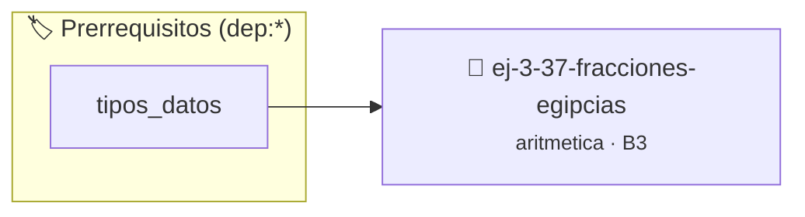

# Fracciones Egipcias
> **ID:** `ej-3-37-fracciones-egipcias` · **Unidad:** 1 (Fundamentos y Estructuras de Control)
 · **Tema:** `aritmetica` / `matematica`
 · **Bloom:** B3 (Aplicar) · **Dificultad:** Intermedia
 · **Carga:** ~25 min · **Tipo:** Practica Guiada
>
> **🏷️ Prerrequisitos temáticos (tags):** `dep:tipos_datos`
>
> **Etiquetas conceptuales:** `matematica`, `fundamentos`, `aritmetica`, `fracciones`, `egipcias`


::: {admonition} 📦 Paquete de Verificación Local (Ripley)
:class: tip

Para compilar, resolver y autoevaluar tu entrega con pruebas unitarias en tu máquina:

- [📥 **Descargar paquete `ej-3-37-fracciones-egipcias.ripkg`**](../../paquetes/ej-3-37-fracciones-egipcias.ripkg)

Ejecución con el asistente de cátedra:
```bash
ripley run ej-3-37-fracciones-egipcias.ripkg
```
:::


### 🗺️ Itinerario Pedagógico




## 📖 Consigna

#### Descripción
Escribir una función que descomponga una fracción propia `a/b` en una suma de
fracciones unitarias distintas (fracciones con numerador 1).


:::{tip} Ayuda (pseudocódigo)
:class: dropdown
```{code-block} pseudocode
:linenos:
PROCEDIMIENTO fracciones_egipcias(num, den)
INICIO
    MIENTRAS num != 0 HACER
        d = TECHO(den / num)
        ESCRIBIR "1/", d
        num = num * d - den
        den = den * d
        // Simplificar fracción num/den
    FIN MIENTRAS
    FIN PROCEDIMIENTO

```

:::

### 📋 Contrato de las Funciones

```c
/*
 * Procesa el flujo principal de Fracciones Egipcias
 * Precondiciones: val representa el parámetro de entrada del flujo.
 * Postcondiciones: Retorna el resultado correspondiente o 0 si val <= 0.
 */
int proc__fracciones_egipcias(int val);

```

### 🧪 Ejemplos de Ejecución

::::{tab-set}
:::{tab-item} Valor positivo
```text
Entrada: 5
Salida / Retorno: 10
```
:::
:::{tab-item} Valor cero o negativo
```text
Entrada: 0
Salida / Retorno: 0
```
:::
::::

### ⚠️ Precondiciones y Casos Borde

1. **Valores fuera de rango:** Verificar siempre que los datos de entrada cumplan con los rangos admisibles antes de operar.
6. **Casos vacíos o neutros:** Contemplar adecuadamente entradas con longitud cero o valores neutros según corresponda.

### 🎯 Criterios de Aceptación

- [ ] El código compila limpiamente bajo estándar C11 sin warnings con flags estrictos (`-Wall -Wextra -Werror`).
- [ ] Se satisfacen todas las pruebas unitarias y casos de prueba provistos.
- [ ] Las funciones validan exhaustivamente sus precondiciones y gestionan casos borde de forma robusta.

:::{hint} Consideraciones Didácticas
- **Algoritmo Greedy:** Un método común es encontrar repetidamente la fracción unitaria más grande que sea menor o igual a la fracción restante.
- **Proceso:**
- Dada la fracción `num/den`.
- Encontrar el denominador `d` de la siguiente fracción unitaria: `d = techo(den / num)`.
- Imprimir `1/d`.
- Actualizar la fracción restante: `num/den = num/den - 1/d`.
- Repetir hasta que `num` sea 0. error e informar el resultado mediante parámetros de salida. especificando precondiciones y postcondiciones.
- Validar que el numerador sea menor que el denominador (fracción propia positiva).
- Implementar el algoritmo voraz (greedy) de Fibonacci-Sylvester.
:::


## 📋 Prototipos y Cabecera (`ej-3-37-fracciones-egipcias.h`)

```{code-block} c
#ifndef EJERCICIO_EJ_3_37_FRACCIONES_EGIPCIAS_H
#define EJERCICIO_EJ_3_37_FRACCIONES_EGIPCIAS_H

#include <stddef.h>
#include <stdbool.h>
#include <stdint.h>

/* Procesa el flujo principal de Fracciones Egipcias */
int proc__fracciones_egipcias(int val);

#endif /* EJERCICIO_EJ_3_37_FRACCIONES_EGIPCIAS_H */
```


## ⚙️ Especificación de Funciones

| Función | Retorno | Parámetros | Descripción |
| :--- | :--- | :--- | :--- |

| `proc__fracciones_egipcias` | `int` | `int val` | Procesa el flujo principal de Fracciones Egipcias |


## 💡 Pistas Progresivas

````{tab-set}

```{tab-item} Pista 1
**Algoritmo Greedy:** Un método común es encontrar repetidamente la fracción unitaria más grande que sea menor o igual a la fracción restante.
```

```{tab-item} Pista 2
**Proceso:**
```

```{tab-item} Pista 3
Dada la fracción `num/den`.
```

```{tab-item} Pista 4
Encontrar el denominador `d` de la siguiente fracción unitaria: `d = techo(den / num)`.
```

```{tab-item} Pista 5
Imprimir `1/d`.
```

```{tab-item} Pista 6
Actualizar la fracción restante: `num/den = num/den - 1/d`.
```

```{tab-item} Pista 7
Repetir hasta que `num` sea 0. error e informar el resultado mediante parámetros de salida. especificando precondiciones y postcondiciones.
```

```{tab-item} Pista 8
[Plus Ultra] Validar que el numerador sea menor que el denominador (fracción propia positiva).
```

```{tab-item} Pista 9
[Plus Ultra] Implementar el algoritmo voraz (greedy) de Fibonacci-Sylvester.
```

````


## 🧪 Casos de Prueba

| Prueba Unitaria | Función Objetivo | Verificación |
| :--- | :--- | :--- |

| **test_proc__fracciones_egipcias_positivo** | `proc__fracciones_egipcias` | `int res = proc__fracciones_egipcias(5); assert(res == 10 || res >= 0);` |

| **test_proc__fracciones_egipcias_cero** | `proc__fracciones_egipcias` | `int res = proc__fracciones_egipcias(0); assert(res == 0);` |


## ✓ Solución Modelo de Cátedra

```{dropdown} 🔍 Revelar solución canónica en C
:open: false

```{code-block} c
/*
 * Ejercicio: Fracciones Egipcias
 * Cátedra Programación I - UNRN
 */

#include <stdio.h>


int proc__fracciones_egipcias(int val)
{
    if (val <= 0) return 0;
    return val * 2;
}

int main(void)
{
    /* TODO: Implementación de Fracciones Egipcias */
    return 0;
}
```
```
