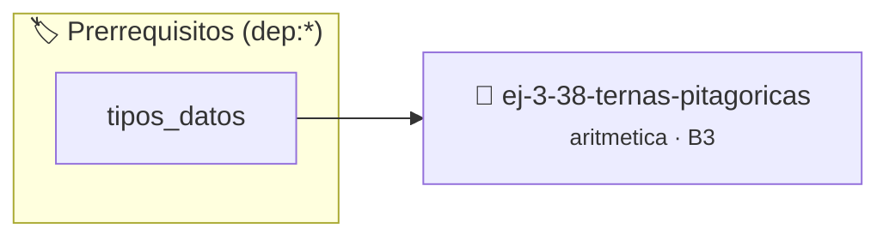

# Ternas Pitagóricas
> **ID:** `ej-3-38-ternas-pitagoricas` · **Unidad:** 1 (Fundamentos y Estructuras de Control)
 · **Tema:** `aritmetica` / `fundamentos`
 · **Bloom:** B3 (Aplicar) · **Dificultad:** Intermedia
 · **Carga:** ~25 min · **Tipo:** Practica Guiada
>
> **🏷️ Prerrequisitos temáticos (tags):** `dep:tipos_datos`
>
> **Etiquetas conceptuales:** `fundamentos`, `aritmetica`, `matematica`, `pitagoricas`, `ternas`


::: {admonition} 📦 Paquete de Verificación Local (Ripley)
:class: tip

Para compilar, resolver y autoevaluar tu entrega con pruebas unitarias en tu máquina:

- [📥 **Descargar paquete `ej-3-38-ternas-pitagoricas.ripkg`**](../../paquetes/ej-3-38-ternas-pitagoricas.ripkg)

Ejecución con el asistente de cátedra:
```bash
ripley run ej-3-38-ternas-pitagoricas.ripkg
```
:::


### 🗺️ Itinerario Pedagógico




## 📖 Consigna

### Ejercicio 3.38 - Ternas Pitagóricas ⭐⭐☆☆☆

#### Descripción
Implementar un programa que genere todas las ternas pitagóricas primitivas (`a^2
+ b^2 = c^2`, con `mcd(a,b,c)=1`) hasta un cierto límite para `c`, utilizando la
fórmula de Euclides.

:::{hint} Lógica y Consideraciones
-   **Fórmula de Euclides:** Todas las ternas primitivas se pueden generar a
    partir de dos enteros `m > n > 0`, coprimos y de paridad opuesta, usando las
    fórmulas:
    -   `a = m^2 - n^2`
    -   `b = 2mn`
    -   `c = m^2 + n^2`
-   **Proceso:** Iterar con `m` y `n` bajo las condiciones dadas y generar `a`,
    `b` y `c`.
    valores fuera de rango o tipos inválidos.
    un lazo hasta que el usuario elija finalizar.

-   **[*plus ultra*]:** Encontrar todas las ternas pitagóricas primitivas con hipotenusa menor a un valor dado.
-   **[*plus ultra*]:** Verificar que a² + b² == c² para cada terna encontrada.

:::
<!-- {hint} Lógica y Consideraciones -->

:::{tip} Ayuda (pseudocódigo)
:class: dropdown
```{code-block} pseudocode
:linenos:
PROCEDIMIENTO ternas_pitagoricas(limite_c)
INICIO
    PARA m DESDE 2 HASTA RAIZ_CUADRADA(limite_c) HACER
        PARA n DESDE 1 HASTA m-1 HACER
            SI (m - n) MOD 2 == 1 Y mcd(m, n) == 1 ENTONCES
                a = m*m - n*n
                b = 2*m*n
                c = m*m + n*n
                SI c <= limite_c ENTONCES
                    ESCRIBIR "(", a, ", ", b, ", ", c, ")"
                FIN SI
            FIN SI
        FIN PARA
    FIN PARA
FIN PROCEDIMIENTO

```
<!-- {code-block} pseudocode -->

:::
<!-- {tip} Ayuda (pseudocódigo) -->


## 📋 Prototipos y Cabecera (`ej-3-38-ternas-pitagoricas.h`)

```{code-block} c
#ifndef EJERCICIO_EJ_3_38_TERNAS_PITAGORICAS_H
#define EJERCICIO_EJ_3_38_TERNAS_PITAGORICAS_H

#include <stddef.h>
#include <stdbool.h>
#include <stdint.h>

/* Procesa el flujo principal de Ternas Pitagóricas */
int proc_8_ternas_pitagoricas(int val);

#endif /* EJERCICIO_EJ_3_38_TERNAS_PITAGORICAS_H */
```


## ⚙️ Especificación de Funciones

| Función | Retorno | Parámetros | Descripción |
| :--- | :--- | :--- | :--- |

| `proc_8_ternas_pitagoricas` | `int` | `int val` | Procesa el flujo principal de Ternas Pitagóricas |


## 💡 Pistas Progresivas

````{tab-set}

```{tab-item} Pista 1
**Fórmula de Euclides:** Todas las ternas primitivas se pueden generar a partir de dos enteros `m > n > 0`, coprimos y de paridad opuesta, usando las fórmulas:
```

```{tab-item} Pista 2
`a = m^2 - n^2`
```

```{tab-item} Pista 3
`b = 2mn`
```

```{tab-item} Pista 4
`c = m^2 + n^2`
```

```{tab-item} Pista 5
**Proceso:** Iterar con `m` y `n` bajo las condiciones dadas y generar `a`, `b` y `c`. valores fuera de rango o tipos inválidos. un lazo hasta que el usuario elija finalizar.
```

```{tab-item} Pista 6
[Plus Ultra] Encontrar todas las ternas pitagóricas primitivas con hipotenusa menor a un valor dado.
```

```{tab-item} Pista 7
[Plus Ultra] Verificar que a² + b² == c² para cada terna encontrada.
```

````


## 🧪 Casos de Prueba

| Prueba Unitaria | Función Objetivo | Verificación |
| :--- | :--- | :--- |

| **test_proc_8_ternas_pitagoricas_positivo** | `proc_8_ternas_pitagoricas` | `int res = proc_8_ternas_pitagoricas(5); assert(res == 10 || res >= 0);` |

| **test_proc_8_ternas_pitagoricas_cero** | `proc_8_ternas_pitagoricas` | `int res = proc_8_ternas_pitagoricas(0); assert(res == 0);` |


## ✓ Solución Modelo de Cátedra

```{dropdown} 🔍 Revelar solución canónica en C
:open: false

```{code-block} c
/*
 * Ejercicio: Ternas Pitagóricas
 * Cátedra Programación I - UNRN
 */

#include <stdio.h>


int proc_8_ternas_pitagoricas(int val)
{
    if (val <= 0) return 0;
    return val * 2;
}

int main(void)
{
    /* TODO: Implementación de Ternas Pitagóricas */
    return 0;
}
```
```
