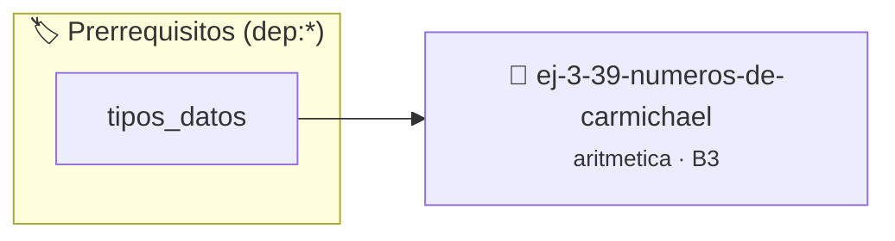

# Números de Carmichael
> **ID:** `ej-3-39-numeros-de-carmichael` · **Unidad:** 1 (Fundamentos y Estructuras de Control)
 · **Tema:** `aritmetica` / `fundamentos`
 · **Bloom:** B3 (Aplicar) · **Dificultad:** Intermedia
 · **Carga:** ~25 min · **Tipo:** Practica Guiada
>
> **🏷️ Prerrequisitos temáticos (tags):** `dep:tipos_datos`
>
> **Etiquetas conceptuales:** `fundamentos`, `aritmetica`, `numeros`, `matematica`, `carmichael`


::: {admonition} 📦 Paquete de Verificación Local (Ripley)
:class: tip

Para compilar, resolver y autoevaluar tu entrega con pruebas unitarias en tu máquina:

- [📥 **Descargar paquete `ej-3-39-numeros-de-carmichael.ripkg`**](../../paquetes/ej-3-39-numeros-de-carmichael.ripkg)

Ejecución con el asistente de cátedra:
```bash
ripley run ej-3-39-numeros-de-carmichael.ripkg
```
:::


### 🗺️ Itinerario Pedagógico




## 📖 Consigna

#### Descripción
Un número de Carmichael es un número que satisface la congruencia $b^{n-1}
\equiv 1 \pmod{n}$ para todos los enteros `b` coprimos con `n`. Escribir una
función que verifique si un número es un número de Carmichael.


:::{tip} Ayuda (pseudocódigo)
:class: dropdown
```{code-block} pseudocode
:linenos:
FUNCION es_carmichael(n)
INICIO
    SI es_primo(n) O n MOD 2 == 0 RETORNAR FALSO

    PARA b DESDE 2 HASTA n-1 HACER
        SI mcd(b, n) == 1 ENTONCES
            SI potencia_modular(b, n-1, n) != 1 ENTONCES
                RETORNAR FALSO
            FIN SI
        FIN SI
    FIN PARA
    RETORNAR VERDADERO
FIN FUNCION

```

:::

### 📋 Contrato de las Funciones

```c
/*
 * Procesa el flujo principal de Números de Carmichael
 * Precondiciones: val representa el parámetro de entrada del flujo.
 * Postcondiciones: Retorna el resultado correspondiente o 0 si val <= 0.
 */
int proc_umeros_de_carmichael(int val);

```

### 🧪 Ejemplos de Ejecución

::::{tab-set}
:::{tab-item} Valor positivo
```text
Entrada: 5
Salida / Retorno: 10
```
:::
:::{tab-item} Valor cero o negativo
```text
Entrada: 0
Salida / Retorno: 0
```
:::
::::

### ⚠️ Precondiciones y Casos Borde

1. **Valores fuera de rango:** Verificar siempre que los datos de entrada cumplan con los rangos admisibles antes de operar.
6. **Casos vacíos o neutros:** Contemplar adecuadamente entradas con longitud cero o valores neutros según corresponda.

### 🎯 Criterios de Aceptación

- [ ] El código compila limpiamente bajo estándar C11 sin warnings con flags estrictos (`-Wall -Wextra -Werror`).
- [ ] Se satisfacen todas las pruebas unitarias y casos de prueba provistos.
- [ ] Las funciones validan exhaustivamente sus precondiciones y gestionan casos borde de forma robusta.

:::{hint} Consideraciones Didácticas
- **Proceso:**
- Verificar si `n` es compuesto (no es primo).
- Iterar con `b` desde 2 hasta `n-1`.
- Si `mcd(b, n) == 1`, verificar si `potencia_modular(b, n-1, n) != 1`.
- Si se encuentra un `b` que no cumple la condición, `n` no es de Carmichael. Si se prueban todos y la cumplen, sí lo es. error e informar el resultado mediante parámetros de salida. especificando precondiciones y postcondiciones.
- Validar que el número sea compuesto y satisfaga a^(n-1) ≡ 1 (mod n) para todo a coprimo con n.
- Comprobar el criterio de Korselt para verificar números de Carmichael.
:::


## 📋 Prototipos y Cabecera (`ej-3-39-numeros-de-carmichael.h`)

```{code-block} c
#ifndef EJERCICIO_EJ_3_39_NUMEROS_DE_CARMICHAEL_H
#define EJERCICIO_EJ_3_39_NUMEROS_DE_CARMICHAEL_H

#include <stddef.h>
#include <stdbool.h>
#include <stdint.h>

/* Procesa el flujo principal de Números de Carmichael */
int proc_umeros_de_carmichael(int val);

#endif /* EJERCICIO_EJ_3_39_NUMEROS_DE_CARMICHAEL_H */
```


## ⚙️ Especificación de Funciones

| Función | Retorno | Parámetros | Descripción |
| :--- | :--- | :--- | :--- |

| `proc_umeros_de_carmichael` | `int` | `int val` | Procesa el flujo principal de Números de Carmichael |


## 💡 Pistas Progresivas

````{tab-set}

```{tab-item} Pista 1
**Proceso:**
```

```{tab-item} Pista 2
Verificar si `n` es compuesto (no es primo).
```

```{tab-item} Pista 3
Iterar con `b` desde 2 hasta `n-1`.
```

```{tab-item} Pista 4
Si `mcd(b, n) == 1`, verificar si `potencia_modular(b, n-1, n) != 1`.
```

```{tab-item} Pista 5
Si se encuentra un `b` que no cumple la condición, `n` no es de Carmichael. Si se prueban todos y la cumplen, sí lo es. error e informar el resultado mediante parámetros de salida. especificando precondiciones y postcondiciones.
```

```{tab-item} Pista 6
[Plus Ultra] Validar que el número sea compuesto y satisfaga a^(n-1) ≡ 1 (mod n) para todo a coprimo con n.
```

```{tab-item} Pista 7
[Plus Ultra] Comprobar el criterio de Korselt para verificar números de Carmichael.
```

````


## 🧪 Casos de Prueba

| Prueba Unitaria | Función Objetivo | Verificación |
| :--- | :--- | :--- |

| **test_proc_umeros_de_carmichael_positivo** | `proc_umeros_de_carmichael` | `int res = proc_umeros_de_carmichael(5); assert(res == 10 || res >= 0);` |

| **test_proc_umeros_de_carmichael_cero** | `proc_umeros_de_carmichael` | `int res = proc_umeros_de_carmichael(0); assert(res == 0);` |


## ✓ Solución Modelo de Cátedra

```{dropdown} 🔍 Revelar solución canónica en C
:open: false

```{code-block} c
/*
 * Ejercicio: Números de Carmichael
 * Cátedra Programación I - UNRN
 */

#include <stdio.h>


int proc_umeros_de_carmichael(int val)
{
    if (val <= 0) return 0;
    return val * 2;
}

int main(void)
{
    /* TODO: Implementación de Números de Carmichael */
    return 0;
}
```
```
