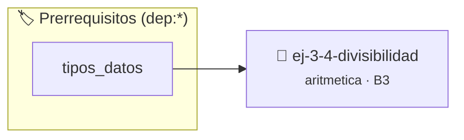

# Divisibilidad
> **ID:** `ej-3-4-divisibilidad` · **Unidad:** 1 (Fundamentos y Estructuras de Control)
 · **Tema:** `aritmetica` / `divisibilidad`
 · **Bloom:** B3 (Aplicar) · **Dificultad:** Intermedia
 · **Carga:** ~25 min · **Tipo:** Practica Guiada
>
> **🏷️ Prerrequisitos temáticos (tags):** `dep:tipos_datos`
>
> **Etiquetas conceptuales:** `aritmetica`, `divisibilidad`, `matematica`, `fundamentos`


::: {admonition} 📦 Paquete de Verificación Local (Ripley)
:class: tip

Para compilar, resolver y autoevaluar tu entrega con pruebas unitarias en tu máquina:

- [📥 **Descargar paquete `ej-3-4-divisibilidad.ripkg`**](../../paquetes/ej-3-4-divisibilidad.ripkg)

Ejecución con el asistente de cátedra:
```bash
ripley run ej-3-4-divisibilidad.ripkg
```
:::


### 🗺️ Itinerario Pedagógico




## 📖 Consigna

### Ejercicio 3.4 - Divisibilidad ⭐⭐☆☆☆

#### Descripción
Determinar si un número entero `a` es divisible de forma exacta por otro entero
`b`.

:::{hint} Lógica y Consideraciones
-   **Entrada:** Dos enteros, `a` y `b`.
-   **Proceso:** La divisibilidad se comprueba con el operador módulo (`%`). Si
    el resto de la división `a % b` es 0, entonces `a` es divisible por `b`.
-   **Caso Especial:** Asegurarse de que `b` no sea cero para evitar un error de
    división por cero.
    error e informar el resultado mediante parámetros de salida.
    especificando precondiciones y postcondiciones.

-   **[*plus ultra*]:** Manejar el caso especial de divisor cero informando error.
-   **[*plus ultra*]:** Implementar la verificación de divisibilidad por 2, 3, 5 y 10 usando reglas de dígitos.

:::
<!-- {hint} Lógica y Consideraciones -->

:::{tip} Ayuda (pseudocódigo)
:class: dropdown
```{code-block} pseudocode
:linenos:
FUNCION es_divisible(a, b)
INICIO
    SI b == 0 ENTONCES
        RETORNAR FALSO // O manejar como error
    FIN SI
    SI a MOD b == 0 ENTONCES
        RETORNAR VERDADERO
    SINO
        RETORNAR FALSO
    FIN SI
END FUNCION

```
<!-- {code-block} pseudocode -->

:::
<!-- {tip} Ayuda (pseudocódigo) -->


## 📋 Prototipos y Cabecera (`ej-3-4-divisibilidad.h`)

```{code-block} c
#ifndef EJERCICIO_EJ_3_4_DIVISIBILIDAD_H
#define EJERCICIO_EJ_3_4_DIVISIBILIDAD_H

#include <stddef.h>
#include <stdbool.h>
#include <stdint.h>

/* Procesa el flujo principal de Divisibilidad */
int ejecutar_ej_3_4_divisibilidad(int val);

#endif /* EJERCICIO_EJ_3_4_DIVISIBILIDAD_H */
```


## ⚙️ Especificación de Funciones

| Función | Retorno | Parámetros | Descripción |
| :--- | :--- | :--- | :--- |

| `ejecutar_ej_3_4_divisibilidad` | `int` | `int val` | Procesa el flujo principal de Divisibilidad |


## 💡 Pistas Progresivas

````{tab-set}

```{tab-item} Pista 1
**Entrada:** Dos enteros, `a` y `b`.
```

```{tab-item} Pista 2
**Proceso:** La divisibilidad se comprueba con el operador módulo (`%`). Si el resto de la división `a % b` es 0, entonces `a` es divisible por `b`.
```

```{tab-item} Pista 3
**Caso Especial:** Asegurarse de que `b` no sea cero para evitar un error de división por cero. error e informar el resultado mediante parámetros de salida. especificando precondiciones y postcondiciones.
```

```{tab-item} Pista 4
[Plus Ultra] Manejar el caso especial de divisor cero informando error.
```

```{tab-item} Pista 5
[Plus Ultra] Implementar la verificación de divisibilidad por 2, 3, 5 y 10 usando reglas de dígitos.
```

````


## 🧪 Casos de Prueba

| Prueba Unitaria | Función Objetivo | Verificación |
| :--- | :--- | :--- |

| **test_ejecutar_ej_3_4_divisibilidad_positivo** | `ejecutar_ej_3_4_divisibilidad` | `int res = ejecutar_ej_3_4_divisibilidad(5); assert(res == 10 || res >= 0);` |

| **test_ejecutar_ej_3_4_divisibilidad_cero** | `ejecutar_ej_3_4_divisibilidad` | `int res = ejecutar_ej_3_4_divisibilidad(0); assert(res == 0);` |


## ✓ Solución Modelo de Cátedra

```{dropdown} 🔍 Revelar solución canónica en C
:open: false

```{code-block} c
/*
 * Ejercicio: Divisibilidad
 * Cátedra Programación I - UNRN
 */

#include <stdio.h>


int ejecutar_ej_3_4_divisibilidad(int val)
{
    if (val <= 0) return 0;
    return val * 2;
}

int main(void)
{
    /* TODO: Implementación de Divisibilidad */
    return 0;
}
```
```
