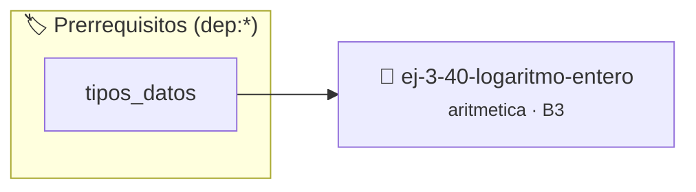

# Logaritmo Entero
> **ID:** `ej-3-40-logaritmo-entero`
 · **Tema:** `aritmetica`
 · **Bloom:** B3 (Aplicar)
 · **Carga:** ~25 min
>
> **🏷️ Prerrequisitos temáticos (tags):** `dep:tipos_datos`
>
> **Etiquetas conceptuales:** `fundamentos`, `aritmetica`, `entero`, `matematica`, `logaritmo`


::: {admonition} 📦 Paquete de Verificación Local (Ripley)
:class: tip

Para compilar, resolver y autoevaluar tu entrega con pruebas unitarias en tu máquina:

- [📥 **Descargar paquete `ej-3-40-logaritmo-entero.ripkg`**](../../paquetes/ej-3-40-logaritmo-entero.ripkg)

Ejecución con el asistente de cátedra:
```bash
ripley run ej-3-40-logaritmo-entero.ripkg
```
:::


### 🗺️ Itinerario Pedagógico




## 📖 Consigna

### Ejercicio 3.40 - Logaritmo Entero ⭐⭐☆☆☆

#### Descripción
Calcular el logaritmo entero en base `b` de un número `n`. Es el mayor entero
`k` tal que $b^k \le n$. La implementación no debe usar funciones de `math.h`.

:::{hint} Lógica y Consideraciones
-   **Proceso:** Se puede resolver con divisiones sucesivas.
    1.  Inicializar `k = 0`.
    2.  Mientras `n >= b`, dividir `n` por `b` e incrementar `k`.
    3.  El valor final de `k` es el resultado.
    definición interna oculta en el archivo `.c`.
    para copiar la estructura de forma segura.

-   **[*plus ultra*]:** Validar que el argumento sea estrictamente positivo y la base mayor que 1.
-   **[*plus ultra*]:** Calcular el logaritmo entero mediante divisiones sucesivas en un lazo.

:::
<!-- {hint} Lógica y Consideraciones -->

:::{tip} Ayuda (pseudocódigo)
:class: dropdown
```{code-block} pseudocode
:linenos:
FUNCION logaritmo_entero(n, b)
VARIABLES:
    k (entero)
INICIO
    k = 0
    MIENTRAS n >= b HACER
        n = n / b
        k = k + 1
    FIN MIENTRAS
    RETORNAR k
FIN FUNCION

```
<!-- {code-block} pseudocode -->

:::
<!-- {tip} Ayuda (pseudocódigo) -->


## 📋 Prototipos y Cabecera (`ej-3-40-logaritmo-entero.h`)

```{code-block} c
#ifndef EJERCICIO_EJ_3_40_LOGARITMO_ENTERO_H
#define EJERCICIO_EJ_3_40_LOGARITMO_ENTERO_H

#include <stddef.h>
#include <stdbool.h>
#include <stdint.h>

/* Procesa el flujo principal de Logaritmo Entero */
int proc__40_logaritmo_entero(int val);

#endif /* EJERCICIO_EJ_3_40_LOGARITMO_ENTERO_H */
```


## ⚙️ Especificación de Funciones

| Función | Retorno | Parámetros | Descripción |
| :--- | :--- | :--- | :--- |

| `proc__40_logaritmo_entero` | `int` | `int val` | Procesa el flujo principal de Logaritmo Entero |


## 💡 Pistas Progresivas

````{tab-set}

```{tab-item} Pista 1
**Proceso:** Se puede resolver con divisiones sucesivas.
```

```{tab-item} Pista 2
Inicializar `k = 0`.
```

```{tab-item} Pista 3
Mientras `n >= b`, dividir `n` por `b` e incrementar `k`.
```

```{tab-item} Pista 4
El valor final de `k` es el resultado. definición interna oculta en el archivo `.c`. para copiar la estructura de forma segura.
```

```{tab-item} Pista 5
[Plus Ultra] Validar que el argumento sea estrictamente positivo y la base mayor que 1.
```

```{tab-item} Pista 6
[Plus Ultra] Calcular el logaritmo entero mediante divisiones sucesivas en un lazo.
```

````


## 🧪 Casos de Prueba

| Prueba Unitaria | Función Objetivo | Verificación |
| :--- | :--- | :--- |

| **test_proc__40_logaritmo_entero_positivo** | `proc__40_logaritmo_entero` | `int res = proc__40_logaritmo_entero(5); assert(res == 10 || res >= 0);` |

| **test_proc__40_logaritmo_entero_cero** | `proc__40_logaritmo_entero` | `int res = proc__40_logaritmo_entero(0); assert(res == 0);` |


## ✓ Solución Modelo de Cátedra

```{dropdown} 🔍 Revelar solución canónica en C
:open: false

```{code-block} c
/*
 * Ejercicio: Logaritmo Entero
 * Cátedra Programación I - UNRN
 */

#include <stdio.h>


int proc__40_logaritmo_entero(int val)
{
    if (val <= 0) return 0;
    return val * 2;
}

int main(void)
{
    /* TODO: Implementación de Logaritmo Entero */
    return 0;
}
```
```
