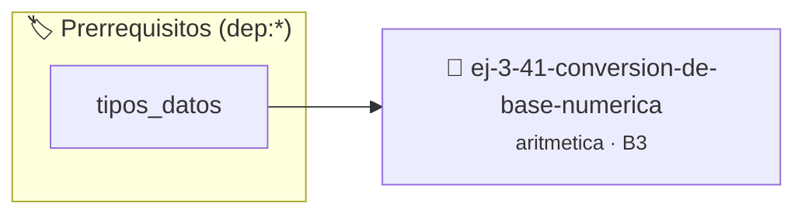

# Conversión de Base Numérica
> **ID:** `ej-3-41-conversion-de-base-numerica`
 · **Tema:** `aritmetica`
 · **Bloom:** B3 (Aplicar)
 · **Carga:** ~25 min
>
> **🏷️ Prerrequisitos temáticos (tags):** `dep:tipos_datos`
>
> **Etiquetas conceptuales:** `fundamentos`, `conversion`, `numerica`, `aritmetica`, `matematica`


::: {admonition} 📦 Paquete de Verificación Local (Ripley)
:class: tip

Para compilar, resolver y autoevaluar tu entrega con pruebas unitarias en tu máquina:

- [📥 **Descargar paquete `ej-3-41-conversion-de-base-numerica.ripkg`**](../../paquetes/ej-3-41-conversion-de-base-numerica.ripkg)

Ejecución con el asistente de cátedra:
```bash
ripley run ej-3-41-conversion-de-base-numerica.ripkg
```
:::


### 🗺️ Itinerario Pedagógico




## 📖 Consigna

### Ejercicio 3.41 - Conversión de Base Numérica ⭐⭐☆☆☆

#### Descripción
Escribir una función que convierta un número `n` de una base `b1` a una base
`b2`.

:::{hint} Lógica y Consideraciones
-   **Proceso en dos pasos:** El método más simple es:
    1.  **Convertir a base 10:** Convertir el número de su base original `b1` a
        base 10. Si el número está en un arreglo de dígitos, se calcula $\sum
        digito_i \cdot b1^i$.
    2.  **Convertir de base 10:** Convertir el número de base 10 a la base de
        destino `b2` usando divisiones sucesivas y guardando los restos.
    filas (*row-major order*) para mejorar el uso de caché.
    estrictamente dentro de los límites del contenedor.

-   **[*plus ultra*]:** Validar que la base de destino esté entre 2 y 16.
-   **[*plus ultra*]:** Formatear la salida con dígitos alfanuméricos apropiados (0-9, A-F).

:::
<!-- {hint} Lógica y Consideraciones -->

:::{tip} Ayuda (pseudocódigo)
:class: dropdown
```{code-block} pseudocode
:linenos:
FUNCION convertir_base(numero_original, b1, b2)
INICIO
    // Paso 1: Convertir de b1 a base 10
    valor_base10 = 0
    // ... lazo para calcular el valor en base 10 ...

    // Paso 2: Convertir de base 10 a b2
    resultado_final = ""
    MIENTRAS valor_base10 > 0 HACER
        resto = valor_base10 MOD b2
        resultado_final = caracter(resto) + resultado_final
        valor_base10 = valor_base10 / b2
    FIN MIENTRAS

    RETORNAR resultado_final
FIN FUNCION

```
<!-- {code-block} pseudocode -->

:::
<!-- {tip} Ayuda (pseudocódigo) -->


## 📋 Prototipos y Cabecera (`ej-3-41-conversion-de-base-numerica.h`)

```{code-block} c
#ifndef EJERCICIO_EJ_3_41_CONVERSION_DE_BASE_NUMERICA_H
#define EJERCICIO_EJ_3_41_CONVERSION_DE_BASE_NUMERICA_H

#include <stddef.h>
#include <stdbool.h>
#include <stdint.h>

/* Procesa el flujo principal de Conversión de Base Numérica */
int proc_ion_de_base_numerica(int val);

#endif /* EJERCICIO_EJ_3_41_CONVERSION_DE_BASE_NUMERICA_H */
```


## ⚙️ Especificación de Funciones

| Función | Retorno | Parámetros | Descripción |
| :--- | :--- | :--- | :--- |

| `proc_ion_de_base_numerica` | `int` | `int val` | Procesa el flujo principal de Conversión de Base Numérica |


## 💡 Pistas Progresivas

````{tab-set}

```{tab-item} Pista 1
**Proceso en dos pasos:** El método más simple es:
```

```{tab-item} Pista 2
**Convertir a base 10:** Convertir el número de su base original `b1` a base 10. Si el número está en un arreglo de dígitos, se calcula $\sum digito_i \cdot b1^i$.
```

```{tab-item} Pista 3
**Convertir de base 10:** Convertir el número de base 10 a la base de destino `b2` usando divisiones sucesivas y guardando los restos. filas (*row-major order*) para mejorar el uso de caché. estrictamente dentro de los límites del contenedor.
```

```{tab-item} Pista 4
[Plus Ultra] Validar que la base de destino esté entre 2 y 16.
```

```{tab-item} Pista 5
[Plus Ultra] Formatear la salida con dígitos alfanuméricos apropiados (0-9, A-F).
```

````


## 🧪 Casos de Prueba

| Prueba Unitaria | Función Objetivo | Verificación |
| :--- | :--- | :--- |

| **test_proc_ion_de_base_numerica_positivo** | `proc_ion_de_base_numerica` | `int res = proc_ion_de_base_numerica(5); assert(res == 10 || res >= 0);` |

| **test_proc_ion_de_base_numerica_cero** | `proc_ion_de_base_numerica` | `int res = proc_ion_de_base_numerica(0); assert(res == 0);` |


## ✓ Solución Modelo de Cátedra

```{dropdown} 🔍 Revelar solución canónica en C
:open: false

```{code-block} c
/*
 * Ejercicio: Conversión de Base Numérica
 * Cátedra Programación I - UNRN
 */

#include <stdio.h>


int proc_ion_de_base_numerica(int val)
{
    if (val <= 0) return 0;
    return val * 2;
}

int main(void)
{
    /* TODO: Implementación de Conversión de Base Numérica */
    return 0;
}
```
```
