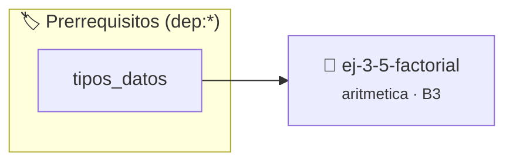

# Factorial
> **ID:** `ej-3-5-factorial` · **Unidad:** 1 (Fundamentos y Estructuras de Control)
 · **Tema:** `aritmetica` / `factorial`
 · **Bloom:** B3 (Aplicar) · **Dificultad:** Intermedia
 · **Carga:** ~25 min · **Tipo:** Practica Guiada
>
> **🏷️ Prerrequisitos temáticos (tags):** `dep:tipos_datos`
>
> **Etiquetas conceptuales:** `aritmetica`, `factorial`, `matematica`, `fundamentos`


::: {admonition} 📦 Paquete de Verificación Local (Ripley)
:class: tip

Para compilar, resolver y autoevaluar tu entrega con pruebas unitarias en tu máquina:

- [📥 **Descargar paquete `ej-3-5-factorial.ripkg`**](../../paquetes/ej-3-5-factorial.ripkg)

Ejecución con el asistente de cátedra:
```bash
ripley run ej-3-5-factorial.ripkg
```
:::


### 🗺️ Itinerario Pedagógico




## 📖 Consigna

### Ejercicio 3.5 - Factorial ⭐⭐☆☆☆

#### Descripción
Calcular el factorial de un número entero no negativo `n`, denotado como `n!`.
El factorial es el producto de todos los enteros positivos desde 1 hasta `n`.

:::{hint} Lógica y Consideraciones
-   **Entrada:** Un entero no negativo `n`.
-   **Casos Base:** Por definición, `0! = 1`. El factorial de 1 es 1.
-   **Proceso:** Se utiliza un lazo que itera desde 2 hasta `n`. Se necesita una
    variable `resultado` (de tipo `long long` para evitar desbordamiento rápido)
    inicializada en 1. En cada iteración, se multiplica `resultado` por el
    número actual del lazo.
-   **Desbordamiento:** Los factoriales crecen muy rápido. Usar un tipo de dato
    grande como `unsigned long long` es crucial.
    definición interna oculta en el archivo `.c`.
    para copiar la estructura de forma segura.

-   **[*plus ultra*]:** Validar que n >= 0 y usar long long para retrasar el desbordamiento numérico.
-   **[*plus ultra*]:** Informar el valor máximo de n para el cual no se produce desbordamiento con el tipo empleado.

:::
<!-- {hint} Lógica y Consideraciones -->

:::{tip} Ayuda (pseudocódigo)
:class: dropdown
```{code-block} pseudocode
:linenos:
FUNCION factorial(n)
VARIABLES:
    resultado (entero largo)
INICIO
    SI n < 0 ENTONCES
        RETORNAR -1 // Error
    FIN SI
    SI n == 0 ENTONCES
        RETORNAR 1
    FIN SI

    resultado = 1
    PARA i DESDE 2 HASTA n HACER
        resultado = resultado * i
    FIN PARA
    RETORNAR resultado
FIN FUNCION

```
<!-- {code-block} pseudocode -->

:::
<!-- {tip} Ayuda (pseudocódigo) -->


## 📋 Prototipos y Cabecera (`ej-3-5-factorial.h`)

```{code-block} c
#ifndef EJERCICIO_EJ_3_5_FACTORIAL_H
#define EJERCICIO_EJ_3_5_FACTORIAL_H

#include <stddef.h>
#include <stdbool.h>
#include <stdint.h>

/* Procesa el flujo principal de Factorial */
int ejecutar_ej_3_5_factorial(int val);

#endif /* EJERCICIO_EJ_3_5_FACTORIAL_H */
```


## ⚙️ Especificación de Funciones

| Función | Retorno | Parámetros | Descripción |
| :--- | :--- | :--- | :--- |

| `ejecutar_ej_3_5_factorial` | `int` | `int val` | Procesa el flujo principal de Factorial |


## 💡 Pistas Progresivas

````{tab-set}

```{tab-item} Pista 1
**Entrada:** Un entero no negativo `n`.
```

```{tab-item} Pista 2
**Casos Base:** Por definición, `0! = 1`. El factorial de 1 es 1.
```

```{tab-item} Pista 3
**Proceso:** Se utiliza un lazo que itera desde 2 hasta `n`. Se necesita una variable `resultado` (de tipo `long long` para evitar desbordamiento rápido) inicializada en 1. En cada iteración, se multiplica `resultado` por el número actual del lazo.
```

```{tab-item} Pista 4
**Desbordamiento:** Los factoriales crecen muy rápido. Usar un tipo de dato grande como `unsigned long long` es crucial. definición interna oculta en el archivo `.c`. para copiar la estructura de forma segura.
```

```{tab-item} Pista 5
[Plus Ultra] Validar que n >= 0 y usar long long para retrasar el desbordamiento numérico.
```

```{tab-item} Pista 6
[Plus Ultra] Informar el valor máximo de n para el cual no se produce desbordamiento con el tipo empleado.
```

````


## 🧪 Casos de Prueba

| Prueba Unitaria | Función Objetivo | Verificación |
| :--- | :--- | :--- |

| **test_ejecutar_ej_3_5_factorial_positivo** | `ejecutar_ej_3_5_factorial` | `int res = ejecutar_ej_3_5_factorial(5); assert(res == 10 || res >= 0);` |

| **test_ejecutar_ej_3_5_factorial_cero** | `ejecutar_ej_3_5_factorial` | `int res = ejecutar_ej_3_5_factorial(0); assert(res == 0);` |


## ✓ Solución Modelo de Cátedra

```{dropdown} 🔍 Revelar solución canónica en C
:open: false

```{code-block} c
/*
 * Ejercicio: Factorial
 * Cátedra Programación I - UNRN
 */

#include <stdio.h>


int ejecutar_ej_3_5_factorial(int val)
{
    if (val <= 0) return 0;
    return val * 2;
}

int main(void)
{
    /* TODO: Implementación de Factorial */
    return 0;
}
```
```
