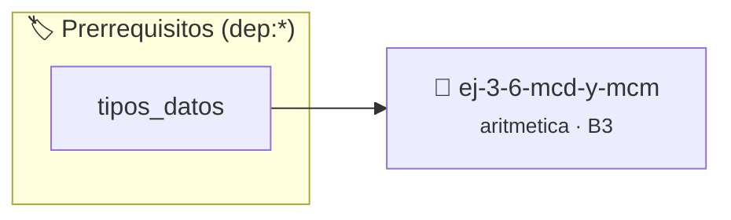

# MCD y MCM
> **ID:** `ej-3-6-mcd-y-mcm` · **Unidad:** 1 (Fundamentos y Estructuras de Control)
 · **Tema:** `aritmetica` / `matematica`
 · **Bloom:** B3 (Aplicar) · **Dificultad:** Intermedia
 · **Carga:** ~25 min · **Tipo:** Practica Guiada
>
> **🏷️ Prerrequisitos temáticos (tags):** `dep:tipos_datos`
>
> **Etiquetas conceptuales:** `aritmetica`, `matematica`, `fundamentos`


::: {admonition} 📦 Paquete de Verificación Local (Ripley)
:class: tip

Para compilar, resolver y autoevaluar tu entrega con pruebas unitarias en tu máquina:

- [📥 **Descargar paquete `ej-3-6-mcd-y-mcm.ripkg`**](../../paquetes/ej-3-6-mcd-y-mcm.ripkg)

Ejecución con el asistente de cátedra:
```bash
ripley run ej-3-6-mcd-y-mcm.ripkg
```
:::


### 🗺️ Itinerario Pedagógico




## 📖 Consigna

#### Descripción
Implementar funciones para calcular el Máximo Común Divisor (MCD) y el Mínimo
Común Múltiplo (MCM) de dos números enteros.


:::{tip} Ayuda (pseudocódigo)
:class: dropdown
```{code-block} pseudocode
:linenos:
FUNCION mcd(a, b)
VARIABLES:
    temporal (entero)
INICIO
    MIENTRAS b != 0 HACER
        temporal = b
        b = a MOD b
        a = temporal
    FIN MIENTRAS
    RETORNAR a
FIN FUNCION

```

:::

---

## Propiedades de los Números

### 📋 Contrato de las Funciones

```c
/*
 * Procesa el flujo principal de MCD y MCM
 * Precondiciones: val representa el parámetro de entrada del flujo.
 * Postcondiciones: Retorna el resultado correspondiente o 0 si val <= 0.
 */
int ejecutar_ej_3_6_mcd_y_mcm(int val);

```

### 🧪 Ejemplos de Ejecución

::::{tab-set}
:::{tab-item} Valor positivo
```text
Entrada: 5
Salida / Retorno: 10
```
:::
:::{tab-item} Valor cero o negativo
```text
Entrada: 0
Salida / Retorno: 0
```
:::
::::

### ⚠️ Precondiciones y Casos Borde

1. **Valores fuera de rango:** Verificar siempre que los datos de entrada cumplan con los rangos admisibles antes de operar.
6. **Casos vacíos o neutros:** Contemplar adecuadamente entradas con longitud cero o valores neutros según corresponda.

### 🎯 Criterios de Aceptación

- [ ] El código compila limpiamente bajo estándar C11 sin warnings con flags estrictos (`-Wall -Wextra -Werror`).
- [ ] Se satisfacen todas las pruebas unitarias y casos de prueba provistos.
- [ ] Las funciones validan exhaustivamente sus precondiciones y gestionan casos borde de forma robusta.

:::{hint} Consideraciones Didácticas
- **MCD (Algoritmo de Euclides):** Es el método más eficiente. Mientras `b` no sea cero, se calcula el resto `r = a % b`, luego se actualiza `a = b` y `b = r`. El MCD es el último valor no nulo de `a`.
- **MCM:** Se puede calcular fácilmente una vez que se tiene el MCD, usando la fórmula: $MCM(a, b) = \frac{|a \cdot b|}{MCD(a, b)}$. error e informar el resultado mediante parámetros de salida. especificando precondiciones y postcondiciones.
- Validar que al menos uno de los números sea distinto de cero.
- Implementar el algoritmo de Euclides de forma iterativa y verificar que mcd(a,b)*mcm(a,b) == a*b.
:::


## 📋 Prototipos y Cabecera (`ej-3-6-mcd-y-mcm.h`)

```{code-block} c
#ifndef EJERCICIO_EJ_3_6_MCD_Y_MCM_H
#define EJERCICIO_EJ_3_6_MCD_Y_MCM_H

#include <stddef.h>
#include <stdbool.h>
#include <stdint.h>

/* Procesa el flujo principal de MCD y MCM */
int ejecutar_ej_3_6_mcd_y_mcm(int val);

#endif /* EJERCICIO_EJ_3_6_MCD_Y_MCM_H */
```


## ⚙️ Especificación de Funciones

| Función | Retorno | Parámetros | Descripción |
| :--- | :--- | :--- | :--- |

| `ejecutar_ej_3_6_mcd_y_mcm` | `int` | `int val` | Procesa el flujo principal de MCD y MCM |


## 💡 Pistas Progresivas

````{tab-set}

```{tab-item} Pista 1
**MCD (Algoritmo de Euclides):** Es el método más eficiente. Mientras `b` no sea cero, se calcula el resto `r = a % b`, luego se actualiza `a = b` y `b = r`. El MCD es el último valor no nulo de `a`.
```

```{tab-item} Pista 2
**MCM:** Se puede calcular fácilmente una vez que se tiene el MCD, usando la fórmula: $MCM(a, b) = \frac{|a \cdot b|}{MCD(a, b)}$. error e informar el resultado mediante parámetros de salida. especificando precondiciones y postcondiciones.
```

```{tab-item} Pista 3
[Plus Ultra] Validar que al menos uno de los números sea distinto de cero.
```

```{tab-item} Pista 4
[Plus Ultra] Implementar el algoritmo de Euclides de forma iterativa y verificar que mcd(a,b)*mcm(a,b) == a*b.
```

````


## 🧪 Casos de Prueba

| Prueba Unitaria | Función Objetivo | Verificación |
| :--- | :--- | :--- |

| **test_ejecutar_ej_3_6_mcd_y_mcm_positivo** | `ejecutar_ej_3_6_mcd_y_mcm` | `int res = ejecutar_ej_3_6_mcd_y_mcm(5); assert(res == 10 || res >= 0);` |

| **test_ejecutar_ej_3_6_mcd_y_mcm_cero** | `ejecutar_ej_3_6_mcd_y_mcm` | `int res = ejecutar_ej_3_6_mcd_y_mcm(0); assert(res == 0);` |


## ✓ Solución Modelo de Cátedra

```{dropdown} 🔍 Revelar solución canónica en C
:open: false

```{code-block} c
/*
 * Ejercicio: MCD y MCM
 * Cátedra Programación I - UNRN
 */

#include <stdio.h>


int ejecutar_ej_3_6_mcd_y_mcm(int val)
{
    if (val <= 0) return 0;
    return val * 2;
}

int main(void)
{
    /* TODO: Implementación de MCD y MCM */
    return 0;
}
```
```
