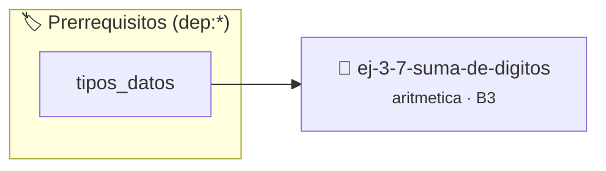

# Suma de dígitos
> **ID:** `ej-3-7-suma-de-digitos`
 · **Tema:** `aritmetica`
 · **Bloom:** B3 (Aplicar)
 · **Carga:** ~25 min
>
> **🏷️ Prerrequisitos temáticos (tags):** `dep:tipos_datos`
>
> **Etiquetas conceptuales:** `aritmetica`, `digitos`, `matematica`, `fundamentos`


::: {admonition} 📦 Paquete de Verificación Local (Ripley)
:class: tip

Para compilar, resolver y autoevaluar tu entrega con pruebas unitarias en tu máquina:

- [📥 **Descargar paquete `ej-3-7-suma-de-digitos.ripkg`**](../../paquetes/ej-3-7-suma-de-digitos.ripkg)

Ejecución con el asistente de cátedra:
```bash
ripley run ej-3-7-suma-de-digitos.ripkg
```
:::


### 🗺️ Itinerario Pedagógico




## 📖 Consigna

### Ejercicio 3.7 - Suma de dígitos ⭐⭐☆☆☆

#### Descripción
Calcular la suma de los dígitos individuales de un número entero positivo.

:::{hint} Lógica y Consideraciones
-   **Entrada:** Un entero positivo `n`.
-   **Proceso:** Se utiliza un lazo que se repite mientras `n` sea mayor que 0.
    1.  **Obtener último dígito:** `digito = n % 10`.
    2.  **Sumar dígito:** `suma = suma + digito`.
    3.  **Eliminar último dígito:** `n = n / 10` (división entera).
    error e informar el resultado mediante parámetros de salida.
    especificando precondiciones y postcondiciones.

-   **[*plus ultra*]:** Manejar números negativos considerando sus dígitos como positivos.
-   **[*plus ultra*]:** Repetir la suma de dígitos hasta obtener un valor de un solo dígito (raíz digital).

:::
<!-- {hint} Lógica y Consideraciones -->

:::{tip} Ayuda (pseudocódigo)
:class: dropdown
```{code-block} pseudocode
:linenos:
FUNCION sumar_digitos(n)
VARIABLES:
    suma (entero)
INICIO
    suma = 0
    MIENTRAS n > 0 HACER
        suma = suma + (n MOD 10)
        n = n / 10
    FIN MIENTRAS
    RETORNAR suma
FIN FUNCION

```
<!-- {code-block} pseudocode -->

:::
<!-- {tip} Ayuda (pseudocódigo) -->


## 📋 Prototipos y Cabecera (`ej-3-7-suma-de-digitos.h`)

```{code-block} c
#ifndef EJERCICIO_EJ_3_7_SUMA_DE_DIGITOS_H
#define EJERCICIO_EJ_3_7_SUMA_DE_DIGITOS_H

#include <stddef.h>
#include <stdbool.h>
#include <stdint.h>

/* Procesa el flujo principal de Suma de dígitos */
int proc__3_7_suma_de_digitos(int val);

#endif /* EJERCICIO_EJ_3_7_SUMA_DE_DIGITOS_H */
```


## ⚙️ Especificación de Funciones

| Función | Retorno | Parámetros | Descripción |
| :--- | :--- | :--- | :--- |

| `proc__3_7_suma_de_digitos` | `int` | `int val` | Procesa el flujo principal de Suma de dígitos |


## 💡 Pistas Progresivas

````{tab-set}

```{tab-item} Pista 1
**Entrada:** Un entero positivo `n`.
```

```{tab-item} Pista 2
**Proceso:** Se utiliza un lazo que se repite mientras `n` sea mayor que 0.
```

```{tab-item} Pista 3
**Obtener último dígito:** `digito = n % 10`.
```

```{tab-item} Pista 4
**Sumar dígito:** `suma = suma + digito`.
```

```{tab-item} Pista 5
**Eliminar último dígito:** `n = n / 10` (división entera). error e informar el resultado mediante parámetros de salida. especificando precondiciones y postcondiciones.
```

```{tab-item} Pista 6
[Plus Ultra] Manejar números negativos considerando sus dígitos como positivos.
```

```{tab-item} Pista 7
[Plus Ultra] Repetir la suma de dígitos hasta obtener un valor de un solo dígito (raíz digital).
```

````


## 🧪 Casos de Prueba

| Prueba Unitaria | Función Objetivo | Verificación |
| :--- | :--- | :--- |

| **test_proc__3_7_suma_de_digitos_positivo** | `proc__3_7_suma_de_digitos` | `int res = proc__3_7_suma_de_digitos(5); assert(res == 10 || res >= 0);` |

| **test_proc__3_7_suma_de_digitos_cero** | `proc__3_7_suma_de_digitos` | `int res = proc__3_7_suma_de_digitos(0); assert(res == 0);` |


## ✓ Solución Modelo de Cátedra

```{dropdown} 🔍 Revelar solución canónica en C
:open: false

```{code-block} c
/*
 * Ejercicio: Suma de dígitos
 * Cátedra Programación I - UNRN
 */

#include <stdio.h>


int proc__3_7_suma_de_digitos(int val)
{
    if (val <= 0) return 0;
    return val * 2;
}

int main(void)
{
    /* TODO: Implementación de Suma de dígitos */
    return 0;
}
```
```
