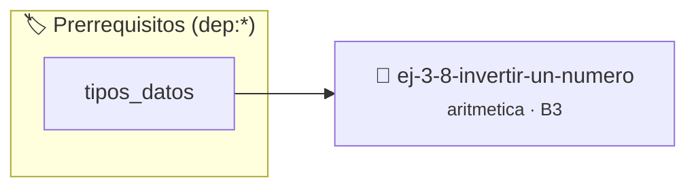

# Invertir un número
> **ID:** `ej-3-8-invertir-un-numero`
 · **Tema:** `aritmetica`
 · **Bloom:** B3 (Aplicar)
 · **Carga:** ~25 min
>
> **🏷️ Prerrequisitos temáticos (tags):** `dep:tipos_datos`
>
> **Etiquetas conceptuales:** `invertir`, `fundamentos`, `aritmetica`, `numero`, `matematica`


::: {admonition} 📦 Paquete de Verificación Local (Ripley)
:class: tip

Para compilar, resolver y autoevaluar tu entrega con pruebas unitarias en tu máquina:

- [📥 **Descargar paquete `ej-3-8-invertir-un-numero.ripkg`**](../../paquetes/ej-3-8-invertir-un-numero.ripkg)

Ejecución con el asistente de cátedra:
```bash
ripley run ej-3-8-invertir-un-numero.ripkg
```
:::


### 🗺️ Itinerario Pedagógico




## 📖 Consigna

### Ejercicio 3.8 - Invertir un número ⭐⭐☆☆☆

#### Descripción
Tomar un número entero y devolver otro número con sus dígitos en orden inverso.

:::{hint} Lógica y Consideraciones
-   **Entrada:** Un entero `n`.
-   **Proceso:** Similar a la suma de dígitos, pero en lugar de sumar, se
    construye un nuevo número.
    1.  Inicializar `invertido = 0`.
    2.  En un lazo, mientras `n > 0`:
        a. `invertido = (invertido * 10) + (n % 10)`.
        b. `n = n / 10`.
    desbordamientos de búfer validando la capacidad máxima.
    líneas de manera robusta.

-   **[*plus ultra*]:** Manejar adecuadamente números terminados en ceros.
-   **[*plus ultra*]:** Validar si el número invertido excede el rango máximo de un entero int.

:::
<!-- {hint} Lógica y Consideraciones -->

:::{tip} Ayuda (pseudocódigo)
:class: dropdown
```{code-block} pseudocode
:linenos:
FUNCION invertir_numero(n)
VARIABLES:
    invertido (entero)
INICIO
    invertido = 0
    MIENTRAS n > 0 HACER
        invertido = (invertido * 10) + (n MOD 10)
        n = n / 10
    FIN MIENTRAS
    RETORNAR invertido
FIN FUNCION

```
<!-- {code-block} pseudocode -->

:::
<!-- {tip} Ayuda (pseudocódigo) -->


## 📋 Prototipos y Cabecera (`ej-3-8-invertir-un-numero.h`)

```{code-block} c
#ifndef EJERCICIO_EJ_3_8_INVERTIR_UN_NUMERO_H
#define EJERCICIO_EJ_3_8_INVERTIR_UN_NUMERO_H

#include <stddef.h>
#include <stdbool.h>
#include <stdint.h>

/* Procesa el flujo principal de Invertir un número */
int proc_8_invertir_un_numero(int val);

#endif /* EJERCICIO_EJ_3_8_INVERTIR_UN_NUMERO_H */
```


## ⚙️ Especificación de Funciones

| Función | Retorno | Parámetros | Descripción |
| :--- | :--- | :--- | :--- |

| `proc_8_invertir_un_numero` | `int` | `int val` | Procesa el flujo principal de Invertir un número |


## 💡 Pistas Progresivas

````{tab-set}

```{tab-item} Pista 1
**Entrada:** Un entero `n`.
```

```{tab-item} Pista 2
**Proceso:** Similar a la suma de dígitos, pero en lugar de sumar, se construye un nuevo número.
```

```{tab-item} Pista 3
Inicializar `invertido = 0`.
```

```{tab-item} Pista 4
En un lazo, mientras `n > 0`: a. `invertido = (invertido * 10) + (n % 10)`. b. `n = n / 10`. desbordamientos de búfer validando la capacidad máxima. líneas de manera robusta.
```

```{tab-item} Pista 5
[Plus Ultra] Manejar adecuadamente números terminados en ceros.
```

```{tab-item} Pista 6
[Plus Ultra] Validar si el número invertido excede el rango máximo de un entero int.
```

````


## 🧪 Casos de Prueba

| Prueba Unitaria | Función Objetivo | Verificación |
| :--- | :--- | :--- |

| **test_proc_8_invertir_un_numero_positivo** | `proc_8_invertir_un_numero` | `int res = proc_8_invertir_un_numero(5); assert(res == 10 || res >= 0);` |

| **test_proc_8_invertir_un_numero_cero** | `proc_8_invertir_un_numero` | `int res = proc_8_invertir_un_numero(0); assert(res == 0);` |


## ✓ Solución Modelo de Cátedra

```{dropdown} 🔍 Revelar solución canónica en C
:open: false

```{code-block} c
/*
 * Ejercicio: Invertir un número
 * Cátedra Programación I - UNRN
 */

#include <stdio.h>


int proc_8_invertir_un_numero(int val)
{
    if (val <= 0) return 0;
    return val * 2;
}

int main(void)
{
    /* TODO: Implementación de Invertir un número */
    return 0;
}
```
```
