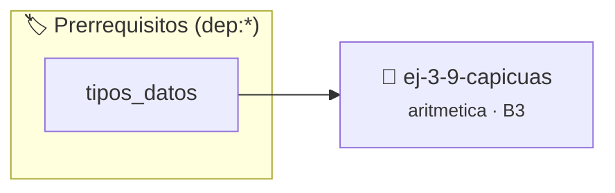

# Capicúas
> **ID:** `ej-3-9-capicuas` · **Unidad:** 1 (Fundamentos y Estructuras de Control)
 · **Tema:** `aritmetica` / `capicuas`
 · **Bloom:** B3 (Aplicar) · **Dificultad:** Intermedia
 · **Carga:** ~25 min · **Tipo:** Practica Guiada
>
> **🏷️ Prerrequisitos temáticos (tags):** `dep:tipos_datos`
>
> **Etiquetas conceptuales:** `aritmetica`, `capicuas`, `matematica`, `fundamentos`


::: {admonition} 📦 Paquete de Verificación Local (Ripley)
:class: tip

Para compilar, resolver y autoevaluar tu entrega con pruebas unitarias en tu máquina:

- [📥 **Descargar paquete `ej-3-9-capicuas.ripkg`**](../../paquetes/ej-3-9-capicuas.ripkg)

Ejecución con el asistente de cátedra:
```bash
ripley run ej-3-9-capicuas.ripkg
```
:::


### 🗺️ Itinerario Pedagógico




## 📖 Consigna

### Ejercicio 3.9 - Capicúas ⭐⭐⭐⭐☆

#### Descripción
Verificar si un número es capicúa (o palíndromo), es decir, si se lee igual de
izquierda a derecha que de derecha a izquierda.

:::{hint} Lógica y Consideraciones
-   **Entrada:** Un entero `n`.
-   **Proceso:** La forma más sencilla es utilizar la función del ejercicio
    anterior para invertir el número y luego comparar el número invertido con el
    original.
    error e informar el resultado mediante parámetros de salida.
    especificando precondiciones y postcondiciones.

-   **[*plus ultra*]:** Modularizar la verificación en una función bool es_capicua(long n).
-   **[*plus ultra*]:** Generar y mostrar todos los números capicúas dentro de un intervalo [a, b].

:::
<!-- {hint} Lógica y Consideraciones -->

:::{tip} Ayuda (pseudocódigo)
:class: dropdown
```{code-block} pseudocode
:linenos:
FUNCION es_capicua(n)
INICIO
    SI n == invertir_numero(n) ENTONCES
        RETORNAR VERDADERO
    SINO
        RETORNAR FALSO
    FIN SI
FIN FUNCION

```
<!-- {code-block} pseudocode -->

:::
<!-- {tip} Ayuda (pseudocódigo) -->


## 📋 Prototipos y Cabecera (`ej-3-9-capicuas.h`)

```{code-block} c
#ifndef EJERCICIO_EJ_3_9_CAPICUAS_H
#define EJERCICIO_EJ_3_9_CAPICUAS_H

#include <stddef.h>
#include <stdbool.h>
#include <stdint.h>

/* Procesa el flujo principal de Capicúas */
int ejecutar_ej_3_9_capicuas(int val);

#endif /* EJERCICIO_EJ_3_9_CAPICUAS_H */
```


## ⚙️ Especificación de Funciones

| Función | Retorno | Parámetros | Descripción |
| :--- | :--- | :--- | :--- |

| `ejecutar_ej_3_9_capicuas` | `int` | `int val` | Procesa el flujo principal de Capicúas |


## 💡 Pistas Progresivas

````{tab-set}

```{tab-item} Pista 1
**Entrada:** Un entero `n`.
```

```{tab-item} Pista 2
**Proceso:** La forma más sencilla es utilizar la función del ejercicio anterior para invertir el número y luego comparar el número invertido con el original. error e informar el resultado mediante parámetros de salida. especificando precondiciones y postcondiciones.
```

```{tab-item} Pista 3
[Plus Ultra] Modularizar la verificación en una función bool es_capicua(long n).
```

```{tab-item} Pista 4
[Plus Ultra] Generar y mostrar todos los números capicúas dentro de un intervalo [a, b].
```

````


## 🧪 Casos de Prueba

| Prueba Unitaria | Función Objetivo | Verificación |
| :--- | :--- | :--- |

| **test_ejecutar_ej_3_9_capicuas_positivo** | `ejecutar_ej_3_9_capicuas` | `int res = ejecutar_ej_3_9_capicuas(5); assert(res == 10 || res >= 0);` |

| **test_ejecutar_ej_3_9_capicuas_cero** | `ejecutar_ej_3_9_capicuas` | `int res = ejecutar_ej_3_9_capicuas(0); assert(res == 0);` |


## ✓ Solución Modelo de Cátedra

```{dropdown} 🔍 Revelar solución canónica en C
:open: false

```{code-block} c
/*
 * Ejercicio: Capicúas
 * Cátedra Programación I - UNRN
 */

#include <stdio.h>


int ejecutar_ej_3_9_capicuas(int val)
{
    if (val <= 0) return 0;
    return val * 2;
}

int main(void)
{
    /* TODO: Implementación de Capicúas */
    return 0;
}
```
```
