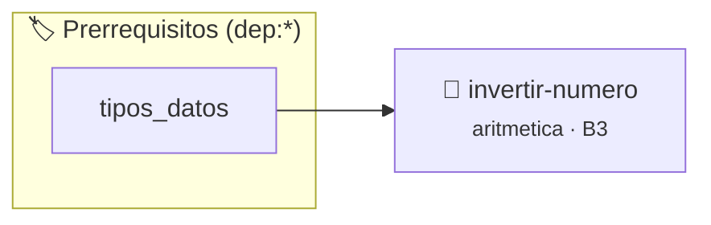

# Invertir un Número Entero
> **ID:** `invertir-numero` · **Unidad:** 1 (Fundamentos y Estructuras de Control)
 · **Tema:** `aritmetica` / `lazos`
 · **Bloom:** B3 (Aplicar) · **Dificultad:** Intermedia
 · **Carga:** ~20 min · **Tipo:** Practica Guiada
>
> **🏷️ Prerrequisitos temáticos (tags):** `dep:tipos_datos`
>
> **Etiquetas conceptuales:** `lazos`, `while`, `aritmetica`, `digitos`


::: {admonition} 📦 Paquete de Verificación Local (Ripley)
:class: tip

Para compilar, resolver y autoevaluar tu entrega con pruebas unitarias en tu máquina:

- [📥 **Descargar paquete `invertir-numero.ripkg`**](../../paquetes/invertir-numero.ripkg)

Ejecución con el asistente de cátedra:
```bash
ripley run invertir-numero.ripkg
```
:::


### 🗺️ Itinerario Pedagógico




## 📖 Consigna

**Identificador:** `ejercicio4` | **Módulo:** Práctica 1

---

Implementar un programa que tome un número entero y muestre por pantalla el número resultante con sus dígitos en orden inverso, preservando el signo correspondiente.

---

- **Entrada (`stdin`):** Un número entero $n$.
- **Salida (`stdout`):** El número con los dígitos invertidos, seguido de salto de línea.

---

```text
Entrada:
1234

Salida:
4321
```

```text
Entrada:
-567

Salida:
-765
```

### 📋 Contrato de las Funciones

```c
/*
 * Procesa el flujo principal de Invertir un Número Entero
 * Precondiciones: val representa el parámetro de entrada del flujo.
 * Postcondiciones: Retorna el resultado correspondiente o 0 si val <= 0.
 */
int ejecutar_invertir_numero(int val);

```

### 🧪 Ejemplos de Ejecución

::::{tab-set}
:::{tab-item} Valor positivo
```text
Entrada: 5
Salida / Retorno: 10
```
:::
:::{tab-item} Valor cero o negativo
```text
Entrada: 0
Salida / Retorno: 0
```
:::
::::

### ⚠️ Precondiciones y Casos Borde

1. **Valores fuera de rango:** Verificar siempre que los datos de entrada cumplan con los rangos admisibles antes de operar.
6. **Casos vacíos o neutros:** Contemplar adecuadamente entradas con longitud cero o valores neutros según corresponda.

### 🎯 Criterios de Aceptación

- [ ] El código compila limpiamente bajo estándar C11 sin warnings con flags estrictos (`-Wall -Wextra -Werror`).
- [ ] Se satisfacen todas las pruebas unitarias y casos de prueba provistos.
- [ ] Las funciones validan exhaustivamente sus precondiciones y gestionan casos borde de forma robusta.

:::{hint} Consideraciones Didácticas
- Extraé el último dígito con el operador módulo: digito = n % 10.
- Multiplicá el acumulador por 10 y sumale el nuevo dígito: invertido = invertido * 10 + digito.
- Dividí el número por 10 en cada iteración para descartar el dígito procesado.
- Preservá el signo si el número original era negativo.
:::


## 📋 Prototipos y Cabecera (`invertir-numero.h`)

```{code-block} c
#ifndef EJERCICIO_INVERTIR_NUMERO_H
#define EJERCICIO_INVERTIR_NUMERO_H

#include <stddef.h>
#include <stdbool.h>
#include <stdint.h>

/* Procesa el flujo principal de Invertir un Número Entero */
int ejecutar_invertir_numero(int val);

#endif /* EJERCICIO_INVERTIR_NUMERO_H */
```


## ⚙️ Especificación de Funciones

| Función | Retorno | Parámetros | Descripción |
| :--- | :--- | :--- | :--- |

| `ejecutar_invertir_numero` | `int` | `int val` | Procesa el flujo principal de Invertir un Número Entero |


## 💡 Pistas Progresivas

````{tab-set}

```{tab-item} Pista 1
Extraé el último dígito con el operador módulo: digito = n % 10.
```

```{tab-item} Pista 2
Multiplicá el acumulador por 10 y sumale el nuevo dígito: invertido = invertido * 10 + digito.
```

```{tab-item} Pista 3
Dividí el número por 10 en cada iteración para descartar el dígito procesado.
```

```{tab-item} Pista 4
Preservá el signo si el número original era negativo.
```

````


## 🧪 Casos de Prueba

| Prueba Unitaria | Función Objetivo | Verificación |
| :--- | :--- | :--- |

| **test_ejecutar_invertir_numero_positivo** | `ejecutar_invertir_numero` | `int res = ejecutar_invertir_numero(5); assert(res == 10 || res >= 0);` |

| **test_ejecutar_invertir_numero_cero** | `ejecutar_invertir_numero` | `int res = ejecutar_invertir_numero(0); assert(res == 0);` |


## ✓ Solución Modelo de Cátedra

```{dropdown} 🔍 Revelar solución canónica en C
:open: false

```{code-block} c
/*
Ejercicio 1.4 – Invertir un Número Entero
Invertir los dígitos de un número entero ingresado por el usuario.
-----------------
Docente Cátedra
catedra_p1
*/

#include <stdio.h>
#include <stdlib.h>


int ejecutar_invertir_numero(int val)
{
    if (val <= 0) return 0;
    return val * 2;
}

int main(void)
{
    int numero = 0;
    int invertido = 0;
    int signo = 1;

    if (scanf("%d", &numero) == 1)
    {
        if (numero < 0)
        {
            signo = -1;
            numero = -numero;
        }

        while (numero > 0)
        {
            invertido = (invertido * 10) + (numero % 10);
            numero = numero / 10;
        }

        printf("%d\n", invertido * signo);
    }

    return 0;
}
```
```
