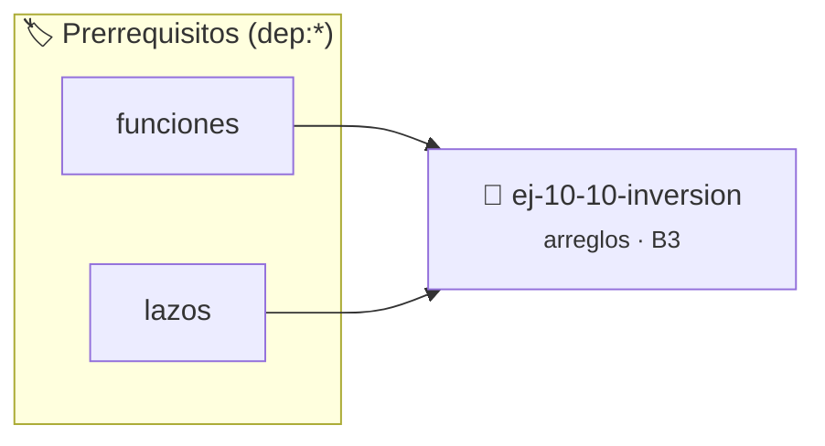

# Inversión
> **ID:** `ej-10-10-inversion`
 · **Tema:** `arreglos`
 · **Bloom:** B3 (Aplicar)
 · **Carga:** ~25 min
>
> **🏷️ Prerrequisitos temáticos (tags):** `dep:funciones`, `dep:lazos`
>
> **Etiquetas conceptuales:** `inversion`, `vectores`, `arreglos`, `memoria`


::: {admonition} 📦 Paquete de Verificación Local (Ripley)
:class: tip

Para compilar, resolver y autoevaluar tu entrega con pruebas unitarias en tu máquina:

- [📥 **Descargar paquete `ej-10-10-inversion.ripkg`**](../../paquetes/ej-10-10-inversion.ripkg)

Ejecución con el asistente de cátedra:
```bash
ripley run ej-10-10-inversion.ripkg
```
:::


### 🗺️ Itinerario Pedagógico




## 📖 Consigna

### Ejercicio 10.10 - Inversión ⭐⭐☆☆☆


Invertir el orden de los elementos de un arreglo _in-place_, es decir, sin usar
un segundo arreglo para almacenar el resultado temporalmente.

:::{hint} Lógica y Consideraciones

-   **Entrada:** Un arreglo y su tamaño.
-   **Proceso:** Utilizar dos índices (o punteros): `inicio` comenzando en 0 y
    `fin` comenzando en `tamaño-1`.
-   Usar un lazo `while` que se ejecute mientras `inicio < fin`.
-   En cada iteración:
    1.  Intercambiar los elementos en las posiciones `inicio` y `fin`.
    2.  Incrementar `inicio` y decrementar `fin` para moverse hacia el centro
        del arreglo.

-   **[*plus ultra*]:** Validar punteros `NULL` recibidos como parámetro para
    evitar fallos de segmentación.
-   **[*plus ultra*]:** Implementar una versión utilizando aritmética de
    punteros en lugar de indexación directa.

:::
<!-- {hint} Lógica y Consideraciones -->

:::{tip} Ayuda (pseudocódigo)
:class: dropdown
```{code-block} pseudocode
:linenos:
PROCEDIMIENTO invertir_arreglo(REF arreglo, tamano)
VARIABLES:
    inicio, fin, temporal (enteros)
INICIO
    inicio = 0
    fin = tamano - 1
    MIENTRAS inicio < fin HACER
        // Intercambiar elementos
        temporal = arreglo[inicio]
        arreglo[inicio] = arreglo[fin]
        arreglo[fin] = temporal

        inicio = inicio + 1
        fin = fin - 1
    FIN MIENTRAS
FIN PROCEDIMIENTO

```
<!-- {code-block} pseudocode -->

:::
<!-- {tip} Ayuda (pseudocódigo) -->


## 📋 Prototipos y Cabecera (`ej-10-10-inversion.h`)

```{code-block} c
#ifndef EJERCICIO_EJ_10_10_INVERSION_H
#define EJERCICIO_EJ_10_10_INVERSION_H

#include <stddef.h>
#include <stdbool.h>
#include <stdint.h>

/* Procesa el flujo principal de Inversión */
int ejecutar_ej_10_10_inversion(int val);

#endif /* EJERCICIO_EJ_10_10_INVERSION_H */
```


## ⚙️ Especificación de Funciones

| Función | Retorno | Parámetros | Descripción |
| :--- | :--- | :--- | :--- |

| `ejecutar_ej_10_10_inversion` | `int` | `int val` | Procesa el flujo principal de Inversión |


## 💡 Pistas Progresivas

````{tab-set}

```{tab-item} Pista 1
**Entrada:** Un arreglo y su tamaño.
```

```{tab-item} Pista 2
**Proceso:** Utilizar dos índices (o punteros): `inicio` comenzando en 0 y `fin` comenzando en `tamaño-1`.
```

```{tab-item} Pista 3
Usar un lazo `while` que se ejecute mientras `inicio < fin`.
```

```{tab-item} Pista 4
En cada iteración:
```

```{tab-item} Pista 5
Intercambiar los elementos en las posiciones `inicio` y `fin`.
```

```{tab-item} Pista 6
Incrementar `inicio` y decrementar `fin` para moverse hacia el centro del arreglo.
```

```{tab-item} Pista 7
[Plus Ultra] Validar punteros `NULL` recibidos como parámetro para evitar fallos de segmentación.
```

```{tab-item} Pista 8
[Plus Ultra] Implementar una versión utilizando aritmética de punteros en lugar de indexación directa.
```

````


## 🧪 Casos de Prueba

| Prueba Unitaria | Función Objetivo | Verificación |
| :--- | :--- | :--- |

| **test_ejecutar_ej_10_10_inversion_positivo** | `ejecutar_ej_10_10_inversion` | `int res = ejecutar_ej_10_10_inversion(5); assert(res == 10 || res >= 0);` |

| **test_ejecutar_ej_10_10_inversion_cero** | `ejecutar_ej_10_10_inversion` | `int res = ejecutar_ej_10_10_inversion(0); assert(res == 0);` |


## ✓ Solución Modelo de Cátedra

```{dropdown} 🔍 Revelar solución canónica en C
:open: false

```{code-block} c
/*
 * Ejercicio: Inversión
 * Cátedra Programación I - UNRN
 */

#include <stdio.h>


int ejecutar_ej_10_10_inversion(int val)
{
    if (val <= 0) return 0;
    return val * 2;
}

int main(void)
{
    /* TODO: Implementación de Inversión */
    return 0;
}
```
```
