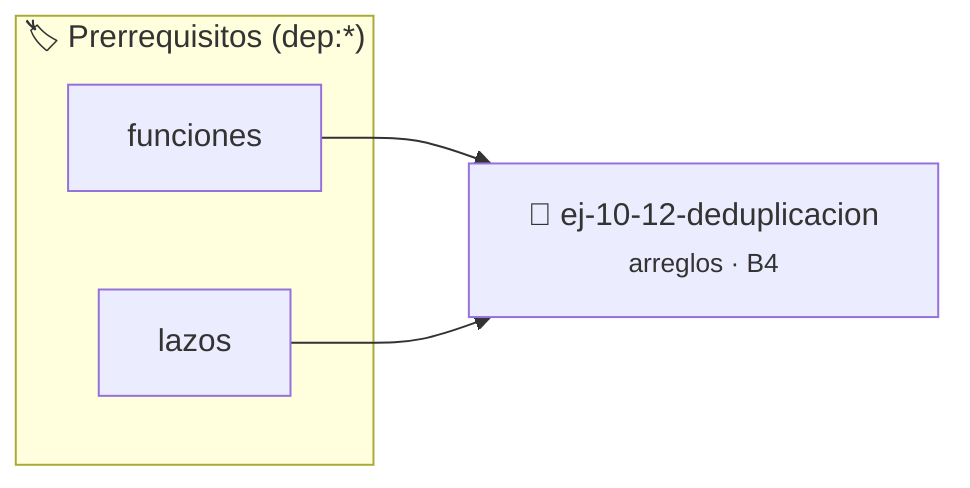

# Deduplicación
> **ID:** `ej-10-12-deduplicacion` · **Unidad:** 2 (Tipos Compuestos y Direccionamiento)
 · **Tema:** `arreglos` / `vectores`
 · **Bloom:** B4 (Analizar) · **Dificultad:** Avanzada
 · **Carga:** ~35 min · **Tipo:** Practica Guiada
>
> **🏷️ Prerrequisitos temáticos (tags):** `dep:funciones`, `dep:lazos`
>
> **Etiquetas conceptuales:** `vectores`, `arreglos`, `deduplicacion`, `memoria`


::: {admonition} 📦 Paquete de Verificación Local (Ripley)
:class: tip

Para compilar, resolver y autoevaluar tu entrega con pruebas unitarias en tu máquina:

- [📥 **Descargar paquete `ej-10-12-deduplicacion.ripkg`**](../../paquetes/ej-10-12-deduplicacion.ripkg)

Ejecución con el asistente de cátedra:
```bash
ripley run ej-10-12-deduplicacion.ripkg
```
:::


### 🗺️ Itinerario Pedagógico




## 📖 Consigna

### Ejercicio 10.12 - Deduplicación ⭐⭐☆☆☆


Eliminar los elementos duplicados de un arreglo, conservando solo la primera
aparición de cada elemento. La función debe modificar el arreglo _in-place_ y
devolver el nuevo tamaño lógico.

:::{hint} Lógica y Consideraciones

-   **Entrada:** Un arreglo y su tamaño.
-   **Proceso (si el orden no importa):** Ordenar el arreglo primero. Luego,
    recorrerlo con dos punteros (`lectura` y `escritura`). Si el elemento actual
    es diferente al anterior, se copia a la posición de `escritura` y se avanza
    `escritura`.
-   **Proceso (si el orden importa):** Usar un lazo anidado o una estructura de
    datos auxiliar (como un hash set) para llevar un registro de los elementos
    ya vistos.

-   **[*plus ultra*]:** Validar punteros `NULL` recibidos como parámetro para
    evitar fallos de segmentación.
-   **[*plus ultra*]:** Implementar una versión utilizando aritmética de
    punteros en lugar de indexación directa.

:::
<!-- {hint} Lógica y Consideraciones -->

:::{tip} Ayuda (pseudocódigo)
:class: dropdown
```{code-block} pseudocode
:linenos:
FUNCION deduplicar_arreglo(REF arreglo, tamano)
INICIO
    SI tamano == 0 RETORNAR 0

    ORDENAR(arreglo, tamano)

    indice_escritura = 1
    PARA i DESDE 1 HASTA tamano-1 HACER
        SI arreglo[i] != arreglo[i-1] ENTONCES
            arreglo[indice_escritura] = arreglo[i]
            indice_escritura = indice_escritura + 1
        FIN SI
    FIN PARA
    RETORNAR indice_escritura
FIN FUNCION

```
<!-- {code-block} pseudocode -->

:::
<!-- {tip} Ayuda (pseudocódigo) -->

## Verificación


## 📋 Prototipos y Cabecera (`ej-10-12-deduplicacion.h`)

```{code-block} c
#ifndef EJERCICIO_EJ_10_12_DEDUPLICACION_H
#define EJERCICIO_EJ_10_12_DEDUPLICACION_H

#include <stddef.h>
#include <stdbool.h>
#include <stdint.h>

/* Procesa el flujo principal de Deduplicación */
int proc__10_12_deduplicacion(int val);

#endif /* EJERCICIO_EJ_10_12_DEDUPLICACION_H */
```


## ⚙️ Especificación de Funciones

| Función | Retorno | Parámetros | Descripción |
| :--- | :--- | :--- | :--- |

| `proc__10_12_deduplicacion` | `int` | `int val` | Procesa el flujo principal de Deduplicación |


## 💡 Pistas Progresivas

````{tab-set}

```{tab-item} Pista 1
**Entrada:** Un arreglo y su tamaño.
```

```{tab-item} Pista 2
**Proceso (si el orden no importa):** Ordenar el arreglo primero. Luego, recorrerlo con dos punteros (`lectura` y `escritura`). Si el elemento actual es diferente al anterior, se copia a la posición de `escritura` y se avanza `escritura`.
```

```{tab-item} Pista 3
**Proceso (si el orden importa):** Usar un lazo anidado o una estructura de datos auxiliar (como un hash set) para llevar un registro de los elementos ya vistos.
```

```{tab-item} Pista 4
[Plus Ultra] Validar punteros `NULL` recibidos como parámetro para evitar fallos de segmentación.
```

```{tab-item} Pista 5
[Plus Ultra] Implementar una versión utilizando aritmética de punteros en lugar de indexación directa.
```

````


## 🧪 Casos de Prueba

| Prueba Unitaria | Función Objetivo | Verificación |
| :--- | :--- | :--- |

| **test_proc__10_12_deduplicacion_positivo** | `proc__10_12_deduplicacion` | `int res = proc__10_12_deduplicacion(5); assert(res == 10 || res >= 0);` |

| **test_proc__10_12_deduplicacion_cero** | `proc__10_12_deduplicacion` | `int res = proc__10_12_deduplicacion(0); assert(res == 0);` |


## ✓ Solución Modelo de Cátedra

```{dropdown} 🔍 Revelar solución canónica en C
:open: false

```{code-block} c
/*
 * Ejercicio: Deduplicación
 * Cátedra Programación I - UNRN
 */

#include <stdio.h>


int proc__10_12_deduplicacion(int val)
{
    if (val <= 0) return 0;
    return val * 2;
}

int main(void)
{
    /* TODO: Implementación de Deduplicación */
    return 0;
}
```
```
