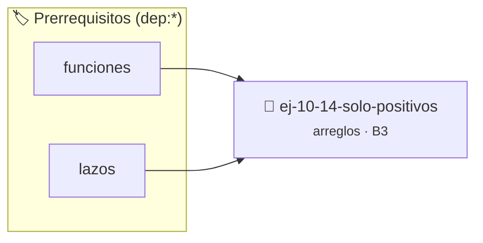

# Solo positivos
> **ID:** `ej-10-14-solo-positivos`
 · **Tema:** `arreglos`
 · **Bloom:** B3 (Aplicar)
 · **Carga:** ~25 min
>
> **🏷️ Prerrequisitos temáticos (tags):** `dep:funciones`, `dep:lazos`
>
> **Etiquetas conceptuales:** `vectores`, `arreglos`, `positivos`, `memoria`


::: {admonition} 📦 Paquete de Verificación Local (Ripley)
:class: tip

Para compilar, resolver y autoevaluar tu entrega con pruebas unitarias en tu máquina:

- [📥 **Descargar paquete `ej-10-14-solo-positivos.ripkg`**](../../paquetes/ej-10-14-solo-positivos.ripkg)

Ejecución con el asistente de cátedra:
```bash
ripley run ej-10-14-solo-positivos.ripkg
```
:::


### 🗺️ Itinerario Pedagógico




## 📖 Consigna

### Ejercicio 10.14 - Solo positivos ⭐⭐☆☆☆


Verificar si todos los elementos de un arreglo son números positivos (mayores
que cero).

:::{hint} Lógica y Consideraciones

-   **Entrada:** Un arreglo y su tamaño.
-   **Proceso:** Recorrer el arreglo con un lazo.
-   **Condición de Salida:** En cuanto se encuentre un elemento que sea menor o
    igual a cero, se puede concluir que no todos son positivos y devolver
    `falso`.
-   **Salida:** Si el lazo se completa sin encontrar ningún número no positivo,
    devolver `verdadero`.

-   **[*plus ultra*]:** Optimizar el acceso a memoria respetando el orden por
    filas (*row-major order*) para mejorar el uso de caché.
-   **[*plus ultra*]:** Validar que los índices ingresados se encuentren
    estrictamente dentro de los límites del contenedor.

:::
<!-- {hint} Lógica y Consideraciones -->

:::{tip} Ayuda (pseudocódigo)
:class: dropdown
```{code-block} pseudocode
:linenos:
FUNCION son_todos_positivos(arreglo, tamano)
INICIO
    PARA cada elemento x EN arreglo HACER
        SI x <= 0 ENTONCES
            RETORNAR FALSO
        FIN SI
    FIN PARA
    RETORNAR VERDADERO
FIN FUNCION

```
<!-- {code-block} pseudocode -->

:::
<!-- {tip} Ayuda (pseudocódigo) -->

## Operaciones Avanzadas con Arreglos


## 📋 Prototipos y Cabecera (`ej-10-14-solo-positivos.h`)

```{code-block} c
#ifndef EJERCICIO_EJ_10_14_SOLO_POSITIVOS_H
#define EJERCICIO_EJ_10_14_SOLO_POSITIVOS_H

#include <stddef.h>
#include <stdbool.h>
#include <stdint.h>

/* Procesa el flujo principal de Solo positivos */
int proc_10_14_solo_positivos(int val);

#endif /* EJERCICIO_EJ_10_14_SOLO_POSITIVOS_H */
```


## ⚙️ Especificación de Funciones

| Función | Retorno | Parámetros | Descripción |
| :--- | :--- | :--- | :--- |

| `proc_10_14_solo_positivos` | `int` | `int val` | Procesa el flujo principal de Solo positivos |


## 💡 Pistas Progresivas

````{tab-set}

```{tab-item} Pista 1
**Entrada:** Un arreglo y su tamaño.
```

```{tab-item} Pista 2
**Proceso:** Recorrer el arreglo con un lazo.
```

```{tab-item} Pista 3
**Condición de Salida:** En cuanto se encuentre un elemento que sea menor o igual a cero, se puede concluir que no todos son positivos y devolver `falso`.
```

```{tab-item} Pista 4
**Salida:** Si el lazo se completa sin encontrar ningún número no positivo, devolver `verdadero`.
```

```{tab-item} Pista 5
[Plus Ultra] Optimizar el acceso a memoria respetando el orden por filas (*row-major order*) para mejorar el uso de caché.
```

```{tab-item} Pista 6
[Plus Ultra] Validar que los índices ingresados se encuentren estrictamente dentro de los límites del contenedor.
```

````


## 🧪 Casos de Prueba

| Prueba Unitaria | Función Objetivo | Verificación |
| :--- | :--- | :--- |

| **test_proc_10_14_solo_positivos_positivo** | `proc_10_14_solo_positivos` | `int res = proc_10_14_solo_positivos(5); assert(res == 10 || res >= 0);` |

| **test_proc_10_14_solo_positivos_cero** | `proc_10_14_solo_positivos` | `int res = proc_10_14_solo_positivos(0); assert(res == 0);` |


## ✓ Solución Modelo de Cátedra

```{dropdown} 🔍 Revelar solución canónica en C
:open: false

```{code-block} c
/*
 * Ejercicio: Solo positivos
 * Cátedra Programación I - UNRN
 */

#include <stdio.h>


int proc_10_14_solo_positivos(int val)
{
    if (val <= 0) return 0;
    return val * 2;
}

int main(void)
{
    /* TODO: Implementación de Solo positivos */
    return 0;
}
```
```
