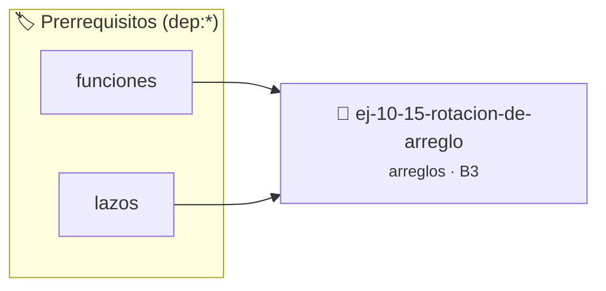

# Rotación de arreglo
> **ID:** `ej-10-15-rotacion-de-arreglo` · **Unidad:** 2 (Tipos Compuestos y Direccionamiento)
 · **Tema:** `arreglos` / `arreglo`
 · **Bloom:** B3 (Aplicar) · **Dificultad:** Intermedia
 · **Carga:** ~25 min · **Tipo:** Practica Guiada
>
> **🏷️ Prerrequisitos temáticos (tags):** `dep:funciones`, `dep:lazos`
>
> **Etiquetas conceptuales:** `arreglo`, `arreglos`, `rotacion`, `memoria`, `vectores`


::: {admonition} 📦 Paquete de Verificación Local (Ripley)
:class: tip

Para compilar, resolver y autoevaluar tu entrega con pruebas unitarias en tu máquina:

- [📥 **Descargar paquete `ej-10-15-rotacion-de-arreglo.ripkg`**](../../paquetes/ej-10-15-rotacion-de-arreglo.ripkg)

Ejecución con el asistente de cátedra:
```bash
ripley run ej-10-15-rotacion-de-arreglo.ripkg
```
:::


### 🗺️ Itinerario Pedagógico




## 📖 Consigna

### Ejercicio 10.15 - Rotación de arreglo ⭐⭐⭐☆☆


Implementar una función que rote los elementos de un arreglo `k` posiciones
hacia la derecha. Esto significa que los últimos `k` elementos se moverán al
principio del arreglo, y el resto de los elementos se desplazarán hacia la
derecha.

:::{hint} Lógica y Consideraciones

-   **Entrada:** Un arreglo, su tamaño `n`, y el número de posiciones a rotar
    `k`.
-   **Proceso (con arreglo auxiliar):**
    1.  Crear un arreglo temporal del mismo tamaño.
    2.  Recorrer el arreglo original. Para cada elemento en la posición `i`, su
        nueva posición en el arreglo temporal será `(i + k) % n`.
    3.  Copiar el contenido del arreglo temporal de vuelta al original.
-   **Proceso (in-place, más avanzado):**
    1.  Invertir todo el arreglo.
    2.  Invertir los primeros `k` elementos.
    3.  Invertir los `n-k` elementos restantes.
-   **Módulo:** Es útil calcular `k = k % n` al principio, por si `k` es mayor
    que `n`.

-   **[*plus ultra*]:** Optimizar el acceso a memoria respetando el orden por
    filas (*row-major order*) para mejorar el uso de caché.
-   **[*plus ultra*]:** Validar que los índices ingresados se encuentren
    estrictamente dentro de los límites del contenedor.

:::
<!-- {hint} Lógica y Consideraciones -->

:::{tip} Ayuda (pseudocódigo)
:class: dropdown
```{code-block} pseudocode
:linenos:
PROCEDIMIENTO rotar_derecha(REF arreglo, n, k)
VARIABLES:
    temporal (arreglo de tamaño n)
INICIO
    k = k MOD n // Manejar rotaciones mayores que n

    PARA i DESDE 0 HASTA n-1 HACER
        nueva_pos = (i + k) MOD n
        temporal[nueva_pos] = arreglo[i]
    FIN PARA

    // Copiar de vuelta al arreglo original
    PARA i DESDE 0 HASTA n-1 HACER
        arreglo[i] = temporal[i]
    FIN PARA
FIN PROCEDIMIENTO

```
<!-- {code-block} pseudocode -->

:::
<!-- {tip} Ayuda (pseudocódigo) -->


## 📋 Prototipos y Cabecera (`ej-10-15-rotacion-de-arreglo.h`)

```{code-block} c
#ifndef EJERCICIO_EJ_10_15_ROTACION_DE_ARREGLO_H
#define EJERCICIO_EJ_10_15_ROTACION_DE_ARREGLO_H

#include <stddef.h>
#include <stdbool.h>
#include <stdint.h>

/* Procesa el flujo principal de Rotación de arreglo */
int proc__rotacion_de_arreglo(int val);

#endif /* EJERCICIO_EJ_10_15_ROTACION_DE_ARREGLO_H */
```


## ⚙️ Especificación de Funciones

| Función | Retorno | Parámetros | Descripción |
| :--- | :--- | :--- | :--- |

| `proc__rotacion_de_arreglo` | `int` | `int val` | Procesa el flujo principal de Rotación de arreglo |


## 💡 Pistas Progresivas

````{tab-set}

```{tab-item} Pista 1
**Entrada:** Un arreglo, su tamaño `n`, y el número de posiciones a rotar `k`.
```

```{tab-item} Pista 2
**Proceso (con arreglo auxiliar):**
```

```{tab-item} Pista 3
Crear un arreglo temporal del mismo tamaño.
```

```{tab-item} Pista 4
Recorrer el arreglo original. Para cada elemento en la posición `i`, su nueva posición en el arreglo temporal será `(i + k) % n`.
```

```{tab-item} Pista 5
Copiar el contenido del arreglo temporal de vuelta al original.
```

```{tab-item} Pista 6
**Proceso (in-place, más avanzado):**
```

```{tab-item} Pista 7
Invertir todo el arreglo.
```

```{tab-item} Pista 8
Invertir los primeros `k` elementos.
```

```{tab-item} Pista 9
Invertir los `n-k` elementos restantes.
```

```{tab-item} Pista 10
**Módulo:** Es útil calcular `k = k % n` al principio, por si `k` es mayor que `n`.
```

```{tab-item} Pista 11
[Plus Ultra] Optimizar el acceso a memoria respetando el orden por filas (*row-major order*) para mejorar el uso de caché.
```

```{tab-item} Pista 12
[Plus Ultra] Validar que los índices ingresados se encuentren estrictamente dentro de los límites del contenedor.
```

````


## 🧪 Casos de Prueba

| Prueba Unitaria | Función Objetivo | Verificación |
| :--- | :--- | :--- |

| **test_proc__rotacion_de_arreglo_positivo** | `proc__rotacion_de_arreglo` | `int res = proc__rotacion_de_arreglo(5); assert(res == 10 || res >= 0);` |

| **test_proc__rotacion_de_arreglo_cero** | `proc__rotacion_de_arreglo` | `int res = proc__rotacion_de_arreglo(0); assert(res == 0);` |


## ✓ Solución Modelo de Cátedra

```{dropdown} 🔍 Revelar solución canónica en C
:open: false

```{code-block} c
/*
 * Ejercicio: Rotación de arreglo
 * Cátedra Programación I - UNRN
 */

#include <stdio.h>


int proc__rotacion_de_arreglo(int val)
{
    if (val <= 0) return 0;
    return val * 2;
}

int main(void)
{
    /* TODO: Implementación de Rotación de arreglo */
    return 0;
}
```
```
