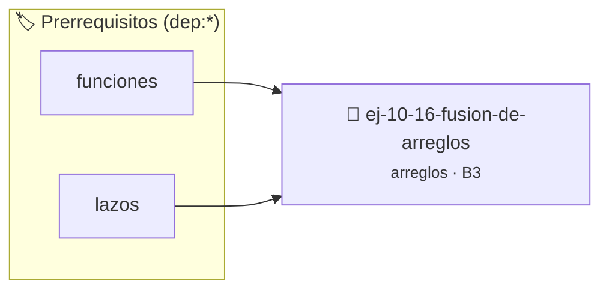

# Fusión de arreglos
> **ID:** `ej-10-16-fusion-de-arreglos`
 · **Tema:** `arreglos`
 · **Bloom:** B3 (Aplicar)
 · **Carga:** ~25 min
>
> **🏷️ Prerrequisitos temáticos (tags):** `dep:funciones`, `dep:lazos`
>
> **Etiquetas conceptuales:** `vectores`, `arreglos`, `fusion`, `memoria`


::: {admonition} 📦 Paquete de Verificación Local (Ripley)
:class: tip

Para compilar, resolver y autoevaluar tu entrega con pruebas unitarias en tu máquina:

- [📥 **Descargar paquete `ej-10-16-fusion-de-arreglos.ripkg`**](../../paquetes/ej-10-16-fusion-de-arreglos.ripkg)

Ejecución con el asistente de cátedra:
```bash
ripley run ej-10-16-fusion-de-arreglos.ripkg
```
:::


### 🗺️ Itinerario Pedagógico




## 📖 Consigna

### Ejercicio 10.16 - Fusión de arreglos ⭐⭐⭐☆☆


Escribir una función que fusione dos arreglos en un tercer arreglo que contenga
todos los elementos de los dos primeros. Si los arreglos originales están
ordenados, el resultado también debería estarlo (ver Merge Sort).

:::{hint} Lógica y Consideraciones

-   **Entrada:** Dos arreglos (`a1`, `a2`) con sus respectivos tamaños (`n1`,
    `n2`).
-   **Salida:** Un nuevo arreglo de tamaño `n1 + n2`.
-   **Proceso (desordenado):** Simplemente copiar todos los elementos de `a1` al
    nuevo arreglo, y luego todos los elementos de `a2` a continuación.
-   **Proceso (ordenado):** Usar el algoritmo de mezcla de Merge Sort. Con tres
    punteros (`i` para `a1`, `j` para `a2`, `k` para el resultado), comparar
    `a1[i]` y `a2[j]`, copiar el menor al resultado y avanzar el puntero
    correspondiente.

-   **[*plus ultra*]:** Validar punteros `NULL` recibidos como parámetro para
    evitar fallos de segmentación.
-   **[*plus ultra*]:** Implementar una versión utilizando aritmética de
    punteros en lugar de indexación directa.

:::
<!-- {hint} Lógica y Consideraciones -->

:::{tip} Ayuda (pseudocódigo)
:class: dropdown
```{code-block} pseudocode
:linenos:
FUNCION fusionar_ordenado(a1, n1, a2, n2)
VARIABLES:
    resultado (arreglo de tamaño n1+n2)
    i, j, k (enteros)
INICIO
    i=0, j=0, k=0
    MIENTRAS i < n1 Y j < n2 HACER
        SI a1[i] <= a2[j] ENTONCES
            resultado[k] = a1[i]
            i = i + 1
        SINO
            resultado[k] = a2[j]
            j = j + 1
        FIN SI
        k = k + 1
    FIN MIENTRAS

    // Copiar elementos restantes
    MIENTRAS i < n1 HACER
        resultado[k] = a1[i]
        i = i + 1, k = k + 1
    FIN MIENTRAS
    MIENTRAS j < n2 HACER
        resultado[k] = a2[j]
        j = j + 1, k = k + 1
    FIN MIENTRAS

    RETORNAR resultado
FIN FUNCION

```
<!-- {code-block} pseudocode -->

:::
<!-- {tip} Ayuda (pseudocódigo) -->


## 📋 Prototipos y Cabecera (`ej-10-16-fusion-de-arreglos.h`)

```{code-block} c
#ifndef EJERCICIO_EJ_10_16_FUSION_DE_ARREGLOS_H
#define EJERCICIO_EJ_10_16_FUSION_DE_ARREGLOS_H

#include <stddef.h>
#include <stdbool.h>
#include <stdint.h>

/* Procesa el flujo principal de Fusión de arreglos */
int proc_6_fusion_de_arreglos(int val);

#endif /* EJERCICIO_EJ_10_16_FUSION_DE_ARREGLOS_H */
```


## ⚙️ Especificación de Funciones

| Función | Retorno | Parámetros | Descripción |
| :--- | :--- | :--- | :--- |

| `proc_6_fusion_de_arreglos` | `int` | `int val` | Procesa el flujo principal de Fusión de arreglos |


## 💡 Pistas Progresivas

````{tab-set}

```{tab-item} Pista 1
**Entrada:** Dos arreglos (`a1`, `a2`) con sus respectivos tamaños (`n1`, `n2`).
```

```{tab-item} Pista 2
**Salida:** Un nuevo arreglo de tamaño `n1 + n2`.
```

```{tab-item} Pista 3
**Proceso (desordenado):** Simplemente copiar todos los elementos de `a1` al nuevo arreglo, y luego todos los elementos de `a2` a continuación.
```

```{tab-item} Pista 4
**Proceso (ordenado):** Usar el algoritmo de mezcla de Merge Sort. Con tres punteros (`i` para `a1`, `j` para `a2`, `k` para el resultado), comparar `a1[i]` y `a2[j]`, copiar el menor al resultado y avanzar el puntero correspondiente.
```

```{tab-item} Pista 5
[Plus Ultra] Validar punteros `NULL` recibidos como parámetro para evitar fallos de segmentación.
```

```{tab-item} Pista 6
[Plus Ultra] Implementar una versión utilizando aritmética de punteros en lugar de indexación directa.
```

````


## 🧪 Casos de Prueba

| Prueba Unitaria | Función Objetivo | Verificación |
| :--- | :--- | :--- |

| **test_proc_6_fusion_de_arreglos_positivo** | `proc_6_fusion_de_arreglos` | `int res = proc_6_fusion_de_arreglos(5); assert(res == 10 || res >= 0);` |

| **test_proc_6_fusion_de_arreglos_cero** | `proc_6_fusion_de_arreglos` | `int res = proc_6_fusion_de_arreglos(0); assert(res == 0);` |


## ✓ Solución Modelo de Cátedra

```{dropdown} 🔍 Revelar solución canónica en C
:open: false

```{code-block} c
/*
 * Ejercicio: Fusión de arreglos
 * Cátedra Programación I - UNRN
 */

#include <stdio.h>


int proc_6_fusion_de_arreglos(int val)
{
    if (val <= 0) return 0;
    return val * 2;
}

int main(void)
{
    /* TODO: Implementación de Fusión de arreglos */
    return 0;
}
```
```
