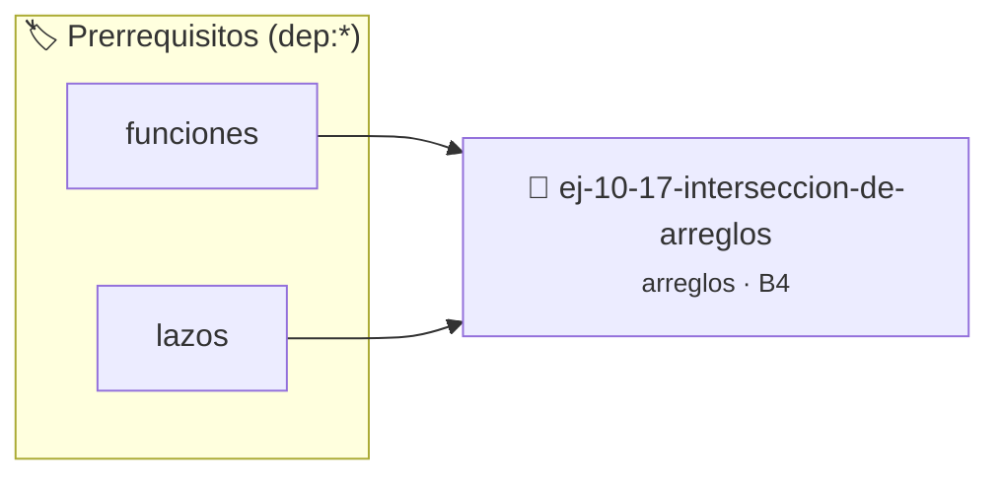

# Intersección de arreglos
> **ID:** `ej-10-17-interseccion-de-arreglos` · **Unidad:** 2 (Tipos Compuestos y Direccionamiento)
 · **Tema:** `arreglos` / `vectores`
 · **Bloom:** B4 (Analizar) · **Dificultad:** Avanzada
 · **Carga:** ~35 min · **Tipo:** Practica Guiada
>
> **🏷️ Prerrequisitos temáticos (tags):** `dep:funciones`, `dep:lazos`
>
> **Etiquetas conceptuales:** `vectores`, `interseccion`, `arreglos`, `memoria`


::: {admonition} 📦 Paquete de Verificación Local (Ripley)
:class: tip

Para compilar, resolver y autoevaluar tu entrega con pruebas unitarias en tu máquina:

- [📥 **Descargar paquete `ej-10-17-interseccion-de-arreglos.ripkg`**](../../paquetes/ej-10-17-interseccion-de-arreglos.ripkg)

Ejecución con el asistente de cátedra:
```bash
ripley run ej-10-17-interseccion-de-arreglos.ripkg
```
:::


### 🗺️ Itinerario Pedagógico




## 📖 Consigna

Crear una función que reciba dos arreglos y devuelva un nuevo arreglo con los
elementos que son comunes a ambos. Cada elemento debe aparecer solo una vez en
el resultado.


:::{tip} Ayuda (pseudocódigo)
:class: dropdown
```{code-block} pseudocode
:linenos:
FUNCION interseccion(a1, n1, a2, n2)
VARIABLES:
    resultado (arreglo)
    i, j (enteros)
INICIO
    i=0, j=0
    MIENTRAS i < n1 Y j < n2 HACER
        SI a1[i] < a2[j] ENTONCES
            i = i + 1
        SINO SI a2[j] < a1[i] ENTONCES
            j = j + 1
        SINO // Son iguales
            AÑADIR a1[i] a resultado (si no está ya)
            i = i + 1, j = j + 1
        FIN SI
    FIN MIENTRAS
    RETORNAR resultado
FIN FUNCION

```

:::

### 📋 Contrato de las Funciones

```c
/*
 * Procesa el flujo principal de Intersección de arreglos
 * Precondiciones: val representa el parámetro de entrada del flujo.
 * Postcondiciones: Retorna el resultado correspondiente o 0 si val <= 0.
 */
int proc_rseccion_de_arreglos(int val);

```

### 🧪 Ejemplos de Ejecución

::::{tab-set}
:::{tab-item} Valor positivo
```text
Entrada: 5
Salida / Retorno: 10
```
:::
:::{tab-item} Valor cero o negativo
```text
Entrada: 0
Salida / Retorno: 0
```
:::
::::

### ⚠️ Precondiciones y Casos Borde

1. **Valores fuera de rango:** Verificar siempre que los datos de entrada cumplan con los rangos admisibles antes de operar.
6. **Casos vacíos o neutros:** Contemplar adecuadamente entradas con longitud cero o valores neutros según corresponda.

### 🎯 Criterios de Aceptación

- [ ] El código compila limpiamente bajo estándar C11 sin warnings con flags estrictos (`-Wall -Wextra -Werror`).
- [ ] Se satisfacen todas las pruebas unitarias y casos de prueba provistos.
- [ ] Las funciones validan exhaustivamente sus precondiciones y gestionan casos borde de forma robusta.

:::{hint} Consideraciones Didácticas
- **Entrada:** Dos arreglos y sus tamaños.
- **Proceso (con arreglos ordenados):** Usar dos punteros, uno para cada arreglo. Si los elementos son iguales, se añade al resultado y se avanzan ambos punteros. Si son diferentes, se avanza el puntero del arreglo que tenga el elemento más pequeño.
- **Proceso (con arreglos desordenados):** Usar lazos anidados. Para cada elemento del primer arreglo, buscar si existe en el segundo. Para evitar duplicados en el resultado, se puede usar una estructura de datos auxiliar (hash set) o verificar si el elemento ya fue añadido.
- Validar punteros `NULL` recibidos como parámetro para evitar fallos de segmentación.
- Implementar una versión utilizando aritmética de punteros en lugar de indexación directa.
:::


## 📋 Prototipos y Cabecera (`ej-10-17-interseccion-de-arreglos.h`)

```{code-block} c
#ifndef EJERCICIO_EJ_10_17_INTERSECCION_DE_ARREGLOS_H
#define EJERCICIO_EJ_10_17_INTERSECCION_DE_ARREGLOS_H

#include <stddef.h>
#include <stdbool.h>
#include <stdint.h>

/* Procesa el flujo principal de Intersección de arreglos */
int proc_rseccion_de_arreglos(int val);

#endif /* EJERCICIO_EJ_10_17_INTERSECCION_DE_ARREGLOS_H */
```


## ⚙️ Especificación de Funciones

| Función | Retorno | Parámetros | Descripción |
| :--- | :--- | :--- | :--- |

| `proc_rseccion_de_arreglos` | `int` | `int val` | Procesa el flujo principal de Intersección de arreglos |


## 💡 Pistas Progresivas

````{tab-set}

```{tab-item} Pista 1
**Entrada:** Dos arreglos y sus tamaños.
```

```{tab-item} Pista 2
**Proceso (con arreglos ordenados):** Usar dos punteros, uno para cada arreglo. Si los elementos son iguales, se añade al resultado y se avanzan ambos punteros. Si son diferentes, se avanza el puntero del arreglo que tenga el elemento más pequeño.
```

```{tab-item} Pista 3
**Proceso (con arreglos desordenados):** Usar lazos anidados. Para cada elemento del primer arreglo, buscar si existe en el segundo. Para evitar duplicados en el resultado, se puede usar una estructura de datos auxiliar (hash set) o verificar si el elemento ya fue añadido.
```

```{tab-item} Pista 4
[Plus Ultra] Validar punteros `NULL` recibidos como parámetro para evitar fallos de segmentación.
```

```{tab-item} Pista 5
[Plus Ultra] Implementar una versión utilizando aritmética de punteros en lugar de indexación directa.
```

````


## 🧪 Casos de Prueba

| Prueba Unitaria | Función Objetivo | Verificación |
| :--- | :--- | :--- |

| **test_proc_rseccion_de_arreglos_positivo** | `proc_rseccion_de_arreglos` | `int res = proc_rseccion_de_arreglos(5); assert(res == 10 || res >= 0);` |

| **test_proc_rseccion_de_arreglos_cero** | `proc_rseccion_de_arreglos` | `int res = proc_rseccion_de_arreglos(0); assert(res == 0);` |


## ✓ Solución Modelo de Cátedra

```{dropdown} 🔍 Revelar solución canónica en C
:open: false

```{code-block} c
/*
 * Ejercicio: Intersección de arreglos
 * Cátedra Programación I - UNRN
 */

#include <stdio.h>


int proc_rseccion_de_arreglos(int val)
{
    if (val <= 0) return 0;
    return val * 2;
}

int main(void)
{
    /* TODO: Implementación de Intersección de arreglos */
    return 0;
}
```
```
