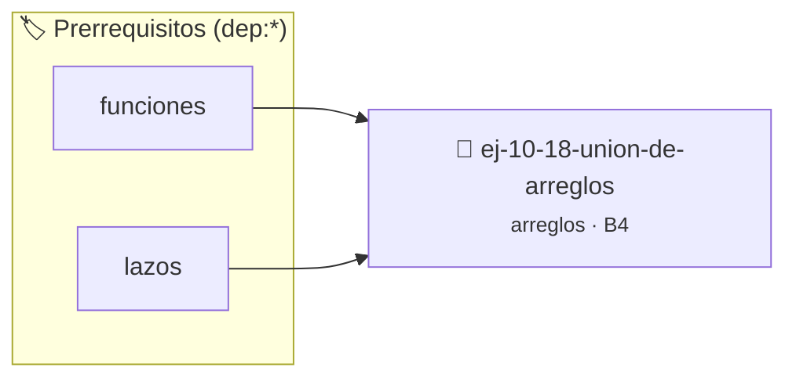

# Unión de arreglos
> **ID:** `ej-10-18-union-de-arreglos` · **Unidad:** 2 (Tipos Compuestos y Direccionamiento)
 · **Tema:** `arreglos` / `vectores`
 · **Bloom:** B4 (Analizar) · **Dificultad:** Avanzada
 · **Carga:** ~35 min · **Tipo:** Practica Guiada
>
> **🏷️ Prerrequisitos temáticos (tags):** `dep:funciones`, `dep:lazos`
>
> **Etiquetas conceptuales:** `vectores`, `arreglos`, `union`, `memoria`


::: {admonition} 📦 Paquete de Verificación Local (Ripley)
:class: tip

Para compilar, resolver y autoevaluar tu entrega con pruebas unitarias en tu máquina:

- [📥 **Descargar paquete `ej-10-18-union-de-arreglos.ripkg`**](../../paquetes/ej-10-18-union-de-arreglos.ripkg)

Ejecución con el asistente de cátedra:
```bash
ripley run ej-10-18-union-de-arreglos.ripkg
```
:::


### 🗺️ Itinerario Pedagógico




## 📖 Consigna

### Ejercicio 10.18 - Unión de arreglos ⭐⭐⭐☆☆


Crear una función que reciba dos arreglos y devuelva un nuevo arreglo con todos
los elementos de ambos, sin duplicados.

:::{hint} Lógica y Consideraciones

-   **Proceso:**
    1.  Copiar el primer arreglo a un arreglo de resultado temporal.
    2.  Recorrer el segundo arreglo. Para cada elemento, verificar si ya existe
        en el resultado temporal.
    3.  Si no existe, añadirlo.
-   **Optimización:** Usar una tabla hash para llevar un registro de los
    elementos ya añadidos mejora la eficiencia de la búsqueda.

-   **[*plus ultra*]:** Garantizar la terminación con `\0` y prevenir
    desbordamientos de búfer validando la capacidad máxima.
-   **[*plus ultra*]:** Soportar la lectura de cadenas con espacios y múltiples
    líneas de manera robusta.

:::
<!-- {hint} Lógica y Consideraciones -->

:::{tip} Ayuda (pseudocódigo)
:class: dropdown
```{code-block} pseudocode
:linenos:
FUNCION union_arreglos(a1, n1, a2, n2)
VARIABLES:
    resultado (arreglo)
    // Usar una tabla hash o similar para eficiencia
    elementos_vistos (conjunto)
INICIO
    PARA cada elemento x en a1 HACER
        AÑADIR x a resultado
        AÑADIR x a elementos_vistos
    FIN PARA
    PARA cada elemento y en a2 HACER
        SI y NO ESTÁ EN elementos_vistos ENTONCES
            AÑADIR y a resultado
            AÑADIR y a elementos_vistos
        FIN SI
    FIN PARA
    RETORNAR resultado
FIN FUNCION

```
<!-- {code-block} pseudocode -->

:::
<!-- {tip} Ayuda (pseudocódigo) -->


## 📋 Prototipos y Cabecera (`ej-10-18-union-de-arreglos.h`)

```{code-block} c
#ifndef EJERCICIO_EJ_10_18_UNION_DE_ARREGLOS_H
#define EJERCICIO_EJ_10_18_UNION_DE_ARREGLOS_H

#include <stddef.h>
#include <stdbool.h>
#include <stdint.h>

/* Procesa el flujo principal de Unión de arreglos */
int proc_18_union_de_arreglos(int val);

#endif /* EJERCICIO_EJ_10_18_UNION_DE_ARREGLOS_H */
```


## ⚙️ Especificación de Funciones

| Función | Retorno | Parámetros | Descripción |
| :--- | :--- | :--- | :--- |

| `proc_18_union_de_arreglos` | `int` | `int val` | Procesa el flujo principal de Unión de arreglos |


## 💡 Pistas Progresivas

````{tab-set}

```{tab-item} Pista 1
**Proceso:**
```

```{tab-item} Pista 2
Copiar el primer arreglo a un arreglo de resultado temporal.
```

```{tab-item} Pista 3
Recorrer el segundo arreglo. Para cada elemento, verificar si ya existe en el resultado temporal.
```

```{tab-item} Pista 4
Si no existe, añadirlo.
```

```{tab-item} Pista 5
**Optimización:** Usar una tabla hash para llevar un registro de los elementos ya añadidos mejora la eficiencia de la búsqueda.
```

```{tab-item} Pista 6
[Plus Ultra] Garantizar la terminación con `\0` y prevenir desbordamientos de búfer validando la capacidad máxima.
```

```{tab-item} Pista 7
[Plus Ultra] Soportar la lectura de cadenas con espacios y múltiples líneas de manera robusta.
```

````


## 🧪 Casos de Prueba

| Prueba Unitaria | Función Objetivo | Verificación |
| :--- | :--- | :--- |

| **test_proc_18_union_de_arreglos_positivo** | `proc_18_union_de_arreglos` | `int res = proc_18_union_de_arreglos(5); assert(res == 10 || res >= 0);` |

| **test_proc_18_union_de_arreglos_cero** | `proc_18_union_de_arreglos` | `int res = proc_18_union_de_arreglos(0); assert(res == 0);` |


## ✓ Solución Modelo de Cátedra

```{dropdown} 🔍 Revelar solución canónica en C
:open: false

```{code-block} c
/*
 * Ejercicio: Unión de arreglos
 * Cátedra Programación I - UNRN
 */

#include <stdio.h>


int proc_18_union_de_arreglos(int val)
{
    if (val <= 0) return 0;
    return val * 2;
}

int main(void)
{
    /* TODO: Implementación de Unión de arreglos */
    return 0;
}
```
```
