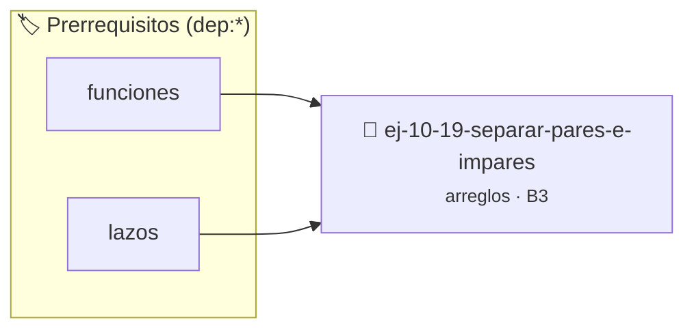

# Separar pares e impares
> **ID:** `ej-10-19-separar-pares-e-impares` · **Unidad:** 2 (Tipos Compuestos y Direccionamiento)
 · **Tema:** `arreglos` / `pares`
 · **Bloom:** B3 (Aplicar) · **Dificultad:** Intermedia
 · **Carga:** ~25 min · **Tipo:** Practica Guiada
>
> **🏷️ Prerrequisitos temáticos (tags):** `dep:funciones`, `dep:lazos`
>
> **Etiquetas conceptuales:** `pares`, `arreglos`, `separar`, `memoria`, `impares`


::: {admonition} 📦 Paquete de Verificación Local (Ripley)
:class: tip

Para compilar, resolver y autoevaluar tu entrega con pruebas unitarias en tu máquina:

- [📥 **Descargar paquete `ej-10-19-separar-pares-e-impares.ripkg`**](../../paquetes/ej-10-19-separar-pares-e-impares.ripkg)

Ejecución con el asistente de cátedra:
```bash
ripley run ej-10-19-separar-pares-e-impares.ripkg
```
:::


### 🗺️ Itinerario Pedagógico




## 📖 Consigna

Reorganizar un arreglo _in-place_ de tal manera que todos los números pares
queden al principio y todos los impares al final. El orden relativo entre los
números pares o entre los impares no necesita conservarse.


:::{tip} Ayuda (pseudocódigo)
:class: dropdown
```{code-block} pseudocode
:linenos:
PROCEDIMIENTO separar_pares_impares(REF arreglo, tamano)
VARIABLES:
    izquierda, derecha (enteros)
INICIO
    izquierda = 0, derecha = tamano - 1
    MIENTRAS izquierda < derecha HACER
        MIENTRAS arreglo[izquierda] MOD 2 == 0 Y izquierda < derecha HACER
            izquierda = izquierda + 1
        FIN MIENTRAS
        MIENTRAS arreglo[derecha] MOD 2 != 0 Y izquierda < derecha HACER
            derecha = derecha - 1
        FIN MIENTRAS

        SI izquierda < derecha ENTONCES
            INTERCAMBIAR(arreglo[izquierda], arreglo[derecha])
            izquierda = izquierda + 1
            derecha = derecha - 1
        FIN SI
    FIN MIENTRAS
FIN PROCEDIMIENTO

```

:::

### 📋 Contrato de las Funciones

```c
/*
 * Procesa el flujo principal de Separar pares e impares
 * Precondiciones: val representa el parámetro de entrada del flujo.
 * Postcondiciones: Retorna el resultado correspondiente o 0 si val <= 0.
 */
int proc_arar_pares_e_impares(int val);

```

### 🧪 Ejemplos de Ejecución

::::{tab-set}
:::{tab-item} Valor positivo
```text
Entrada: 5
Salida / Retorno: 10
```
:::
:::{tab-item} Valor cero o negativo
```text
Entrada: 0
Salida / Retorno: 0
```
:::
::::

### ⚠️ Precondiciones y Casos Borde

1. **Valores fuera de rango:** Verificar siempre que los datos de entrada cumplan con los rangos admisibles antes de operar.
6. **Casos vacíos o neutros:** Contemplar adecuadamente entradas con longitud cero o valores neutros según corresponda.

### 🎯 Criterios de Aceptación

- [ ] El código compila limpiamente bajo estándar C11 sin warnings con flags estrictos (`-Wall -Wextra -Werror`).
- [ ] Se satisfacen todas las pruebas unitarias y casos de prueba provistos.
- [ ] Las funciones validan exhaustivamente sus precondiciones y gestionan casos borde de forma robusta.

:::{hint} Consideraciones Didácticas
- **Proceso (dos punteros):**
- Usar dos índices, `izquierda` comenzando en 0 y `derecha` en `tamaño-1`.
- Mientras `izquierda < derecha`: a. Mover `izquierda` hacia la derecha hasta encontrar un número impar. b. Mover `derecha` hacia la izquierda hasta encontrar un número par. c. Si `izquierda < derecha`, intercambiar los elementos en esas posiciones.
- Validar punteros `NULL` recibidos como parámetro para evitar fallos de segmentación.
- Implementar una versión utilizando aritmética de punteros en lugar de indexación directa.
:::


## 📋 Prototipos y Cabecera (`ej-10-19-separar-pares-e-impares.h`)

```{code-block} c
#ifndef EJERCICIO_EJ_10_19_SEPARAR_PARES_E_IMPARES_H
#define EJERCICIO_EJ_10_19_SEPARAR_PARES_E_IMPARES_H

#include <stddef.h>
#include <stdbool.h>
#include <stdint.h>

/* Procesa el flujo principal de Separar pares e impares */
int proc_arar_pares_e_impares(int val);

#endif /* EJERCICIO_EJ_10_19_SEPARAR_PARES_E_IMPARES_H */
```


## ⚙️ Especificación de Funciones

| Función | Retorno | Parámetros | Descripción |
| :--- | :--- | :--- | :--- |

| `proc_arar_pares_e_impares` | `int` | `int val` | Procesa el flujo principal de Separar pares e impares |


## 💡 Pistas Progresivas

````{tab-set}

```{tab-item} Pista 1
**Proceso (dos punteros):**
```

```{tab-item} Pista 2
Usar dos índices, `izquierda` comenzando en 0 y `derecha` en `tamaño-1`.
```

```{tab-item} Pista 3
Mientras `izquierda < derecha`: a. Mover `izquierda` hacia la derecha hasta encontrar un número impar. b. Mover `derecha` hacia la izquierda hasta encontrar un número par. c. Si `izquierda < derecha`, intercambiar los elementos en esas posiciones.
```

```{tab-item} Pista 4
[Plus Ultra] Validar punteros `NULL` recibidos como parámetro para evitar fallos de segmentación.
```

```{tab-item} Pista 5
[Plus Ultra] Implementar una versión utilizando aritmética de punteros en lugar de indexación directa.
```

````


## 🧪 Casos de Prueba

| Prueba Unitaria | Función Objetivo | Verificación |
| :--- | :--- | :--- |

| **test_proc_arar_pares_e_impares_positivo** | `proc_arar_pares_e_impares` | `int res = proc_arar_pares_e_impares(5); assert(res == 10 || res >= 0);` |

| **test_proc_arar_pares_e_impares_cero** | `proc_arar_pares_e_impares` | `int res = proc_arar_pares_e_impares(0); assert(res == 0);` |


## ✓ Solución Modelo de Cátedra

```{dropdown} 🔍 Revelar solución canónica en C
:open: false

```{code-block} c
/*
 * Ejercicio: Separar pares e impares
 * Cátedra Programación I - UNRN
 */

#include <stdio.h>


int proc_arar_pares_e_impares(int val)
{
    if (val <= 0) return 0;
    return val * 2;
}

int main(void)
{
    /* TODO: Implementación de Separar pares e impares */
    return 0;
}
```
```
