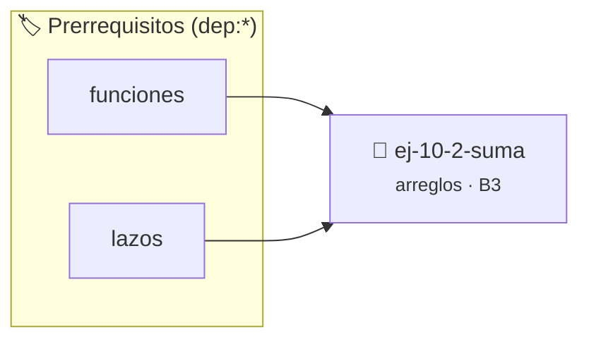

# Suma
> **ID:** `ej-10-2-suma`
 · **Tema:** `arreglos`
 · **Bloom:** B3 (Aplicar)
 · **Carga:** ~25 min
>
> **🏷️ Prerrequisitos temáticos (tags):** `dep:funciones`, `dep:lazos`
>
> **Etiquetas conceptuales:** `vectores`, `arreglos`, `memoria`


::: {admonition} 📦 Paquete de Verificación Local (Ripley)
:class: tip

Para compilar, resolver y autoevaluar tu entrega con pruebas unitarias en tu máquina:

- [📥 **Descargar paquete `ej-10-2-suma.ripkg`**](../../paquetes/ej-10-2-suma.ripkg)

Ejecución con el asistente de cátedra:
```bash
ripley run ej-10-2-suma.ripkg
```
:::


### 🗺️ Itinerario Pedagógico




## 📖 Consigna

### Ejercicio 10.2 - Suma ⭐⭐☆☆☆


Calcular la suma de todos los elementos contenidos en un arreglo de números.

:::{hint} Lógica y Consideraciones

-   **Entrada:** Un arreglo y su tamaño.
-   **Variables:** Se necesita una variable `acumulador` (o `suma`) inicializada
    en 0.
-   **Proceso:** Recorrer el arreglo con un lazo `for`. En cada iteración, sumar
    el elemento actual al `acumulador`.
-   **Salida:** La función debe devolver el valor final del `acumulador`.

-   **[*plus ultra*]:** Optimizar el acceso a memoria respetando el orden por
    filas (*row-major order*) para mejorar el uso de caché.
-   **[*plus ultra*]:** Validar que los índices ingresados se encuentren
    estrictamente dentro de los límites del contenedor.

:::
<!-- {hint} Lógica y Consideraciones -->

:::{tip} Ayuda (pseudocódigo)
:class: dropdown
```{code-block} pseudocode
:linenos:
FUNCION sumar_arreglo(arreglo, tamano)
VARIABLES:
    suma (tipo de dato del arreglo)
INICIO
    suma = 0
    PARA i DESDE 0 HASTA tamano-1 HACER
        suma = suma + arreglo[i]
    FIN PARA
    RETORNAR suma
FIN FUNCION

```
<!-- {code-block} pseudocode -->

:::
<!-- {tip} Ayuda (pseudocódigo) -->


## 📋 Prototipos y Cabecera (`ej-10-2-suma.h`)

```{code-block} c
#ifndef EJERCICIO_EJ_10_2_SUMA_H
#define EJERCICIO_EJ_10_2_SUMA_H

#include <stddef.h>
#include <stdbool.h>
#include <stdint.h>

/* Procesa el flujo principal de Suma */
int ejecutar_ej_10_2_suma(int val);

#endif /* EJERCICIO_EJ_10_2_SUMA_H */
```


## ⚙️ Especificación de Funciones

| Función | Retorno | Parámetros | Descripción |
| :--- | :--- | :--- | :--- |

| `ejecutar_ej_10_2_suma` | `int` | `int val` | Procesa el flujo principal de Suma |


## 💡 Pistas Progresivas

````{tab-set}

```{tab-item} Pista 1
**Entrada:** Un arreglo y su tamaño.
```

```{tab-item} Pista 2
**Variables:** Se necesita una variable `acumulador` (o `suma`) inicializada en 0.
```

```{tab-item} Pista 3
**Proceso:** Recorrer el arreglo con un lazo `for`. En cada iteración, sumar el elemento actual al `acumulador`.
```

```{tab-item} Pista 4
**Salida:** La función debe devolver el valor final del `acumulador`.
```

```{tab-item} Pista 5
[Plus Ultra] Optimizar el acceso a memoria respetando el orden por filas (*row-major order*) para mejorar el uso de caché.
```

```{tab-item} Pista 6
[Plus Ultra] Validar que los índices ingresados se encuentren estrictamente dentro de los límites del contenedor.
```

````


## 🧪 Casos de Prueba

| Prueba Unitaria | Función Objetivo | Verificación |
| :--- | :--- | :--- |

| **test_ejecutar_ej_10_2_suma_positivo** | `ejecutar_ej_10_2_suma` | `int res = ejecutar_ej_10_2_suma(5); assert(res == 10 || res >= 0);` |

| **test_ejecutar_ej_10_2_suma_cero** | `ejecutar_ej_10_2_suma` | `int res = ejecutar_ej_10_2_suma(0); assert(res == 0);` |


## ✓ Solución Modelo de Cátedra

```{dropdown} 🔍 Revelar solución canónica en C
:open: false

```{code-block} c
/*
 * Ejercicio: Suma
 * Cátedra Programación I - UNRN
 */

#include <stdio.h>


int ejecutar_ej_10_2_suma(int val)
{
    if (val <= 0) return 0;
    return val * 2;
}

int main(void)
{
    /* TODO: Implementación de Suma */
    return 0;
}
```
```
