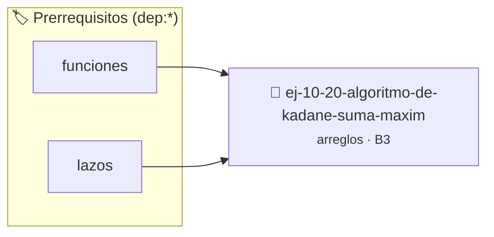

# Algoritmo de Kadane (Suma máxima de subarreglo)
> **ID:** `ej-10-20-algoritmo-de-kadane-suma-maxim` · **Unidad:** 2 (Tipos Compuestos y Direccionamiento)
 · **Tema:** `arreglos` / `suma`
 · **Bloom:** B3 (Aplicar) · **Dificultad:** Intermedia
 · **Carga:** ~25 min · **Tipo:** Practica Guiada
>
> **🏷️ Prerrequisitos temáticos (tags):** `dep:funciones`, `dep:lazos`
>
> **Etiquetas conceptuales:** `suma`, `subarreglo`, `arreglos`, `kadane`, `memoria`


::: {admonition} 📦 Paquete de Verificación Local (Ripley)
:class: tip

Para compilar, resolver y autoevaluar tu entrega con pruebas unitarias en tu máquina:

- [📥 **Descargar paquete `ej-10-20-algoritmo-de-kadane-suma-maxim.ripkg`**](../../paquetes/ej-10-20-algoritmo-de-kadane-suma-maxim.ripkg)

Ejecución con el asistente de cátedra:
```bash
ripley run ej-10-20-algoritmo-de-kadane-suma-maxim.ripkg
```
:::


### 🗺️ Itinerario Pedagógico




## 📖 Consigna

### Ejercicio 10.20 - Algoritmo de Kadane (Suma máxima de subarreglo) ⭐⭐⭐☆☆


Implementar el algoritmo de Kadane para encontrar la suma del subarreglo
contiguo que tenga la suma más grande. El arreglo puede contener números
negativos.

:::{hint} Lógica y Consideraciones

-   **Proceso:** Se recorre el arreglo una sola vez, manteniendo dos variables:
    -   `max_actual`: La suma máxima del subarreglo que termina en la posición
        actual.
    -   `max_global`: La suma máxima encontrada en todo el arreglo hasta el
        momento.
-   En cada paso `i`:
    1.  `max_actual = MAXIMO(arreglo[i], max_actual + arreglo[i])`
    2.  `max_global = MAXIMO(max_global, max_actual)`

-   **[*plus ultra*]:** Optimizar el acceso a memoria respetando el orden por
    filas (*row-major order*) para mejorar el uso de caché.
-   **[*plus ultra*]:** Validar que los índices ingresados se encuentren
    estrictamente dentro de los límites del contenedor.

:::
<!-- {hint} Lógica y Consideraciones -->

:::{tip} Ayuda (pseudocódigo)
:class: dropdown
```{code-block} pseudocode
:linenos:
FUNCION kadane(arreglo, tamano)
VARIABLES:
    max_actual, max_global
INICIO
    max_actual = arreglo[0]
    max_global = arreglo[0]

    PARA i DESDE 1 HASTA tamano-1 HACER
        max_actual = MAXIMO(arreglo[i], max_actual + arreglo[i])
        SI max_actual > max_global ENTONCES
            max_global = max_actual
        FIN SI
    FIN PARA
    RETORNAR max_global
FIN FUNCION

```
<!-- {code-block} pseudocode -->

:::
<!-- {tip} Ayuda (pseudocódigo) -->


## 📋 Prototipos y Cabecera (`ej-10-20-algoritmo-de-kadane-suma-maxim.h`)

```{code-block} c
#ifndef EJERCICIO_EJ_10_20_ALGORITMO_DE_KADANE_SUMA_MAXIM_H
#define EJERCICIO_EJ_10_20_ALGORITMO_DE_KADANE_SUMA_MAXIM_H

#include <stddef.h>
#include <stdbool.h>
#include <stdint.h>

/* Procesa el flujo principal de Algoritmo de Kadane (Suma máxima de subarreglo) */
int proc_de_kadane_suma_maxim(int val);

#endif /* EJERCICIO_EJ_10_20_ALGORITMO_DE_KADANE_SUMA_MAXIM_H */
```


## ⚙️ Especificación de Funciones

| Función | Retorno | Parámetros | Descripción |
| :--- | :--- | :--- | :--- |

| `proc_de_kadane_suma_maxim` | `int` | `int val` | Procesa el flujo principal de Algoritmo de Kadane (Suma máxima de subarreglo) |


## 💡 Pistas Progresivas

````{tab-set}

```{tab-item} Pista 1
**Proceso:** Se recorre el arreglo una sola vez, manteniendo dos variables:
```

```{tab-item} Pista 2
`max_actual`: La suma máxima del subarreglo que termina en la posición actual.
```

```{tab-item} Pista 3
`max_global`: La suma máxima encontrada en todo el arreglo hasta el momento.
```

```{tab-item} Pista 4
En cada paso `i`:
```

```{tab-item} Pista 5
`max_actual = MAXIMO(arreglo[i], max_actual + arreglo[i])`
```

```{tab-item} Pista 6
`max_global = MAXIMO(max_global, max_actual)`
```

```{tab-item} Pista 7
[Plus Ultra] Optimizar el acceso a memoria respetando el orden por filas (*row-major order*) para mejorar el uso de caché.
```

```{tab-item} Pista 8
[Plus Ultra] Validar que los índices ingresados se encuentren estrictamente dentro de los límites del contenedor.
```

````


## 🧪 Casos de Prueba

| Prueba Unitaria | Función Objetivo | Verificación |
| :--- | :--- | :--- |

| **test_proc_de_kadane_suma_maxim_positivo** | `proc_de_kadane_suma_maxim` | `int res = proc_de_kadane_suma_maxim(5); assert(res == 10 || res >= 0);` |

| **test_proc_de_kadane_suma_maxim_cero** | `proc_de_kadane_suma_maxim` | `int res = proc_de_kadane_suma_maxim(0); assert(res == 0);` |


## ✓ Solución Modelo de Cátedra

```{dropdown} 🔍 Revelar solución canónica en C
:open: false

```{code-block} c
/*
 * Ejercicio: Algoritmo de Kadane (Suma máxima de subarreglo)
 * Cátedra Programación I - UNRN
 */

#include <stdio.h>


int proc_de_kadane_suma_maxim(int val)
{
    if (val <= 0) return 0;
    return val * 2;
}

int main(void)
{
    /* TODO: Implementación de Algoritmo de Kadane (Suma máxima de subarreglo) */
    return 0;
}
```
```
