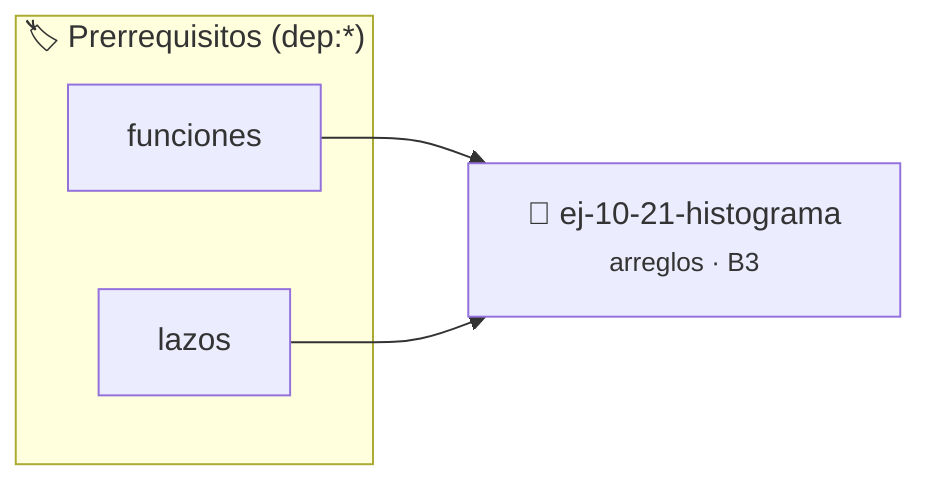

# Histograma
> **ID:** `ej-10-21-histograma`
 · **Tema:** `arreglos`
 · **Bloom:** B3 (Aplicar)
 · **Carga:** ~25 min
>
> **🏷️ Prerrequisitos temáticos (tags):** `dep:funciones`, `dep:lazos`
>
> **Etiquetas conceptuales:** `histograma`, `vectores`, `arreglos`, `memoria`


::: {admonition} 📦 Paquete de Verificación Local (Ripley)
:class: tip

Para compilar, resolver y autoevaluar tu entrega con pruebas unitarias en tu máquina:

- [📥 **Descargar paquete `ej-10-21-histograma.ripkg`**](../../paquetes/ej-10-21-histograma.ripkg)

Ejecución con el asistente de cátedra:
```bash
ripley run ej-10-21-histograma.ripkg
```
:::


### 🗺️ Itinerario Pedagógico




## 📖 Consigna

### Ejercicio 10.21 - Histograma ⭐⭐☆☆☆


Dado un arreglo de enteros no negativos, el programa debe imprimir un histograma
simple usando asteriscos, donde cada número `n` se representa con una línea de
`n` asteriscos.

:::{hint} Lógica y Consideraciones

-   **Proceso:** Usar lazos anidados.
    1.  El lazo exterior recorre cada elemento del arreglo.
    2.  El lazo interior se ejecuta tantas veces como el valor del elemento
        actual, imprimiendo un asterisco en cada una de sus iteraciones.
    3.  Después del lazo interior, se imprime un salto de línea.

-   **[*plus ultra*]:** Optimizar el acceso a memoria respetando el orden por
    filas (*row-major order*) para mejorar el uso de caché.
-   **[*plus ultra*]:** Validar que los índices ingresados se encuentren
    estrictamente dentro de los límites del contenedor.

:::
<!-- {hint} Lógica y Consideraciones -->

:::{tip} Ayuda (pseudocódigo)
:class: dropdown
```{code-block} pseudocode
:linenos:
PROCEDIMIENTO imprimir_histograma(arreglo, tamano)
INICIO
    PARA i DESDE 0 HASTA tamano-1 HACER
        ESCRIBIR i, ": " SIN SALTO DE LÍNEA
        PARA j DESDE 1 HASTA arreglo[i] HACER
            ESCRIBIR "*" SIN SALTO DE LÍNEA
        FIN PARA
        ESCRIBIR SALTO DE LÍNEA
    FIN PARA
FIN PROCEDIMIENTO

```
<!-- {code-block} pseudocode -->

:::
<!-- {tip} Ayuda (pseudocódigo) -->


## 📋 Prototipos y Cabecera (`ej-10-21-histograma.h`)

```{code-block} c
#ifndef EJERCICIO_EJ_10_21_HISTOGRAMA_H
#define EJERCICIO_EJ_10_21_HISTOGRAMA_H

#include <stddef.h>
#include <stdbool.h>
#include <stdint.h>

/* Procesa el flujo principal de Histograma */
int ejecutar_ej_10_21_histograma(int val);

#endif /* EJERCICIO_EJ_10_21_HISTOGRAMA_H */
```


## ⚙️ Especificación de Funciones

| Función | Retorno | Parámetros | Descripción |
| :--- | :--- | :--- | :--- |

| `ejecutar_ej_10_21_histograma` | `int` | `int val` | Procesa el flujo principal de Histograma |


## 💡 Pistas Progresivas

````{tab-set}

```{tab-item} Pista 1
**Proceso:** Usar lazos anidados.
```

```{tab-item} Pista 2
El lazo exterior recorre cada elemento del arreglo.
```

```{tab-item} Pista 3
El lazo interior se ejecuta tantas veces como el valor del elemento actual, imprimiendo un asterisco en cada una de sus iteraciones.
```

```{tab-item} Pista 4
Después del lazo interior, se imprime un salto de línea.
```

```{tab-item} Pista 5
[Plus Ultra] Optimizar el acceso a memoria respetando el orden por filas (*row-major order*) para mejorar el uso de caché.
```

```{tab-item} Pista 6
[Plus Ultra] Validar que los índices ingresados se encuentren estrictamente dentro de los límites del contenedor.
```

````


## 🧪 Casos de Prueba

| Prueba Unitaria | Función Objetivo | Verificación |
| :--- | :--- | :--- |

| **test_ejecutar_ej_10_21_histograma_positivo** | `ejecutar_ej_10_21_histograma` | `int res = ejecutar_ej_10_21_histograma(5); assert(res == 10 || res >= 0);` |

| **test_ejecutar_ej_10_21_histograma_cero** | `ejecutar_ej_10_21_histograma` | `int res = ejecutar_ej_10_21_histograma(0); assert(res == 0);` |


## ✓ Solución Modelo de Cátedra

```{dropdown} 🔍 Revelar solución canónica en C
:open: false

```{code-block} c
/*
 * Ejercicio: Histograma
 * Cátedra Programación I - UNRN
 */

#include <stdio.h>


int ejecutar_ej_10_21_histograma(int val)
{
    if (val <= 0) return 0;
    return val * 2;
}

int main(void)
{
    /* TODO: Implementación de Histograma */
    return 0;
}
```
```
