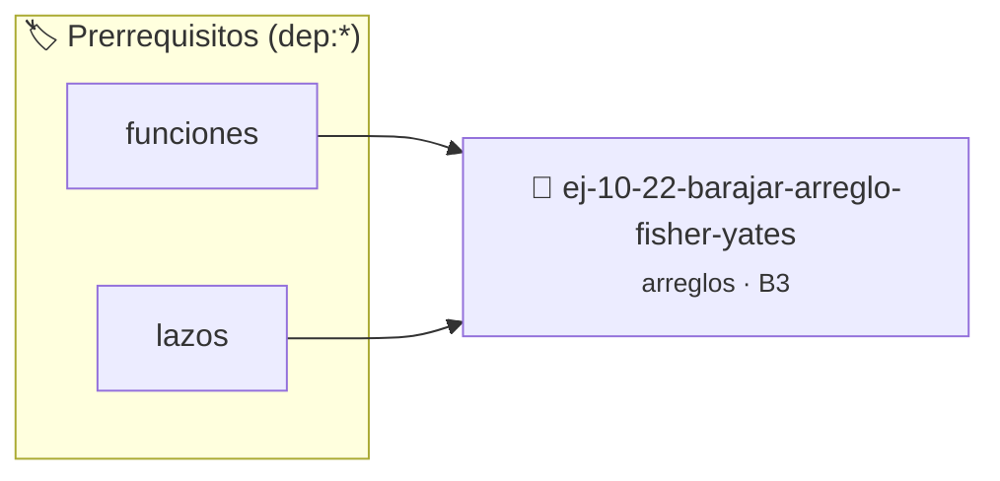

# Barajar arreglo (Fisher-Yates)
> **ID:** `ej-10-22-barajar-arreglo-fisher-yates`
 · **Tema:** `arreglos`
 · **Bloom:** B3 (Aplicar)
 · **Carga:** ~25 min
>
> **🏷️ Prerrequisitos temáticos (tags):** `dep:funciones`, `dep:lazos`
>
> **Etiquetas conceptuales:** `arreglo`, `arreglos`, `fisher-yates`, `memoria`, `vectores`


::: {admonition} 📦 Paquete de Verificación Local (Ripley)
:class: tip

Para compilar, resolver y autoevaluar tu entrega con pruebas unitarias en tu máquina:

- [📥 **Descargar paquete `ej-10-22-barajar-arreglo-fisher-yates.ripkg`**](../../paquetes/ej-10-22-barajar-arreglo-fisher-yates.ripkg)

Ejecución con el asistente de cátedra:
```bash
ripley run ej-10-22-barajar-arreglo-fisher-yates.ripkg
```
:::


### 🗺️ Itinerario Pedagógico




## 📖 Consigna

### Ejercicio 10.22 - Barajar arreglo (Fisher-Yates) ⭐⭐⭐☆☆


Implementar el algoritmo de Fisher-Yates para barajar (desordenar
aleatoriamente) los elementos de un arreglo _in-place_.

:::{hint} Lógica y Consideraciones

-   **Proceso:**
    1.  Recorrer el arreglo desde el último elemento hasta el segundo (`i` desde
        `n-1` hasta 1).
    2.  En cada iteración, generar un índice aleatorio `j` entre 0 e `i`
        (inclusive).
    3.  Intercambiar el elemento en la posición `i` con el elemento en la
        posición `j`.
-   **Aleatoriedad:** Requiere `srand()` y `rand()`.

-   **[*plus ultra*]:** Optimizar el acceso a memoria respetando el orden por
    filas (*row-major order*) para mejorar el uso de caché.
-   **[*plus ultra*]:** Validar que los índices ingresados se encuentren
    estrictamente dentro de los límites del contenedor.

:::
<!-- {hint} Lógica y Consideraciones -->

:::{tip} Ayuda (pseudocódigo)
:class: dropdown
```{code-block} pseudocode
:linenos:
PROCEDIMIENTO barajar_fisher_yates(REF arreglo, tamano)
VARIABLES:
    j, temporal (enteros)
INICIO
    PARA i DESDE tamano-1 HASTA 1 CON PASO -1 HACER
        j = generar_aleatorio(0, i)
        INTERCAMBIAR(arreglo[i], arreglo[j])
    FIN PARA
FIN PROCEDIMIENTO

```
<!-- {code-block} pseudocode -->

:::
<!-- {tip} Ayuda (pseudocódigo) -->


## 📋 Prototipos y Cabecera (`ej-10-22-barajar-arreglo-fisher-yates.h`)

```{code-block} c
#ifndef EJERCICIO_EJ_10_22_BARAJAR_ARREGLO_FISHER_YATES_H
#define EJERCICIO_EJ_10_22_BARAJAR_ARREGLO_FISHER_YATES_H

#include <stddef.h>
#include <stdbool.h>
#include <stdint.h>

/* Procesa el flujo principal de Barajar arreglo (Fisher-Yates) */
int proc_arreglo_fisher_yates(int val);

#endif /* EJERCICIO_EJ_10_22_BARAJAR_ARREGLO_FISHER_YATES_H */
```


## ⚙️ Especificación de Funciones

| Función | Retorno | Parámetros | Descripción |
| :--- | :--- | :--- | :--- |

| `proc_arreglo_fisher_yates` | `int` | `int val` | Procesa el flujo principal de Barajar arreglo (Fisher-Yates) |


## 💡 Pistas Progresivas

````{tab-set}

```{tab-item} Pista 1
**Proceso:**
```

```{tab-item} Pista 2
Recorrer el arreglo desde el último elemento hasta el segundo (`i` desde `n-1` hasta 1).
```

```{tab-item} Pista 3
En cada iteración, generar un índice aleatorio `j` entre 0 e `i` (inclusive).
```

```{tab-item} Pista 4
Intercambiar el elemento en la posición `i` con el elemento en la posición `j`.
```

```{tab-item} Pista 5
**Aleatoriedad:** Requiere `srand()` y `rand()`.
```

```{tab-item} Pista 6
[Plus Ultra] Optimizar el acceso a memoria respetando el orden por filas (*row-major order*) para mejorar el uso de caché.
```

```{tab-item} Pista 7
[Plus Ultra] Validar que los índices ingresados se encuentren estrictamente dentro de los límites del contenedor.
```

````


## 🧪 Casos de Prueba

| Prueba Unitaria | Función Objetivo | Verificación |
| :--- | :--- | :--- |

| **test_proc_arreglo_fisher_yates_positivo** | `proc_arreglo_fisher_yates` | `int res = proc_arreglo_fisher_yates(5); assert(res == 10 || res >= 0);` |

| **test_proc_arreglo_fisher_yates_cero** | `proc_arreglo_fisher_yates` | `int res = proc_arreglo_fisher_yates(0); assert(res == 0);` |


## ✓ Solución Modelo de Cátedra

```{dropdown} 🔍 Revelar solución canónica en C
:open: false

```{code-block} c
/*
 * Ejercicio: Barajar arreglo (Fisher-Yates)
 * Cátedra Programación I - UNRN
 */

#include <stdio.h>


int proc_arreglo_fisher_yates(int val)
{
    if (val <= 0) return 0;
    return val * 2;
}

int main(void)
{
    /* TODO: Implementación de Barajar arreglo (Fisher-Yates) */
    return 0;
}
```
```
