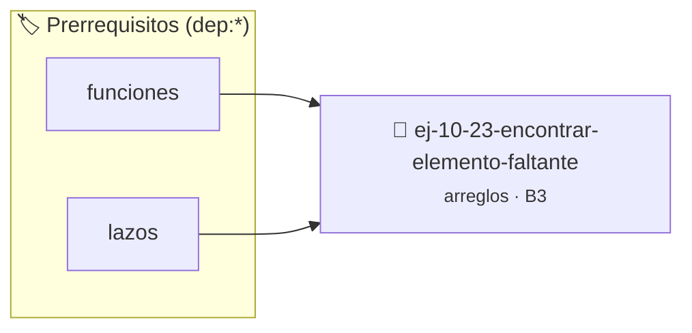

# Encontrar elemento faltante
> **ID:** `ej-10-23-encontrar-elemento-faltante` · **Unidad:** 2 (Tipos Compuestos y Direccionamiento)
 · **Tema:** `arreglos` / `encontrar`
 · **Bloom:** B3 (Aplicar) · **Dificultad:** Intermedia
 · **Carga:** ~25 min · **Tipo:** Practica Guiada
>
> **🏷️ Prerrequisitos temáticos (tags):** `dep:funciones`, `dep:lazos`
>
> **Etiquetas conceptuales:** `encontrar`, `arreglos`, `memoria`, `vectores`, `faltante`


::: {admonition} 📦 Paquete de Verificación Local (Ripley)
:class: tip

Para compilar, resolver y autoevaluar tu entrega con pruebas unitarias en tu máquina:

- [📥 **Descargar paquete `ej-10-23-encontrar-elemento-faltante.ripkg`**](../../paquetes/ej-10-23-encontrar-elemento-faltante.ripkg)

Ejecución con el asistente de cátedra:
```bash
ripley run ej-10-23-encontrar-elemento-faltante.ripkg
```
:::


### 🗺️ Itinerario Pedagógico




## 📖 Consigna

Dado un arreglo que contiene `n-1` números distintos en el rango de 1 a `n`,
encontrar el único número que falta.


:::{tip} Ayuda (pseudocódigo)
:class: dropdown
```{code-block} pseudocode
:linenos:
FUNCION encontrar_faltante(arreglo, tamano_actual)
VARIABLES:
    n, suma_esperada, suma_real (enteros)
INICIO
    n = tamano_actual + 1
    suma_esperada = n * (n + 1) / 2
    suma_real = sumar_arreglo(arreglo, tamano_actual)
    RETORNAR suma_esperada - suma_real
FIN FUNCION

```

:::

### 📋 Contrato de las Funciones

```c
/*
 * Procesa el flujo principal de Encontrar elemento faltante
 * Precondiciones: val representa el parámetro de entrada del flujo.
 * Postcondiciones: Retorna el resultado correspondiente o 0 si val <= 0.
 */
int proc_ar_elemento_faltante(int val);

```

### 🧪 Ejemplos de Ejecución

::::{tab-set}
:::{tab-item} Valor positivo
```text
Entrada: 5
Salida / Retorno: 10
```
:::
:::{tab-item} Valor cero o negativo
```text
Entrada: 0
Salida / Retorno: 0
```
:::
::::

### ⚠️ Precondiciones y Casos Borde

1. **Valores fuera de rango:** Verificar siempre que los datos de entrada cumplan con los rangos admisibles antes de operar.
6. **Casos vacíos o neutros:** Contemplar adecuadamente entradas con longitud cero o valores neutros según corresponda.

### 🎯 Criterios de Aceptación

- [ ] El código compila limpiamente bajo estándar C11 sin warnings con flags estrictos (`-Wall -Wextra -Werror`).
- [ ] Se satisfacen todas las pruebas unitarias y casos de prueba provistos.
- [ ] Las funciones validan exhaustivamente sus precondiciones y gestionan casos borde de forma robusta.

:::{hint} Consideraciones Didácticas
- **Proceso (Suma):**
- Calcular la suma esperada de todos los números de 1 a `n` usando la fórmula de la progresión aritmética: `suma_esperada = n * (n + 1) / 2`.
- Calcular la suma real de los elementos en el arreglo dado.
- El número faltante es la diferencia: `suma_esperada - suma_real`.
- **Proceso (XOR):** El XOR de todos los números del rango con todos los números del arreglo dará como resultado el número faltante.
- Optimizar el acceso a memoria respetando el orden por filas (*row-major order*) para mejorar el uso de caché.
- Validar que los índices ingresados se encuentren estrictamente dentro de los límites del contenedor.
:::


## 📋 Prototipos y Cabecera (`ej-10-23-encontrar-elemento-faltante.h`)

```{code-block} c
#ifndef EJERCICIO_EJ_10_23_ENCONTRAR_ELEMENTO_FALTANTE_H
#define EJERCICIO_EJ_10_23_ENCONTRAR_ELEMENTO_FALTANTE_H

#include <stddef.h>
#include <stdbool.h>
#include <stdint.h>

/* Procesa el flujo principal de Encontrar elemento faltante */
int proc_ar_elemento_faltante(int val);

#endif /* EJERCICIO_EJ_10_23_ENCONTRAR_ELEMENTO_FALTANTE_H */
```


## ⚙️ Especificación de Funciones

| Función | Retorno | Parámetros | Descripción |
| :--- | :--- | :--- | :--- |

| `proc_ar_elemento_faltante` | `int` | `int val` | Procesa el flujo principal de Encontrar elemento faltante |


## 💡 Pistas Progresivas

````{tab-set}

```{tab-item} Pista 1
**Proceso (Suma):**
```

```{tab-item} Pista 2
Calcular la suma esperada de todos los números de 1 a `n` usando la fórmula de la progresión aritmética: `suma_esperada = n * (n + 1) / 2`.
```

```{tab-item} Pista 3
Calcular la suma real de los elementos en el arreglo dado.
```

```{tab-item} Pista 4
El número faltante es la diferencia: `suma_esperada - suma_real`.
```

```{tab-item} Pista 5
**Proceso (XOR):** El XOR de todos los números del rango con todos los números del arreglo dará como resultado el número faltante.
```

```{tab-item} Pista 6
[Plus Ultra] Optimizar el acceso a memoria respetando el orden por filas (*row-major order*) para mejorar el uso de caché.
```

```{tab-item} Pista 7
[Plus Ultra] Validar que los índices ingresados se encuentren estrictamente dentro de los límites del contenedor.
```

````


## 🧪 Casos de Prueba

| Prueba Unitaria | Función Objetivo | Verificación |
| :--- | :--- | :--- |

| **test_proc_ar_elemento_faltante_positivo** | `proc_ar_elemento_faltante` | `int res = proc_ar_elemento_faltante(5); assert(res == 10 || res >= 0);` |

| **test_proc_ar_elemento_faltante_cero** | `proc_ar_elemento_faltante` | `int res = proc_ar_elemento_faltante(0); assert(res == 0);` |


## ✓ Solución Modelo de Cátedra

```{dropdown} 🔍 Revelar solución canónica en C
:open: false

```{code-block} c
/*
 * Ejercicio: Encontrar elemento faltante
 * Cátedra Programación I - UNRN
 */

#include <stdio.h>


int proc_ar_elemento_faltante(int val)
{
    if (val <= 0) return 0;
    return val * 2;
}

int main(void)
{
    /* TODO: Implementación de Encontrar elemento faltante */
    return 0;
}
```
```
