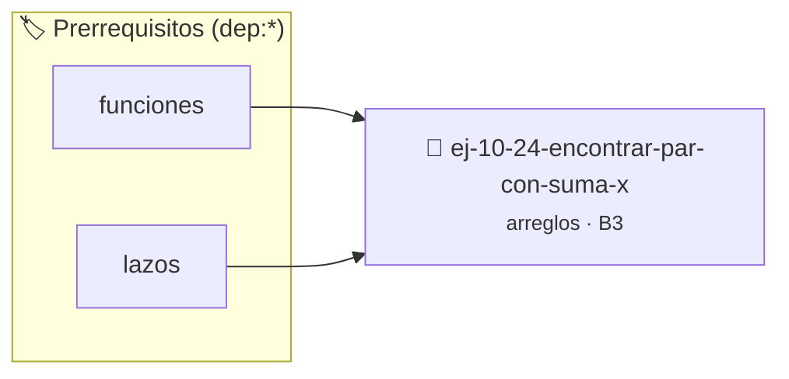

# Encontrar par con suma X
> **ID:** `ej-10-24-encontrar-par-con-suma-x` · **Unidad:** 2 (Tipos Compuestos y Direccionamiento)
 · **Tema:** `arreglos` / `vectores`
 · **Bloom:** B3 (Aplicar) · **Dificultad:** Intermedia
 · **Carga:** ~25 min · **Tipo:** Practica Guiada
>
> **🏷️ Prerrequisitos temáticos (tags):** `dep:funciones`, `dep:lazos`
>
> **Etiquetas conceptuales:** `vectores`, `arreglos`, `encontrar`, `memoria`


::: {admonition} 📦 Paquete de Verificación Local (Ripley)
:class: tip

Para compilar, resolver y autoevaluar tu entrega con pruebas unitarias en tu máquina:

- [📥 **Descargar paquete `ej-10-24-encontrar-par-con-suma-x.ripkg`**](../../paquetes/ej-10-24-encontrar-par-con-suma-x.ripkg)

Ejecución con el asistente de cátedra:
```bash
ripley run ej-10-24-encontrar-par-con-suma-x.ripkg
```
:::


### 🗺️ Itinerario Pedagógico




## 📖 Consigna

### Ejercicio 10.24 - Encontrar par con suma X ⭐⭐☆☆☆


Dado un arreglo de números y un valor `X`, determinar si existe un par de
elementos en el arreglo cuya suma sea exactamente `X`.

:::{hint} Lógica y Consideraciones

-   **Proceso (Ordenando):**
    1.  Ordenar el arreglo.
    2.  Usar dos punteros: `izquierda` en el inicio y `derecha` en el final.
    3.  Mientras `izquierda < derecha`:
        a. Calcular la suma `s = arreglo[izquierda] + arreglo[derecha]`.
        b. Si `s == X`, se encontró el par.
        c. Si `s < X`, se necesita una suma mayor, así que se mueve `izquierda`
        a la derecha.
        d. Si `s > X`, se necesita una suma menor, así que se mueve `derecha` a
        la izquierda.

-   **[*plus ultra*]:** Validar punteros `NULL` recibidos como parámetro para
    evitar fallos de segmentación.
-   **[*plus ultra*]:** Implementar una versión utilizando aritmética de
    punteros en lugar de indexación directa.

:::
<!-- {hint} Lógica y Consideraciones -->

:::{tip} Ayuda (pseudocódigo)
:class: dropdown
```{code-block} pseudocode
:linenos:
FUNCION existe_par_con_suma(arreglo, tamano, X)
VARIABLES:
    izquierda, derecha, suma (enteros)
INICIO
    ORDENAR(arreglo, tamano)
    izquierda = 0, derecha = tamano - 1

    MIENTRAS izquierda < derecha HACER
        suma = arreglo[izquierda] + arreglo[derecha]
        SI suma == X ENTONCES
            RETORNAR VERDADERO
        SINO SI suma < X ENTONCES
            izquierda = izquierda + 1
        SINO
            derecha = derecha - 1
        FIN SI
    FIN MIENTRAS
    RETORNAR FALSO
FIN FUNCION

```
<!-- {code-block} pseudocode -->

:::
<!-- {tip} Ayuda (pseudocódigo) -->


## 📋 Prototipos y Cabecera (`ej-10-24-encontrar-par-con-suma-x.h`)

```{code-block} c
#ifndef EJERCICIO_EJ_10_24_ENCONTRAR_PAR_CON_SUMA_X_H
#define EJERCICIO_EJ_10_24_ENCONTRAR_PAR_CON_SUMA_X_H

#include <stddef.h>
#include <stdbool.h>
#include <stdint.h>

/* Procesa el flujo principal de Encontrar par con suma X */
int proc_ntrar_par_con_suma_x(int val);

#endif /* EJERCICIO_EJ_10_24_ENCONTRAR_PAR_CON_SUMA_X_H */
```


## ⚙️ Especificación de Funciones

| Función | Retorno | Parámetros | Descripción |
| :--- | :--- | :--- | :--- |

| `proc_ntrar_par_con_suma_x` | `int` | `int val` | Procesa el flujo principal de Encontrar par con suma X |


## 💡 Pistas Progresivas

````{tab-set}

```{tab-item} Pista 1
**Proceso (Ordenando):**
```

```{tab-item} Pista 2
Ordenar el arreglo.
```

```{tab-item} Pista 3
Usar dos punteros: `izquierda` en el inicio y `derecha` en el final.
```

```{tab-item} Pista 4
Mientras `izquierda < derecha`: a. Calcular la suma `s = arreglo[izquierda] + arreglo[derecha]`. b. Si `s == X`, se encontró el par. c. Si `s < X`, se necesita una suma mayor, así que se mueve `izquierda` a la derecha. d. Si `s > X`, se necesita una suma menor, así que se mueve `derecha` a la izquierda.
```

```{tab-item} Pista 5
[Plus Ultra] Validar punteros `NULL` recibidos como parámetro para evitar fallos de segmentación.
```

```{tab-item} Pista 6
[Plus Ultra] Implementar una versión utilizando aritmética de punteros en lugar de indexación directa.
```

````


## 🧪 Casos de Prueba

| Prueba Unitaria | Función Objetivo | Verificación |
| :--- | :--- | :--- |

| **test_proc_ntrar_par_con_suma_x_positivo** | `proc_ntrar_par_con_suma_x` | `int res = proc_ntrar_par_con_suma_x(5); assert(res == 10 || res >= 0);` |

| **test_proc_ntrar_par_con_suma_x_cero** | `proc_ntrar_par_con_suma_x` | `int res = proc_ntrar_par_con_suma_x(0); assert(res == 0);` |


## ✓ Solución Modelo de Cátedra

```{dropdown} 🔍 Revelar solución canónica en C
:open: false

```{code-block} c
/*
 * Ejercicio: Encontrar par con suma X
 * Cátedra Programación I - UNRN
 */

#include <stdio.h>


int proc_ntrar_par_con_suma_x(int val)
{
    if (val <= 0) return 0;
    return val * 2;
}

int main(void)
{
    /* TODO: Implementación de Encontrar par con suma X */
    return 0;
}
```
```
