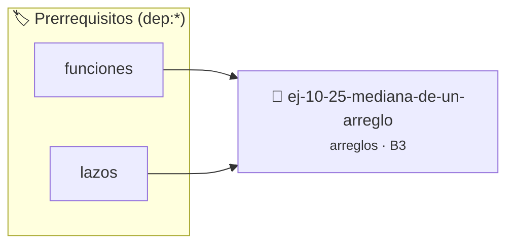

# Mediana de un arreglo
> **ID:** `ej-10-25-mediana-de-un-arreglo`
 · **Tema:** `arreglos`
 · **Bloom:** B3 (Aplicar)
 · **Carga:** ~25 min
>
> **🏷️ Prerrequisitos temáticos (tags):** `dep:funciones`, `dep:lazos`
>
> **Etiquetas conceptuales:** `arreglo`, `mediana`, `arreglos`, `memoria`, `vectores`


::: {admonition} 📦 Paquete de Verificación Local (Ripley)
:class: tip

Para compilar, resolver y autoevaluar tu entrega con pruebas unitarias en tu máquina:

- [📥 **Descargar paquete `ej-10-25-mediana-de-un-arreglo.ripkg`**](../../paquetes/ej-10-25-mediana-de-un-arreglo.ripkg)

Ejecución con el asistente de cátedra:
```bash
ripley run ej-10-25-mediana-de-un-arreglo.ripkg
```
:::


### 🗺️ Itinerario Pedagógico




## 📖 Consigna

### Ejercicio 10.25 - Mediana de un arreglo ⭐⭐⭐☆☆


Calcular la mediana de un arreglo. La mediana es el valor que se encuentra en la
posición central de un arreglo ordenado. Si el arreglo tiene un número par de
elementos, la mediana es el promedio de los dos elementos centrales.

:::{hint} Lógica y Consideraciones

-   **Proceso:**
    1.  Ordenar el arreglo.
    2.  Determinar el índice del medio: `medio = tamano / 2`.
    3.  Si el tamaño es impar, la mediana es `arreglo[medio]`.
    4.  Si el tamaño es par, la mediana es `(arreglo[medio - 1] +
        arreglo[medio]) / 2.0`.

-   **[*plus ultra*]:** Optimizar el acceso a memoria respetando el orden por
    filas (*row-major order*) para mejorar el uso de caché.
-   **[*plus ultra*]:** Validar que los índices ingresados se encuentren
    estrictamente dentro de los límites del contenedor.

:::
<!-- {hint} Lógica y Consideraciones -->

:::{tip} Ayuda (pseudocódigo)
:class: dropdown
```{code-block} pseudocode
:linenos:
FUNCION calcular_mediana(arreglo, tamano)
INICIO
    ORDENAR(arreglo, tamano)
    SI tamano MOD 2 != 0 ENTONCES
        RETORNAR arreglo[tamano / 2]
    SINO
        RETORNAR (arreglo[tamano/2 - 1] + arreglo[tamano/2]) / 2.0
    FIN SI
    FIN FUNCION

```
<!-- {code-block} pseudocode -->

:::
<!-- {tip} Ayuda (pseudocódigo) -->


## 📋 Prototipos y Cabecera (`ej-10-25-mediana-de-un-arreglo.h`)

```{code-block} c
#ifndef EJERCICIO_EJ_10_25_MEDIANA_DE_UN_ARREGLO_H
#define EJERCICIO_EJ_10_25_MEDIANA_DE_UN_ARREGLO_H

#include <stddef.h>
#include <stdbool.h>
#include <stdint.h>

/* Procesa el flujo principal de Mediana de un arreglo */
int proc_ediana_de_un_arreglo(int val);

#endif /* EJERCICIO_EJ_10_25_MEDIANA_DE_UN_ARREGLO_H */
```


## ⚙️ Especificación de Funciones

| Función | Retorno | Parámetros | Descripción |
| :--- | :--- | :--- | :--- |

| `proc_ediana_de_un_arreglo` | `int` | `int val` | Procesa el flujo principal de Mediana de un arreglo |


## 💡 Pistas Progresivas

````{tab-set}

```{tab-item} Pista 1
**Proceso:**
```

```{tab-item} Pista 2
Ordenar el arreglo.
```

```{tab-item} Pista 3
Determinar el índice del medio: `medio = tamano / 2`.
```

```{tab-item} Pista 4
Si el tamaño es impar, la mediana es `arreglo[medio]`.
```

```{tab-item} Pista 5
Si el tamaño es par, la mediana es `(arreglo[medio - 1] + arreglo[medio]) / 2.0`.
```

```{tab-item} Pista 6
[Plus Ultra] Optimizar el acceso a memoria respetando el orden por filas (*row-major order*) para mejorar el uso de caché.
```

```{tab-item} Pista 7
[Plus Ultra] Validar que los índices ingresados se encuentren estrictamente dentro de los límites del contenedor.
```

````


## 🧪 Casos de Prueba

| Prueba Unitaria | Función Objetivo | Verificación |
| :--- | :--- | :--- |

| **test_proc_ediana_de_un_arreglo_positivo** | `proc_ediana_de_un_arreglo` | `int res = proc_ediana_de_un_arreglo(5); assert(res == 10 || res >= 0);` |

| **test_proc_ediana_de_un_arreglo_cero** | `proc_ediana_de_un_arreglo` | `int res = proc_ediana_de_un_arreglo(0); assert(res == 0);` |


## ✓ Solución Modelo de Cátedra

```{dropdown} 🔍 Revelar solución canónica en C
:open: false

```{code-block} c
/*
 * Ejercicio: Mediana de un arreglo
 * Cátedra Programación I - UNRN
 */

#include <stdio.h>


int proc_ediana_de_un_arreglo(int val)
{
    if (val <= 0) return 0;
    return val * 2;
}

int main(void)
{
    /* TODO: Implementación de Mediana de un arreglo */
    return 0;
}
```
```
