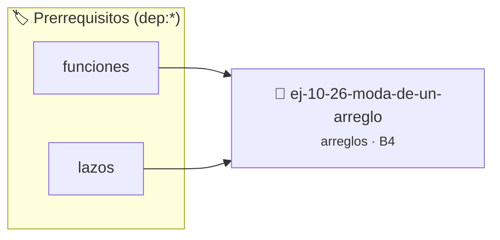

# Moda de un arreglo
> **ID:** `ej-10-26-moda-de-un-arreglo` · **Unidad:** 2 (Tipos Compuestos y Direccionamiento)
 · **Tema:** `arreglos` / `arreglo`
 · **Bloom:** B4 (Analizar) · **Dificultad:** Avanzada
 · **Carga:** ~35 min · **Tipo:** Practica Guiada
>
> **🏷️ Prerrequisitos temáticos (tags):** `dep:funciones`, `dep:lazos`
>
> **Etiquetas conceptuales:** `arreglo`, `vectores`, `arreglos`, `memoria`


::: {admonition} 📦 Paquete de Verificación Local (Ripley)
:class: tip

Para compilar, resolver y autoevaluar tu entrega con pruebas unitarias en tu máquina:

- [📥 **Descargar paquete `ej-10-26-moda-de-un-arreglo.ripkg`**](../../paquetes/ej-10-26-moda-de-un-arreglo.ripkg)

Ejecución con el asistente de cátedra:
```bash
ripley run ej-10-26-moda-de-un-arreglo.ripkg
```
:::


### 🗺️ Itinerario Pedagógico




## 📖 Consigna

Encontrar la moda de un arreglo, que es el elemento que aparece con mayor
frecuencia.


:::{tip} Ayuda (pseudocódigo)
:class: dropdown
```{code-block} pseudocode
:linenos:
FUNCION encontrar_moda(arreglo, tamano)
VARIABLES:
    moda, max_frecuencia, frec_actual, elemento_actual
INICIO
    ORDENAR(arreglo, tamano)
    moda = arreglo[0], max_frecuencia = 1, frec_actual = 1

    PARA i DESDE 1 HASTA tamano-1 HACER
        SI arreglo[i] == arreglo[i-1] ENTONCES
            frec_actual = frec_actual + 1
        SINO
            frec_actual = 1
        FIN SI
        SI frec_actual > max_frecuencia ENTONCES
            max_frecuencia = frec_actual
            moda = arreglo[i]
        FIN SI
    FIN PARA
    RETORNAR moda
FIN FUNCION

```

:::

### 📋 Contrato de las Funciones

```c
/*
 * Procesa el flujo principal de Moda de un arreglo
 * Precondiciones: val representa el parámetro de entrada del flujo.
 * Postcondiciones: Retorna el resultado correspondiente o 0 si val <= 0.
 */
int proc_6_moda_de_un_arreglo(int val);

```

### 🧪 Ejemplos de Ejecución

::::{tab-set}
:::{tab-item} Valor positivo
```text
Entrada: 5
Salida / Retorno: 10
```
:::
:::{tab-item} Valor cero o negativo
```text
Entrada: 0
Salida / Retorno: 0
```
:::
::::

### ⚠️ Precondiciones y Casos Borde

1. **Valores fuera de rango:** Verificar siempre que los datos de entrada cumplan con los rangos admisibles antes de operar.
6. **Casos vacíos o neutros:** Contemplar adecuadamente entradas con longitud cero o valores neutros según corresponda.

### 🎯 Criterios de Aceptación

- [ ] El código compila limpiamente bajo estándar C11 sin warnings con flags estrictos (`-Wall -Wextra -Werror`).
- [ ] Se satisfacen todas las pruebas unitarias y casos de prueba provistos.
- [ ] Las funciones validan exhaustivamente sus precondiciones y gestionan casos borde de forma robusta.

:::{hint} Consideraciones Didácticas
- **Proceso (con ordenamiento):**
- Ordenar el arreglo. Esto agrupa los elementos iguales.
- Recorrer el arreglo y contar la longitud de cada secuencia de elementos idénticos.
- Llevar un registro del elemento con la frecuencia más alta encontrada hasta el momento.
- Garantizar la terminación con `\0` y prevenir desbordamientos de búfer validando la capacidad máxima.
- Soportar la lectura de cadenas con espacios y múltiples líneas de manera robusta.
:::


## 📋 Prototipos y Cabecera (`ej-10-26-moda-de-un-arreglo.h`)

```{code-block} c
#ifndef EJERCICIO_EJ_10_26_MODA_DE_UN_ARREGLO_H
#define EJERCICIO_EJ_10_26_MODA_DE_UN_ARREGLO_H

#include <stddef.h>
#include <stdbool.h>
#include <stdint.h>

/* Procesa el flujo principal de Moda de un arreglo */
int proc_6_moda_de_un_arreglo(int val);

#endif /* EJERCICIO_EJ_10_26_MODA_DE_UN_ARREGLO_H */
```


## ⚙️ Especificación de Funciones

| Función | Retorno | Parámetros | Descripción |
| :--- | :--- | :--- | :--- |

| `proc_6_moda_de_un_arreglo` | `int` | `int val` | Procesa el flujo principal de Moda de un arreglo |


## 💡 Pistas Progresivas

````{tab-set}

```{tab-item} Pista 1
**Proceso (con ordenamiento):**
```

```{tab-item} Pista 2
Ordenar el arreglo. Esto agrupa los elementos iguales.
```

```{tab-item} Pista 3
Recorrer el arreglo y contar la longitud de cada secuencia de elementos idénticos.
```

```{tab-item} Pista 4
Llevar un registro del elemento con la frecuencia más alta encontrada hasta el momento.
```

```{tab-item} Pista 5
[Plus Ultra] Garantizar la terminación con `\0` y prevenir desbordamientos de búfer validando la capacidad máxima.
```

```{tab-item} Pista 6
[Plus Ultra] Soportar la lectura de cadenas con espacios y múltiples líneas de manera robusta.
```

````


## 🧪 Casos de Prueba

| Prueba Unitaria | Función Objetivo | Verificación |
| :--- | :--- | :--- |

| **test_proc_6_moda_de_un_arreglo_positivo** | `proc_6_moda_de_un_arreglo` | `int res = proc_6_moda_de_un_arreglo(5); assert(res == 10 || res >= 0);` |

| **test_proc_6_moda_de_un_arreglo_cero** | `proc_6_moda_de_un_arreglo` | `int res = proc_6_moda_de_un_arreglo(0); assert(res == 0);` |


## ✓ Solución Modelo de Cátedra

```{dropdown} 🔍 Revelar solución canónica en C
:open: false

```{code-block} c
/*
 * Ejercicio: Moda de un arreglo
 * Cátedra Programación I - UNRN
 */

#include <stdio.h>


int proc_6_moda_de_un_arreglo(int val)
{
    if (val <= 0) return 0;
    return val * 2;
}

int main(void)
{
    /* TODO: Implementación de Moda de un arreglo */
    return 0;
}
```
```
