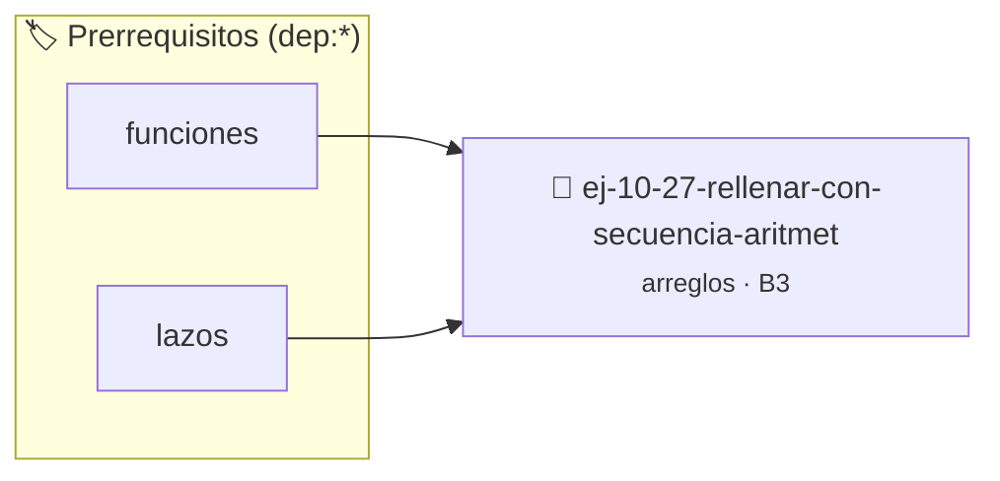

# Rellenar con secuencia aritmética
> **ID:** `ej-10-27-rellenar-con-secuencia-aritmet`
 · **Tema:** `arreglos`
 · **Bloom:** B3 (Aplicar)
 · **Carga:** ~25 min
>
> **🏷️ Prerrequisitos temáticos (tags):** `dep:funciones`, `dep:lazos`
>
> **Etiquetas conceptuales:** `secuencia`, `arreglos`, `memoria`, `aritmetica`, `rellenar`


::: {admonition} 📦 Paquete de Verificación Local (Ripley)
:class: tip

Para compilar, resolver y autoevaluar tu entrega con pruebas unitarias en tu máquina:

- [📥 **Descargar paquete `ej-10-27-rellenar-con-secuencia-aritmet.ripkg`**](../../paquetes/ej-10-27-rellenar-con-secuencia-aritmet.ripkg)

Ejecución con el asistente de cátedra:
```bash
ripley run ej-10-27-rellenar-con-secuencia-aritmet.ripkg
```
:::


### 🗺️ Itinerario Pedagógico




## 📖 Consigna

### Ejercicio 10.27 - Rellenar con secuencia aritmética ⭐⭐☆☆☆


Escribir una función que llene un arreglo con los términos de una secuencia
aritmética, dados un valor de inicio, un tamaño y un paso (la diferencia
constante entre términos).

:::{hint} Lógica y Consideraciones

-   **Entrada:** Un arreglo, su tamaño, un valor de `inicio` y un `paso`.
-   **Proceso:** Recorrer el arreglo con un lazo `for`. Para cada índice `i`, el
    valor a asignar es `inicio + (i * paso)`.

-   **[*plus ultra*]:** Optimizar el acceso a memoria respetando el orden por
    filas (*row-major order*) para mejorar el uso de caché.
-   **[*plus ultra*]:** Validar que los índices ingresados se encuentren
    estrictamente dentro de los límites del contenedor.

:::
<!-- {hint} Lógica y Consideraciones -->

:::{tip} Ayuda (pseudocódigo)
:class: dropdown
```{code-block} pseudocode
:linenos:
PROCEDIMIENTO rellenar_secuencia(REF arreglo, tamano, inicio, paso)
INICIO
    PARA i DESDE 0 HASTA tamano-1 HACER
        arreglo[i] = inicio + (i * paso)
    FIN PARA
FIN PROCEDIMIENTO

```
<!-- {code-block} pseudocode -->

:::
<!-- {tip} Ayuda (pseudocódigo) -->


## 📋 Prototipos y Cabecera (`ej-10-27-rellenar-con-secuencia-aritmet.h`)

```{code-block} c
#ifndef EJERCICIO_EJ_10_27_RELLENAR_CON_SECUENCIA_ARITMET_H
#define EJERCICIO_EJ_10_27_RELLENAR_CON_SECUENCIA_ARITMET_H

#include <stddef.h>
#include <stdbool.h>
#include <stdint.h>

/* Procesa el flujo principal de Rellenar con secuencia aritmética */
int proc_on_secuencia_aritmet(int val);

#endif /* EJERCICIO_EJ_10_27_RELLENAR_CON_SECUENCIA_ARITMET_H */
```


## ⚙️ Especificación de Funciones

| Función | Retorno | Parámetros | Descripción |
| :--- | :--- | :--- | :--- |

| `proc_on_secuencia_aritmet` | `int` | `int val` | Procesa el flujo principal de Rellenar con secuencia aritmética |


## 💡 Pistas Progresivas

````{tab-set}

```{tab-item} Pista 1
**Entrada:** Un arreglo, su tamaño, un valor de `inicio` y un `paso`.
```

```{tab-item} Pista 2
**Proceso:** Recorrer el arreglo con un lazo `for`. Para cada índice `i`, el valor a asignar es `inicio + (i * paso)`.
```

```{tab-item} Pista 3
[Plus Ultra] Optimizar el acceso a memoria respetando el orden por filas (*row-major order*) para mejorar el uso de caché.
```

```{tab-item} Pista 4
[Plus Ultra] Validar que los índices ingresados se encuentren estrictamente dentro de los límites del contenedor.
```

````


## 🧪 Casos de Prueba

| Prueba Unitaria | Función Objetivo | Verificación |
| :--- | :--- | :--- |

| **test_proc_on_secuencia_aritmet_positivo** | `proc_on_secuencia_aritmet` | `int res = proc_on_secuencia_aritmet(5); assert(res == 10 || res >= 0);` |

| **test_proc_on_secuencia_aritmet_cero** | `proc_on_secuencia_aritmet` | `int res = proc_on_secuencia_aritmet(0); assert(res == 0);` |


## ✓ Solución Modelo de Cátedra

```{dropdown} 🔍 Revelar solución canónica en C
:open: false

```{code-block} c
/*
 * Ejercicio: Rellenar con secuencia aritmética
 * Cátedra Programación I - UNRN
 */

#include <stdio.h>


int proc_on_secuencia_aritmet(int val)
{
    if (val <= 0) return 0;
    return val * 2;
}

int main(void)
{
    /* TODO: Implementación de Rellenar con secuencia aritmética */
    return 0;
}
```
```
