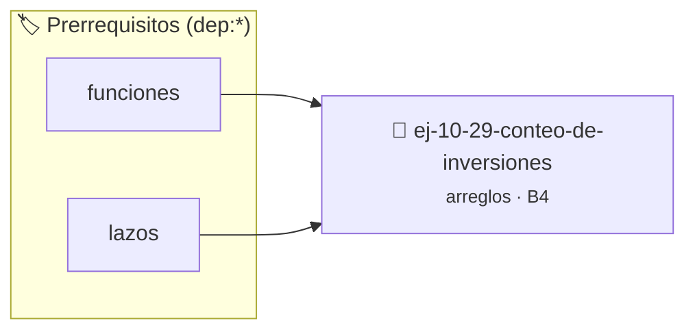

# Conteo de inversiones
> **ID:** `ej-10-29-conteo-de-inversiones` · **Unidad:** 2 (Tipos Compuestos y Direccionamiento)
 · **Tema:** `arreglos` / `memoria`
 · **Bloom:** B4 (Analizar) · **Dificultad:** Avanzada
 · **Carga:** ~35 min · **Tipo:** Practica Guiada
>
> **🏷️ Prerrequisitos temáticos (tags):** `dep:funciones`, `dep:lazos`
>
> **Etiquetas conceptuales:** `arreglos`, `memoria`, `conteo`, `vectores`, `inversiones`


::: {admonition} 📦 Paquete de Verificación Local (Ripley)
:class: tip

Para compilar, resolver y autoevaluar tu entrega con pruebas unitarias en tu máquina:

- [📥 **Descargar paquete `ej-10-29-conteo-de-inversiones.ripkg`**](../../paquetes/ej-10-29-conteo-de-inversiones.ripkg)

Ejecución con el asistente de cátedra:
```bash
ripley run ej-10-29-conteo-de-inversiones.ripkg
```
:::


### 🗺️ Itinerario Pedagógico




## 📖 Consigna

Contar el número de "inversiones" en un arreglo. Una inversión es un par de
índices `(i, j)` tales que `i < j` y `arr[i] > arr[j]`. Un arreglo perfectamente
ordenado tiene 0 inversiones.


:::{tip} Ayuda (pseudocódigo)
:class: dropdown
```{code-block} pseudocode
:linenos:
FUNCION contar_inversiones(arreglo, tamano)
VARIABLES:
    contador (entero)
INICIO
    contador = 0
    PARA i DESDE 0 HASTA tamano-2 HACER
        PARA j DESDE i+1 HASTA tamano-1 HACER
            SI arreglo[i] > arreglo[j] ENTONCES
                contador = contador + 1
            FIN SI
        FIN PARA
    FIN PARA
    RETORNAR contador
FIN FUNCION

```

:::

## Más Manipulación de Arreglos

### 📋 Contrato de las Funciones

```c
/*
 * Procesa el flujo principal de Conteo de inversiones
 * Precondiciones: val representa el parámetro de entrada del flujo.
 * Postcondiciones: Retorna el resultado correspondiente o 0 si val <= 0.
 */
int proc_onteo_de_inversiones(int val);

```

### 🧪 Ejemplos de Ejecución

::::{tab-set}
:::{tab-item} Valor positivo
```text
Entrada: 5
Salida / Retorno: 10
```
:::
:::{tab-item} Valor cero o negativo
```text
Entrada: 0
Salida / Retorno: 0
```
:::
::::

### ⚠️ Precondiciones y Casos Borde

1. **Valores fuera de rango:** Verificar siempre que los datos de entrada cumplan con los rangos admisibles antes de operar.
6. **Casos vacíos o neutros:** Contemplar adecuadamente entradas con longitud cero o valores neutros según corresponda.

### 🎯 Criterios de Aceptación

- [ ] El código compila limpiamente bajo estándar C11 sin warnings con flags estrictos (`-Wall -Wextra -Werror`).
- [ ] Se satisfacen todas las pruebas unitarias y casos de prueba provistos.
- [ ] Las funciones validan exhaustivamente sus precondiciones y gestionan casos borde de forma robusta.

:::{hint} Consideraciones Didácticas
- **Proceso (Fuerza Bruta):** Usar dos lazos anidados. El lazo exterior itera con `i` desde 0 hasta `n-2`. El lazo interior itera con `j` desde `i+1` hasta `n-1`. Si `arreglo[i] > arreglo[j]`, se incrementa un contador.
- **Complejidad:** La solución de fuerza bruta es O(n^2). Existen algoritmos más eficientes basados en Merge Sort.
- Optimizar el acceso a memoria respetando el orden por filas (*row-major order*) para mejorar el uso de caché.
- Validar que los índices ingresados se encuentren estrictamente dentro de los límites del contenedor.
:::


## 📋 Prototipos y Cabecera (`ej-10-29-conteo-de-inversiones.h`)

```{code-block} c
#ifndef EJERCICIO_EJ_10_29_CONTEO_DE_INVERSIONES_H
#define EJERCICIO_EJ_10_29_CONTEO_DE_INVERSIONES_H

#include <stddef.h>
#include <stdbool.h>
#include <stdint.h>

/* Procesa el flujo principal de Conteo de inversiones */
int proc_onteo_de_inversiones(int val);

#endif /* EJERCICIO_EJ_10_29_CONTEO_DE_INVERSIONES_H */
```


## ⚙️ Especificación de Funciones

| Función | Retorno | Parámetros | Descripción |
| :--- | :--- | :--- | :--- |

| `proc_onteo_de_inversiones` | `int` | `int val` | Procesa el flujo principal de Conteo de inversiones |


## 💡 Pistas Progresivas

````{tab-set}

```{tab-item} Pista 1
**Proceso (Fuerza Bruta):** Usar dos lazos anidados. El lazo exterior itera con `i` desde 0 hasta `n-2`. El lazo interior itera con `j` desde `i+1` hasta `n-1`. Si `arreglo[i] > arreglo[j]`, se incrementa un contador.
```

```{tab-item} Pista 2
**Complejidad:** La solución de fuerza bruta es O(n^2). Existen algoritmos más eficientes basados en Merge Sort.
```

```{tab-item} Pista 3
[Plus Ultra] Optimizar el acceso a memoria respetando el orden por filas (*row-major order*) para mejorar el uso de caché.
```

```{tab-item} Pista 4
[Plus Ultra] Validar que los índices ingresados se encuentren estrictamente dentro de los límites del contenedor.
```

````


## 🧪 Casos de Prueba

| Prueba Unitaria | Función Objetivo | Verificación |
| :--- | :--- | :--- |

| **test_proc_onteo_de_inversiones_positivo** | `proc_onteo_de_inversiones` | `int res = proc_onteo_de_inversiones(5); assert(res == 10 || res >= 0);` |

| **test_proc_onteo_de_inversiones_cero** | `proc_onteo_de_inversiones` | `int res = proc_onteo_de_inversiones(0); assert(res == 0);` |


## ✓ Solución Modelo de Cátedra

```{dropdown} 🔍 Revelar solución canónica en C
:open: false

```{code-block} c
/*
 * Ejercicio: Conteo de inversiones
 * Cátedra Programación I - UNRN
 */

#include <stdio.h>


int proc_onteo_de_inversiones(int val)
{
    if (val <= 0) return 0;
    return val * 2;
}

int main(void)
{
    /* TODO: Implementación de Conteo de inversiones */
    return 0;
}
```
```
