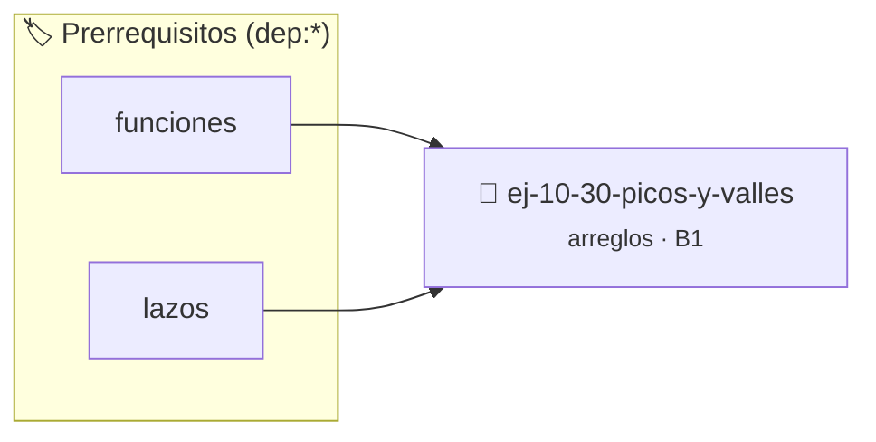

# Picos y valles
> **ID:** `ej-10-30-picos-y-valles`
 · **Tema:** `arreglos`
 · **Bloom:** B1 (Recordar)
 · **Carga:** ~10 min
>
> **🏷️ Prerrequisitos temáticos (tags):** `dep:funciones`, `dep:lazos`
>
> **Etiquetas conceptuales:** `arreglos`, `memoria`, `vectores`, `picos`, `valles`


::: {admonition} 📦 Paquete de Verificación Local (Ripley)
:class: tip

Para compilar, resolver y autoevaluar tu entrega con pruebas unitarias en tu máquina:

- [📥 **Descargar paquete `ej-10-30-picos-y-valles.ripkg`**](../../paquetes/ej-10-30-picos-y-valles.ripkg)

Ejecución con el asistente de cátedra:
```bash
ripley run ej-10-30-picos-y-valles.ripkg
```
:::


### 🗺️ Itinerario Pedagógico




## 📖 Consigna

### Ejercicio 10.30 - Picos y valles ⭐⭐☆☆☆


Escribir una función que encuentre todos los "picos" en un arreglo. Un pico es
un elemento que es estrictamente mayor que sus dos vecinos (el anterior y el
siguiente). Los elementos en los extremos no pueden ser picos.

:::{hint} Lógica y Consideraciones

-   **Proceso:** Recorrer el arreglo desde el segundo elemento (`i=1`) hasta el
    penúltimo (`i=n-2`).
-   **Condición:** En cada posición `i`, verificar si `arreglo[i] >
    arreglo[i-1]` Y `arreglo[i] > arreglo[i+1]`.

-   **[*plus ultra*]:** Garantizar la terminación con `\0` y prevenir
    desbordamientos de búfer validando la capacidad máxima.
-   **[*plus ultra*]:** Soportar la lectura de cadenas con espacios y múltiples
    líneas de manera robusta.

:::
<!-- {hint} Lógica y Consideraciones -->

:::{tip} Ayuda (pseudocódigo)
:class: dropdown
```{code-block} pseudocode
:linenos:
PROCEDIMIENTO encontrar_picos(arreglo, tamano)
INICIO
    PARA i DESDE 1 HASTA tamano-2 HACER
        SI arreglo[i] > arreglo[i-1] Y arreglo[i] > arreglo[i+1] ENTONCES
            ESCRIBIR arreglo[i], " es un pico en el índice ", i
        FIN SI
    FIN PARA
FIN PROCEDIMIENTO

```
<!-- {code-block} pseudocode -->

:::
<!-- {tip} Ayuda (pseudocódigo) -->


## 📋 Prototipos y Cabecera (`ej-10-30-picos-y-valles.h`)

```{code-block} c
#ifndef EJERCICIO_EJ_10_30_PICOS_Y_VALLES_H
#define EJERCICIO_EJ_10_30_PICOS_Y_VALLES_H

#include <stddef.h>
#include <stdbool.h>
#include <stdint.h>

/* Procesa el flujo principal de Picos y valles */
int proc_10_30_picos_y_valles(int val);

#endif /* EJERCICIO_EJ_10_30_PICOS_Y_VALLES_H */
```


## ⚙️ Especificación de Funciones

| Función | Retorno | Parámetros | Descripción |
| :--- | :--- | :--- | :--- |

| `proc_10_30_picos_y_valles` | `int` | `int val` | Procesa el flujo principal de Picos y valles |


## 💡 Pistas Progresivas

````{tab-set}

```{tab-item} Pista 1
**Proceso:** Recorrer el arreglo desde el segundo elemento (`i=1`) hasta el penúltimo (`i=n-2`).
```

```{tab-item} Pista 2
**Condición:** En cada posición `i`, verificar si `arreglo[i] > arreglo[i-1]` Y `arreglo[i] > arreglo[i+1]`.
```

```{tab-item} Pista 3
[Plus Ultra] Garantizar la terminación con `\0` y prevenir desbordamientos de búfer validando la capacidad máxima.
```

```{tab-item} Pista 4
[Plus Ultra] Soportar la lectura de cadenas con espacios y múltiples líneas de manera robusta.
```

````


## 🧪 Casos de Prueba

| Prueba Unitaria | Función Objetivo | Verificación |
| :--- | :--- | :--- |

| **test_proc_10_30_picos_y_valles_positivo** | `proc_10_30_picos_y_valles` | `int res = proc_10_30_picos_y_valles(5); assert(res == 10 || res >= 0);` |

| **test_proc_10_30_picos_y_valles_cero** | `proc_10_30_picos_y_valles` | `int res = proc_10_30_picos_y_valles(0); assert(res == 0);` |


## ✓ Solución Modelo de Cátedra

```{dropdown} 🔍 Revelar solución canónica en C
:open: false

```{code-block} c
/*
 * Ejercicio: Picos y valles
 * Cátedra Programación I - UNRN
 */

#include <stdio.h>


int proc_10_30_picos_y_valles(int val)
{
    if (val <= 0) return 0;
    return val * 2;
}

int main(void)
{
    /* TODO: Implementación de Picos y valles */
    return 0;
}
```
```
