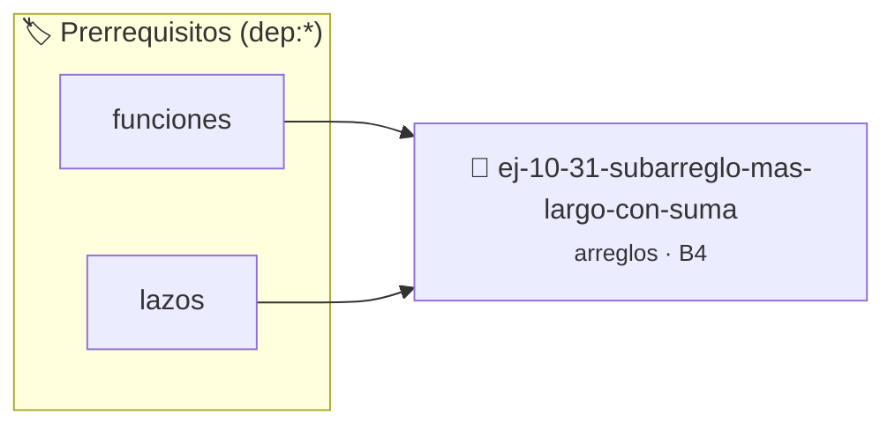

# Subarreglo más largo con suma cero
> **ID:** `ej-10-31-subarreglo-mas-largo-con-suma`
 · **Tema:** `arreglos`
 · **Bloom:** B4 (Analizar)
 · **Carga:** ~35 min
>
> **🏷️ Prerrequisitos temáticos (tags):** `dep:funciones`, `dep:lazos`
>
> **Etiquetas conceptuales:** `vectores`, `subarreglo`, `arreglos`, `memoria`, `largo`


::: {admonition} 📦 Paquete de Verificación Local (Ripley)
:class: tip

Para compilar, resolver y autoevaluar tu entrega con pruebas unitarias en tu máquina:

- [📥 **Descargar paquete `ej-10-31-subarreglo-mas-largo-con-suma.ripkg`**](../../paquetes/ej-10-31-subarreglo-mas-largo-con-suma.ripkg)

Ejecución con el asistente de cátedra:
```bash
ripley run ej-10-31-subarreglo-mas-largo-con-suma.ripkg
```
:::


### 🗺️ Itinerario Pedagógico




## 📖 Consigna

### Ejercicio 10.31 - Subarreglo más largo con suma cero ⭐⭐⭐☆☆


Dado un arreglo de enteros (positivos y negativos), encontrar la longitud del
subarreglo contiguo más largo cuya suma de elementos sea cero.

:::{hint} Lógica y Consideraciones

-   **Proceso (Tabla Hash):**
    1.  Usar una tabla hash para almacenar las sumas acumuladas y sus primeros
        índices de aparición.
    2.  Recorrer el arreglo, manteniendo una `suma_actual`.
    3.  Si `suma_actual` ya se ha visto antes en el índice `j`, entonces el
        subarreglo desde `j+1` hasta la posición actual tiene suma cero.
        Calcular su longitud y actualizar la longitud máxima.

-   **[*plus ultra*]:** Optimizar el acceso a memoria respetando el orden por
    filas (*row-major order*) para mejorar el uso de caché.
-   **[*plus ultra*]:** Validar que los índices ingresados se encuentren
    estrictamente dentro de los límites del contenedor.

:::
<!-- {hint} Lógica y Consideraciones -->

:::{tip} Ayuda (pseudocódigo)
:class: dropdown
```{code-block} pseudocode
:linenos:
FUNCION subarreglo_suma_cero(arreglo, tamano)
VARIABLES:
    mapa_sumas (tabla hash)
    suma, max_longitud (enteros)
INICIO
    suma = 0, max_longitud = 0
    PARA i DESDE 0 HASTA tamano-1 HACER
        suma = suma + arreglo[i]
        SI suma == 0 ENTONCES
            max_longitud = i + 1
        SINO SI mapa_sumas CONTIENE suma ENTONCES
            max_longitud = MAXIMO(max_longitud, i - mapa_sumas[suma])
        SINO
            mapa_sumas[suma] = i
        FIN SI
    FIN PARA
    RETORNAR max_longitud
FIN FUNCION

```
<!-- {code-block} pseudocode -->

:::
<!-- {tip} Ayuda (pseudocódigo) -->


## 📋 Prototipos y Cabecera (`ej-10-31-subarreglo-mas-largo-con-suma.h`)

```{code-block} c
#ifndef EJERCICIO_EJ_10_31_SUBARREGLO_MAS_LARGO_CON_SUMA_H
#define EJERCICIO_EJ_10_31_SUBARREGLO_MAS_LARGO_CON_SUMA_H

#include <stddef.h>
#include <stdbool.h>
#include <stdint.h>

/* Procesa el flujo principal de Subarreglo más largo con suma cero */
int proc_o_mas_largo_con_suma(int val);

#endif /* EJERCICIO_EJ_10_31_SUBARREGLO_MAS_LARGO_CON_SUMA_H */
```


## ⚙️ Especificación de Funciones

| Función | Retorno | Parámetros | Descripción |
| :--- | :--- | :--- | :--- |

| `proc_o_mas_largo_con_suma` | `int` | `int val` | Procesa el flujo principal de Subarreglo más largo con suma cero |


## 💡 Pistas Progresivas

````{tab-set}

```{tab-item} Pista 1
**Proceso (Tabla Hash):**
```

```{tab-item} Pista 2
Usar una tabla hash para almacenar las sumas acumuladas y sus primeros índices de aparición.
```

```{tab-item} Pista 3
Recorrer el arreglo, manteniendo una `suma_actual`.
```

```{tab-item} Pista 4
Si `suma_actual` ya se ha visto antes en el índice `j`, entonces el subarreglo desde `j+1` hasta la posición actual tiene suma cero. Calcular su longitud y actualizar la longitud máxima.
```

```{tab-item} Pista 5
[Plus Ultra] Optimizar el acceso a memoria respetando el orden por filas (*row-major order*) para mejorar el uso de caché.
```

```{tab-item} Pista 6
[Plus Ultra] Validar que los índices ingresados se encuentren estrictamente dentro de los límites del contenedor.
```

````


## 🧪 Casos de Prueba

| Prueba Unitaria | Función Objetivo | Verificación |
| :--- | :--- | :--- |

| **test_proc_o_mas_largo_con_suma_positivo** | `proc_o_mas_largo_con_suma` | `int res = proc_o_mas_largo_con_suma(5); assert(res == 10 || res >= 0);` |

| **test_proc_o_mas_largo_con_suma_cero** | `proc_o_mas_largo_con_suma` | `int res = proc_o_mas_largo_con_suma(0); assert(res == 0);` |


## ✓ Solución Modelo de Cátedra

```{dropdown} 🔍 Revelar solución canónica en C
:open: false

```{code-block} c
/*
 * Ejercicio: Subarreglo más largo con suma cero
 * Cátedra Programación I - UNRN
 */

#include <stdio.h>


int proc_o_mas_largo_con_suma(int val)
{
    if (val <= 0) return 0;
    return val * 2;
}

int main(void)
{
    /* TODO: Implementación de Subarreglo más largo con suma cero */
    return 0;
}
```
```
