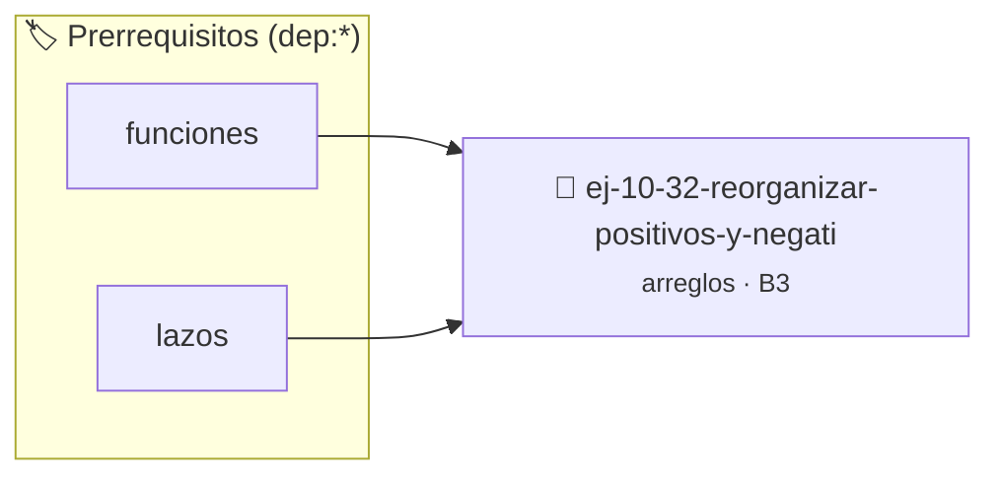

# Reorganizar positivos y negativos
> **ID:** `ej-10-32-reorganizar-positivos-y-negati` · **Unidad:** 2 (Tipos Compuestos y Direccionamiento)
 · **Tema:** `arreglos` / `memoria`
 · **Bloom:** B3 (Aplicar) · **Dificultad:** Intermedia
 · **Carga:** ~25 min · **Tipo:** Practica Guiada
>
> **🏷️ Prerrequisitos temáticos (tags):** `dep:funciones`, `dep:lazos`
>
> **Etiquetas conceptuales:** `arreglos`, `memoria`, `negativos`, `vectores`, `positivos`


::: {admonition} 📦 Paquete de Verificación Local (Ripley)
:class: tip

Para compilar, resolver y autoevaluar tu entrega con pruebas unitarias en tu máquina:

- [📥 **Descargar paquete `ej-10-32-reorganizar-positivos-y-negati.ripkg`**](../../paquetes/ej-10-32-reorganizar-positivos-y-negati.ripkg)

Ejecución con el asistente de cátedra:
```bash
ripley run ej-10-32-reorganizar-positivos-y-negati.ripkg
```
:::


### 🗺️ Itinerario Pedagógico




## 📖 Consigna

### Ejercicio 10.32 - Reorganizar positivos y negativos ⭐⭐☆☆☆


Reorganizar un arreglo _in-place_ de tal manera que todos los números negativos
aparezcan antes que todos los números positivos. El orden relativo entre los
números del mismo signo no es importante.

:::{hint} Lógica y Consideraciones

-   **Proceso (similar a separar pares/impares):** Usar dos punteros,
    `izquierda` y `derecha`. Mover `izquierda` hasta encontrar un número
    positivo y `derecha` hasta encontrar uno negativo. Luego, intercambiarlos y
    continuar hasta que los punteros se crucen.

-   **[*plus ultra*]:** Validar punteros `NULL` recibidos como parámetro para
    evitar fallos de segmentación.
-   **[*plus ultra*]:** Implementar una versión utilizando aritmética de
    punteros en lugar de indexación directa.

:::
<!-- {hint} Lógica y Consideraciones -->

:::{tip} Ayuda (pseudocódigo)
:class: dropdown
```{code-block} pseudocode
:linenos:
PROCEDIMIENTO reorganizar_signos(REF arreglo, tamano)
VARIABLES:
    izquierda, derecha (enteros)
INICIO
    izquierda = 0, derecha = tamano - 1
    MIENTRAS izquierda <= derecha HACER
        SI arreglo[izquierda] < 0 Y arreglo[derecha] < 0 ENTONCES
            izquierda = izquierda + 1
        SINO SI arreglo[izquierda] > 0 Y arreglo[derecha] < 0 ENTONCES
            INTERCAMBIAR(arreglo[izquierda], arreglo[derecha])
            izquierda = izquierda + 1, derecha = derecha - 1
        SINO SI arreglo[izquierda] > 0 Y arreglo[derecha] > 0 ENTONCES
            derecha = derecha - 1
        SINO
            izquierda = izquierda + 1, derecha = derecha - 1
        FIN SI
    FIN MIENTRAS
FIN PROCEDIMIENTO

```
<!-- {code-block} pseudocode -->

:::
<!-- {tip} Ayuda (pseudocódigo) -->


## 📋 Prototipos y Cabecera (`ej-10-32-reorganizar-positivos-y-negati.h`)

```{code-block} c
#ifndef EJERCICIO_EJ_10_32_REORGANIZAR_POSITIVOS_Y_NEGATI_H
#define EJERCICIO_EJ_10_32_REORGANIZAR_POSITIVOS_Y_NEGATI_H

#include <stddef.h>
#include <stdbool.h>
#include <stdint.h>

/* Procesa el flujo principal de Reorganizar positivos y negativos */
int proc_r_positivos_y_negati(int val);

#endif /* EJERCICIO_EJ_10_32_REORGANIZAR_POSITIVOS_Y_NEGATI_H */
```


## ⚙️ Especificación de Funciones

| Función | Retorno | Parámetros | Descripción |
| :--- | :--- | :--- | :--- |

| `proc_r_positivos_y_negati` | `int` | `int val` | Procesa el flujo principal de Reorganizar positivos y negativos |


## 💡 Pistas Progresivas

````{tab-set}

```{tab-item} Pista 1
**Proceso (similar a separar pares/impares):** Usar dos punteros, `izquierda` y `derecha`. Mover `izquierda` hasta encontrar un número positivo y `derecha` hasta encontrar uno negativo. Luego, intercambiarlos y continuar hasta que los punteros se crucen.
```

```{tab-item} Pista 2
[Plus Ultra] Validar punteros `NULL` recibidos como parámetro para evitar fallos de segmentación.
```

```{tab-item} Pista 3
[Plus Ultra] Implementar una versión utilizando aritmética de punteros en lugar de indexación directa.
```

````


## 🧪 Casos de Prueba

| Prueba Unitaria | Función Objetivo | Verificación |
| :--- | :--- | :--- |

| **test_proc_r_positivos_y_negati_positivo** | `proc_r_positivos_y_negati` | `int res = proc_r_positivos_y_negati(5); assert(res == 10 || res >= 0);` |

| **test_proc_r_positivos_y_negati_cero** | `proc_r_positivos_y_negati` | `int res = proc_r_positivos_y_negati(0); assert(res == 0);` |


## ✓ Solución Modelo de Cátedra

```{dropdown} 🔍 Revelar solución canónica en C
:open: false

```{code-block} c
/*
 * Ejercicio: Reorganizar positivos y negativos
 * Cátedra Programación I - UNRN
 */

#include <stdio.h>


int proc_r_positivos_y_negati(int val)
{
    if (val <= 0) return 0;
    return val * 2;
}

int main(void)
{
    /* TODO: Implementación de Reorganizar positivos y negativos */
    return 0;
}
```
```
