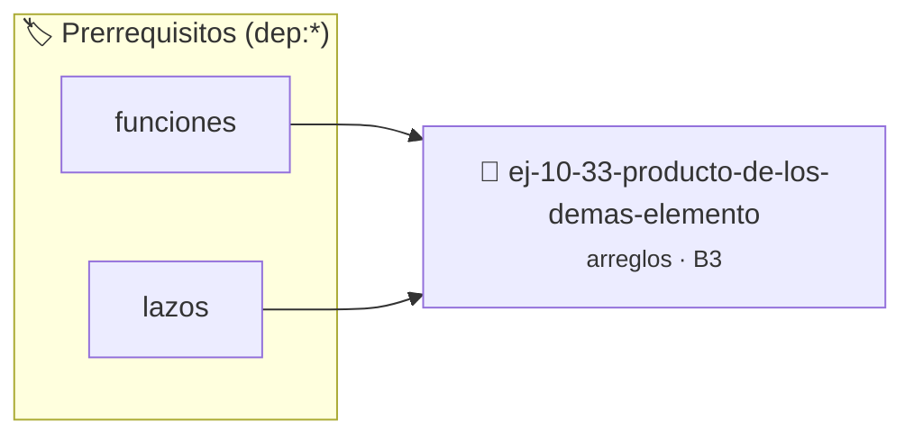

# Producto de los demás elementos
> **ID:** `ej-10-33-producto-de-los-demas-elemento` · **Unidad:** 2 (Tipos Compuestos y Direccionamiento)
 · **Tema:** `arreglos` / `producto`
 · **Bloom:** B3 (Aplicar) · **Dificultad:** Intermedia
 · **Carga:** ~25 min · **Tipo:** Practica Guiada
>
> **🏷️ Prerrequisitos temáticos (tags):** `dep:funciones`, `dep:lazos`
>
> **Etiquetas conceptuales:** `producto`, `arreglos`, `memoria`, `elementos`, `vectores`


::: {admonition} 📦 Paquete de Verificación Local (Ripley)
:class: tip

Para compilar, resolver y autoevaluar tu entrega con pruebas unitarias en tu máquina:

- [📥 **Descargar paquete `ej-10-33-producto-de-los-demas-elemento.ripkg`**](../../paquetes/ej-10-33-producto-de-los-demas-elemento.ripkg)

Ejecución con el asistente de cátedra:
```bash
ripley run ej-10-33-producto-de-los-demas-elemento.ripkg
```
:::


### 🗺️ Itinerario Pedagógico




## 📖 Consigna

### Ejercicio 10.33 - Producto de los demás elementos ⭐⭐☆☆☆


Dado un arreglo de números, crear un nuevo arreglo donde cada elemento en la
posición `i` sea el producto de todos los demás números del arreglo original,
pero sin usar el operador de división.

:::{hint} Lógica y Consideraciones

-   **Proceso (dos pasadas):**
    1.  Crear un arreglo `resultado`.
    2.  **Primera pasada (izquierda a derecha):** Recorrer el arreglo. Para cada
        `i`, `resultado[i]` será el producto de todos los elementos a su
        izquierda. Mantener un acumulador `izquierda_prod`.
    3.  **Segunda pasada (derecha a izquierda):** Recorrer el arreglo al revés.
        Mantener un acumulador `derecha_prod`. Multiplicar `resultado[i]` por
        `derecha_prod` para incorporar los productos de la derecha.

-   **[*plus ultra*]:** Optimizar el acceso a memoria respetando el orden por
    filas (*row-major order*) para mejorar el uso de caché.
-   **[*plus ultra*]:** Validar que los índices ingresados se encuentren
    estrictamente dentro de los límites del contenedor.

:::
<!-- {hint} Lógica y Consideraciones -->

:::{tip} Ayuda (pseudocódigo)
:class: dropdown
```{code-block} pseudocode
:linenos:
FUNCION producto_de_los_demas(arreglo, tamano)
VARIABLES:
    resultado (arreglo de tamaño n)
    izquierda_prod, derecha_prod
INICIO
    izquierda_prod = 1
    PARA i DESDE 0 HASTA tamano-1 HACER
        resultado[i] = izquierda_prod
        izquierda_prod = izquierda_prod * arreglo[i]
    FIN PARA

    derecha_prod = 1
    PARA i DESDE tamano-1 HASTA 0 CON PASO -1 HACER
        resultado[i] = resultado[i] * derecha_prod
        derecha_prod = derecha_prod * arreglo[i]
    FIN PARA

    RETORNAR resultado
FIN FUNCION

```
<!-- {code-block} pseudocode -->

:::
<!-- {tip} Ayuda (pseudocódigo) -->


## 📋 Prototipos y Cabecera (`ej-10-33-producto-de-los-demas-elemento.h`)

```{code-block} c
#ifndef EJERCICIO_EJ_10_33_PRODUCTO_DE_LOS_DEMAS_ELEMENTO_H
#define EJERCICIO_EJ_10_33_PRODUCTO_DE_LOS_DEMAS_ELEMENTO_H

#include <stddef.h>
#include <stdbool.h>
#include <stdint.h>

/* Procesa el flujo principal de Producto de los demás elementos */
int proc_e_los_demas_elemento(int val);

#endif /* EJERCICIO_EJ_10_33_PRODUCTO_DE_LOS_DEMAS_ELEMENTO_H */
```


## ⚙️ Especificación de Funciones

| Función | Retorno | Parámetros | Descripción |
| :--- | :--- | :--- | :--- |

| `proc_e_los_demas_elemento` | `int` | `int val` | Procesa el flujo principal de Producto de los demás elementos |


## 💡 Pistas Progresivas

````{tab-set}

```{tab-item} Pista 1
**Proceso (dos pasadas):**
```

```{tab-item} Pista 2
Crear un arreglo `resultado`.
```

```{tab-item} Pista 3
**Primera pasada (izquierda a derecha):** Recorrer el arreglo. Para cada `i`, `resultado[i]` será el producto de todos los elementos a su izquierda. Mantener un acumulador `izquierda_prod`.
```

```{tab-item} Pista 4
**Segunda pasada (derecha a izquierda):** Recorrer el arreglo al revés. Mantener un acumulador `derecha_prod`. Multiplicar `resultado[i]` por `derecha_prod` para incorporar los productos de la derecha.
```

```{tab-item} Pista 5
[Plus Ultra] Optimizar el acceso a memoria respetando el orden por filas (*row-major order*) para mejorar el uso de caché.
```

```{tab-item} Pista 6
[Plus Ultra] Validar que los índices ingresados se encuentren estrictamente dentro de los límites del contenedor.
```

````


## 🧪 Casos de Prueba

| Prueba Unitaria | Función Objetivo | Verificación |
| :--- | :--- | :--- |

| **test_proc_e_los_demas_elemento_positivo** | `proc_e_los_demas_elemento` | `int res = proc_e_los_demas_elemento(5); assert(res == 10 || res >= 0);` |

| **test_proc_e_los_demas_elemento_cero** | `proc_e_los_demas_elemento` | `int res = proc_e_los_demas_elemento(0); assert(res == 0);` |


## ✓ Solución Modelo de Cátedra

```{dropdown} 🔍 Revelar solución canónica en C
:open: false

```{code-block} c
/*
 * Ejercicio: Producto de los demás elementos
 * Cátedra Programación I - UNRN
 */

#include <stdio.h>


int proc_e_los_demas_elemento(int val)
{
    if (val <= 0) return 0;
    return val * 2;
}

int main(void)
{
    /* TODO: Implementación de Producto de los demás elementos */
    return 0;
}
```
```
