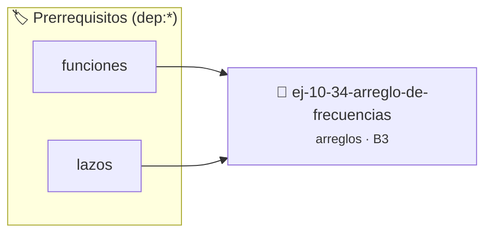

# Arreglo de frecuencias
> **ID:** `ej-10-34-arreglo-de-frecuencias` · **Unidad:** 2 (Tipos Compuestos y Direccionamiento)
 · **Tema:** `arreglos` / `arreglo`
 · **Bloom:** B3 (Aplicar) · **Dificultad:** Intermedia
 · **Carga:** ~25 min · **Tipo:** Practica Guiada
>
> **🏷️ Prerrequisitos temáticos (tags):** `dep:funciones`, `dep:lazos`
>
> **Etiquetas conceptuales:** `arreglo`, `frecuencias`, `arreglos`, `memoria`, `vectores`


::: {admonition} 📦 Paquete de Verificación Local (Ripley)
:class: tip

Para compilar, resolver y autoevaluar tu entrega con pruebas unitarias en tu máquina:

- [📥 **Descargar paquete `ej-10-34-arreglo-de-frecuencias.ripkg`**](../../paquetes/ej-10-34-arreglo-de-frecuencias.ripkg)

Ejecución con el asistente de cátedra:
```bash
ripley run ej-10-34-arreglo-de-frecuencias.ripkg
```
:::


### 🗺️ Itinerario Pedagógico




## 📖 Consigna

Dado un arreglo de enteros que contiene números en un rango conocido (por
ejemplo, de 0 a 99), crear un "arreglo de frecuencias" que cuente cuántas veces
aparece cada número.


:::{tip} Ayuda (pseudocódigo)
:class: dropdown
```{code-block} pseudocode
:linenos:
FUNCION calcular_frecuencias(arreglo, tamano, rango_max)
VARIABLES:
    frecuencias (arreglo de tamaño rango_max, inicializado en 0)
INICIO
    PARA i DESDE 0 HASTA tamano-1 HACER
        numero = arreglo[i]
        frecuencias[numero] = frecuencias[numero] + 1
    FIN PARA
    RETORNAR frecuencias
FIN FUNCION

```

:::

### 📋 Contrato de las Funciones

```c
/*
 * Procesa el flujo principal de Arreglo de frecuencias
 * Precondiciones: val representa el parámetro de entrada del flujo.
 * Postcondiciones: Retorna el resultado correspondiente o 0 si val <= 0.
 */
int proc_reglo_de_frecuencias(int val);

```

### 🧪 Ejemplos de Ejecución

::::{tab-set}
:::{tab-item} Valor positivo
```text
Entrada: 5
Salida / Retorno: 10
```
:::
:::{tab-item} Valor cero o negativo
```text
Entrada: 0
Salida / Retorno: 0
```
:::
::::

### ⚠️ Precondiciones y Casos Borde

1. **Valores fuera de rango:** Verificar siempre que los datos de entrada cumplan con los rangos admisibles antes de operar.
6. **Casos vacíos o neutros:** Contemplar adecuadamente entradas con longitud cero o valores neutros según corresponda.

### 🎯 Criterios de Aceptación

- [ ] El código compila limpiamente bajo estándar C11 sin warnings con flags estrictos (`-Wall -Wextra -Werror`).
- [ ] Se satisfacen todas las pruebas unitarias y casos de prueba provistos.
- [ ] Las funciones validan exhaustivamente sus precondiciones y gestionan casos borde de forma robusta.

:::{hint} Consideraciones Didácticas
- **Proceso:**
- Crear un nuevo arreglo `frecuencias` del tamaño del rango (ej. 100), inicializado todo en 0.
- Recorrer el arreglo de entrada. Para cada número `x`, usarlo como índice en el arreglo de frecuencias e incrementar la cuenta: `frecuencias[x]++`.
- Optimizar el acceso a memoria respetando el orden por filas (*row-major order*) para mejorar el uso de caché.
- Validar que los índices ingresados se encuentren estrictamente dentro de los límites del contenedor.
:::


## 📋 Prototipos y Cabecera (`ej-10-34-arreglo-de-frecuencias.h`)

```{code-block} c
#ifndef EJERCICIO_EJ_10_34_ARREGLO_DE_FRECUENCIAS_H
#define EJERCICIO_EJ_10_34_ARREGLO_DE_FRECUENCIAS_H

#include <stddef.h>
#include <stdbool.h>
#include <stdint.h>

/* Procesa el flujo principal de Arreglo de frecuencias */
int proc_reglo_de_frecuencias(int val);

#endif /* EJERCICIO_EJ_10_34_ARREGLO_DE_FRECUENCIAS_H */
```


## ⚙️ Especificación de Funciones

| Función | Retorno | Parámetros | Descripción |
| :--- | :--- | :--- | :--- |

| `proc_reglo_de_frecuencias` | `int` | `int val` | Procesa el flujo principal de Arreglo de frecuencias |


## 💡 Pistas Progresivas

````{tab-set}

```{tab-item} Pista 1
**Proceso:**
```

```{tab-item} Pista 2
Crear un nuevo arreglo `frecuencias` del tamaño del rango (ej. 100), inicializado todo en 0.
```

```{tab-item} Pista 3
Recorrer el arreglo de entrada. Para cada número `x`, usarlo como índice en el arreglo de frecuencias e incrementar la cuenta: `frecuencias[x]++`.
```

```{tab-item} Pista 4
[Plus Ultra] Optimizar el acceso a memoria respetando el orden por filas (*row-major order*) para mejorar el uso de caché.
```

```{tab-item} Pista 5
[Plus Ultra] Validar que los índices ingresados se encuentren estrictamente dentro de los límites del contenedor.
```

````


## 🧪 Casos de Prueba

| Prueba Unitaria | Función Objetivo | Verificación |
| :--- | :--- | :--- |

| **test_proc_reglo_de_frecuencias_positivo** | `proc_reglo_de_frecuencias` | `int res = proc_reglo_de_frecuencias(5); assert(res == 10 || res >= 0);` |

| **test_proc_reglo_de_frecuencias_cero** | `proc_reglo_de_frecuencias` | `int res = proc_reglo_de_frecuencias(0); assert(res == 0);` |


## ✓ Solución Modelo de Cátedra

```{dropdown} 🔍 Revelar solución canónica en C
:open: false

```{code-block} c
/*
 * Ejercicio: Arreglo de frecuencias
 * Cátedra Programación I - UNRN
 */

#include <stdio.h>


int proc_reglo_de_frecuencias(int val)
{
    if (val <= 0) return 0;
    return val * 2;
}

int main(void)
{
    /* TODO: Implementación de Arreglo de frecuencias */
    return 0;
}
```
```
